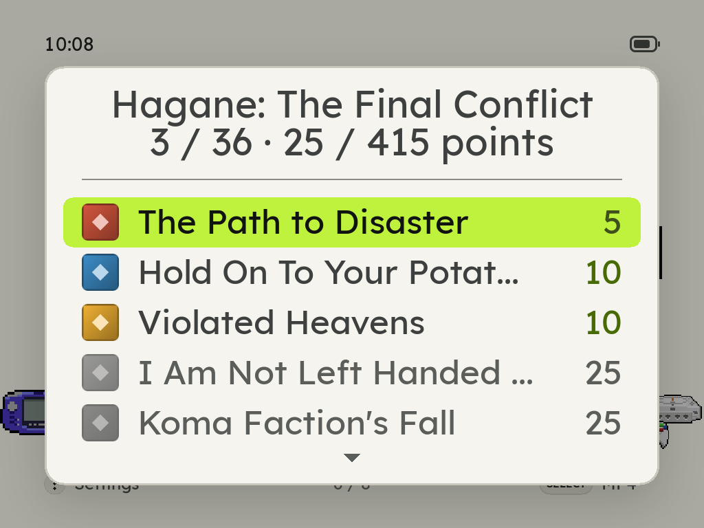
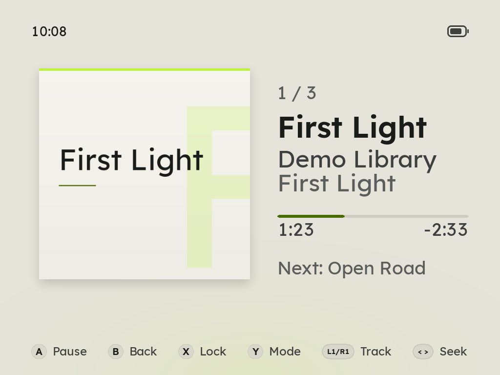
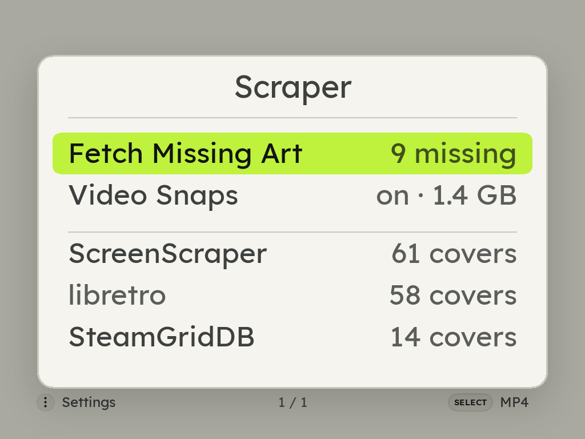
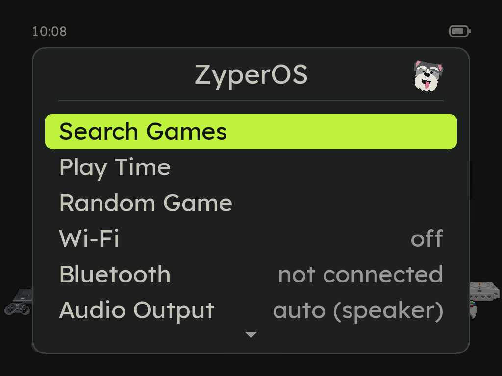
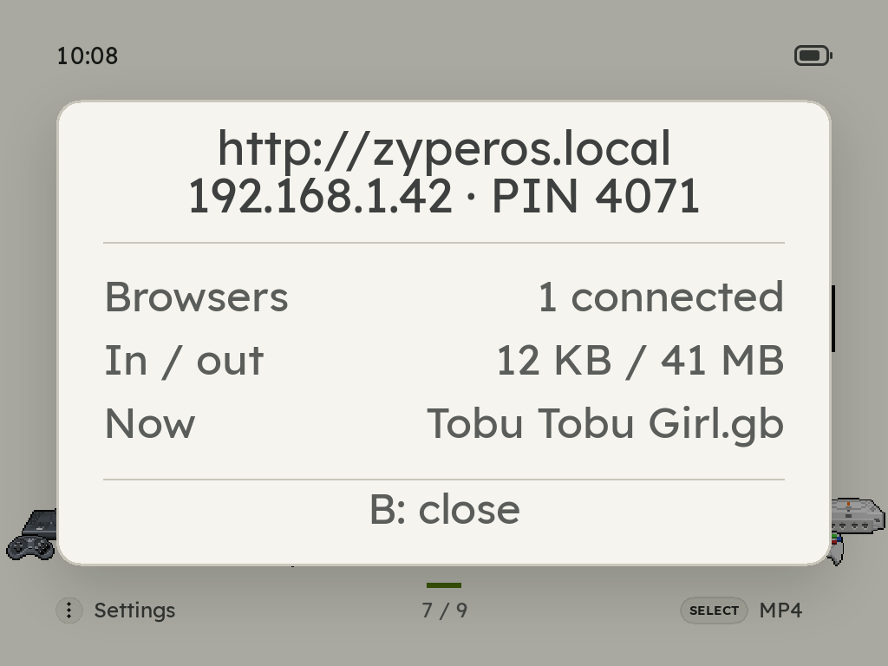

  <picture>
    <source media="(prefers-color-scheme: dark)" srcset="res/readme/lockup.png">
    
  </picture>

  <b>A <ins>fast</ins>, light firmware for the GKD Pixel 2 that plays your whole retro library.</b> 
  Forty systems, PortMaster ports, and your music and videos, from a card you can take out at any time.

  <a href="https://zyperos.com"><b>zyperos.com</b></a> &nbsp;·&nbsp;
  <a href="#the-name">The name</a> &nbsp;·&nbsp;
  <a href="#how-it-compares">Compare</a> &nbsp;·&nbsp;
  <a href="#install">Install</a> &nbsp;·&nbsp;
  <a href="#light-and-dark">Light and dark</a> &nbsp;·&nbsp;
  <a href="#supported-systems">Systems</a> &nbsp;·&nbsp;
  <a href="#controls">Controls</a> &nbsp;·&nbsp;
  <a href="#faq">FAQ</a>

<table>
  <tr>
    <td align="center"> Every system, in pixel art</td>
    <td align="center"> Or the Gallery home</td>
    <td align="center"> Your games, cover by cover</td>
  </tr>
  <tr>
    <td align="center"> A game's details, one button away</td>
    <td align="center"> RetroAchievements on the device</td>
    <td align="center"> The device's settings in one menu</td>
  </tr>
  <tr>
    <td align="center"> Your albums, in MP4</td>
    <td align="center"> Now Playing, on SELECT from anywhere</td>
    <td align="center"> Scraper: Fetch Missing Art, Video Snaps, and the covers ScreenScraper, libretro and SteamGridDB found"> Box art from three sources</td>
  </tr>
</table>

## The name

ZyperOS is named after **Zyper**, my dog, who passed away. He was quick, light on his feet and full of energy, and that is what this system tries to be.

The name is also two words in one: **zippy** and **hyper**. Games start the moment you press A, the menus never make you wait, and the whole system is small enough to come up in about two seconds.

## Features

- **Forty systems,** from the Atari 2600 to PlayStation, Nintendo 64, Nintendo DS, Dreamcast and Saturn, with Arcade, MAME, Neo Geo, NAOMI and Atomiswave, ScummVM, PICO-8, OpenBOR and J2ME ([the full list](#supported-systems)).
- **Ports:** a Ports shelf that runs [PortMaster](https://portmaster.games) games, such as Stardew Valley and Celeste.
- **Nintendo DS your way:** [DSperate](https://github.com/beebono/DSperate) inside the emulator, with three screen layouts and a d-pad stylus, or DraStic if you add it. A Mario Kart DS race keeps 60 frames a second on the Pixel 2.
- **Dreamcast** on flycast2021, the 2021 libretro [Flycast](https://github.com/flyinghead/flycast), drawn on the GPU inside the emulator, with saves, states and resume like any other system. Standalone Flycast is the second choice if you add it.
- **A home screen in pixel art:** every system as its animated console, on a Spotlight or a Gallery home, and your games as a row of covers. The systems go A to Z, or by release date in **MENU > System Order**. Light or dark, [as you like](#light-and-dark).
- **Eight languages:** English, 简体中文, Español, Português (Brasil), Français, Deutsch, 日本語 and Italiano, chosen on the first start or in **MENU > Language**. Every word follows it: the menus, the in-game menu, the charging and low battery screens, the boot screen's line while ZyperOS is copied onto the card, and the File Transfer page. Chinese and Japanese each have a face of their own, so they read as clearly as the rest, and switching languages costs no speed ([below](#languages)).
- **A first start that asks:** Zyper says hello in each language until you pick yours, teaches each button and shows where it is on the Pixel 2, then asks for the theme, the home screen, the button sounds and the menu music ([below](#the-first-start)).
- **An empty card that says what to do:** with no games yet, the home shows the two ways to add them, one button each, and Zyper cheers when the first ones arrive.
- **Search Games and Random Game:** **MENU > Search Games** finds any game by a few letters of its name, on any system. **Random Game** picks one and starts it, from every system in MENU or from one shelf in that system's menu.
- **RetroAchievements:** sign in on the device. A game's achievements download once and then work offline, and anything you unlock offline is sent later. Each one has its badge, and a count like "5 / 10" pops up as you get closer.
- **Box art the device finds itself,** in **MENU > Scraper**: from libretro's collection with no account; from ScreenScraper with a free account, which brings each game's name, year, genre and synopsis too, in a build made with ScreenScraper's developer pair (the page says `not in this build` otherwise); and from SteamGridDB, with your own free key typed or pasted, for what neither has. Renamed ROM packs are matched by checksum, and each game shows under its proper name with its file left as it is. Or add your own.
- **Delete a game from the handheld:** press X on a game and choose **Delete Game**. It asks first, naming the game, with the cursor on Cancel. The game's file or files go (a disc set's folder, a `.cue` with its tracks, an arcade set), with its saves, save states, cover, video snap, cached achievements, details and play time, and the shelf moves on to the next game. A file another game still uses stays, and so does a BIOS set like `neogeo.zip`.
- **Video snaps:** rest on a game for a second, while a bar under its cover fills, and the cover turns into a few seconds of the game itself, from ScreenScraper. A play mark on a cover says its game has one. **MENU > Scraper > Video Snaps** turns them on, per console, and their sound starts muted.
- **Wi-Fi File Transfer:** move games, music, audiobooks, videos, saves and covers on and off the card from any browser on your Wi-Fi, behind a PIN, on [a page made for it](#the-file-transfer-page), on a computer or a phone. With no Wi-Fi network around, the handheld makes [its own](#no-wi-fi-network-around), for a phone that scans the QR code on the screen. Or use the USB cable, with no Wi-Fi at all, as USB File Transfer. A transfer keeps going while you go back to the shelf, with a mark in the corner; B asks before it stops one halfway; the page shows the time left, checks the room on the card first, and its Settings page updates ZyperOS over the cable.
- **USB that only charges until you say so:** plug in a computer and the Pixel 2 asks whether it should charge, open USB File Transfer, or (on development images) bring up SSH.
- **System Update:** [over Wi-Fi](#system-update), only what changed, signed, with Roll Back. Without Wi-Fi, the File Transfer page brings it over the USB cable.
- **Autosave and resume,** plus six save slots for when you want a checkpoint.
- **A QWERTY keyboard** that keeps up with the d-pad.
- **Clocks per system:** 8-bit and handheld systems run the CPU, memory and GPU under lower ceilings, measured to keep every frame, and so does the 16-bit generation a step higher. Lower clocks run at lower voltage, which saves battery. At the first frame that comes late, a game goes back to full clocks for the rest of the session.
- **Turbo buttons:** X and Y press A and B for you, on the nine consoles whose controllers had two face buttons. On Game Boy Advance, L2 and R2 do the same for L and R.
- **Fast forward:** hold MENU and press R1 to run a game at 2x, 3x or 4x, and once more to go back.
- **Every control, in the game:** **Controls** in the in-game menu shows what each button does in the game you are playing: its system's own buttons as its emulator reads them, the turbo buttons, the hotkeys, the Nintendo 64's C buttons and Rumble Pak, and the DS's screens and stylus.
- **Rumble on the Pixel 2:** Dreamcast games, PlayStation games (as a DualShock) and Game Boy Color rumble cartridges shake the handheld, and Nintendo 64 games get a Rumble Pak in place of the Controller Pak. The motor stops while the in-game menu is open.
- **A USB-C headphone adapter on the Pixel 2:** plug one in and the sound goes there, ahead of the headphone jack, in games and in MP4. It's a choice of its own in Audio Output.
- **Bluetooth headphones** on the Brick, paired on the device, with its volume buttons reaching them and their own buttons playing and skipping in MP4. Plug in wired ones and they take over.
- **Mono audio,** for anyone who hears with one ear: Audio Channels plays games and MP4 in mono, or in mono in just the left or right ear on headphones.
- **MP4, a media player for music, audiobooks and videos:** your albums, books and films on a shelf of their own covers; every book and every video picks up where you left it, and **Shuffle All** plays every song on the card in a random order. SELECT opens MP4 from anywhere, even the in-game menu, and it keeps playing when you close it. While it plays, the game is silent. **X** locks it: the screen goes dark and every button but volume stops working, POWER included, until you hold **SELECT + START** for two seconds. A volume press lights the screen just long enough to show the volume bar, and a video stays in sight.
- **Menu music:** ten free 8-bit tracks play behind the shelf and the menus, never over a game, and **MENU > Menu Music** shuffles them, plays one over and over or turns them off. Put your own MP3 or Ogg files in `Roms/BGM` and those play instead. On the shelf, **L2** and **R2** go to the song before or the next, and Zyper pops up with each new song's name, read from its tags. While MP4 plays behind the shelf, L2 and R2 skip its tracks (or a book's chapters) instead.
- **The status corner:** the clock, Wi-Fi and the battery at the top of the home screen. **MENU > Clock** chooses 12-hour or 24-hour, and **MENU > Battery Icon** bars or a percentage.
- **The Pixel 2's side lights** show the battery charging and running low, the volume or brightness as you change it, a climb when files or covers finish, and a sparkle for an achievement; **MENU > Side Lights** turns each on or off. On the charger, the shelf's screen goes dark after the Auto Off time, and any button lights it again.
- **Battery care:** a battery too low to start says so and charges first; a charger plugged in while the Pixel 2 is off shows the charge and the time to full (hold POWER to start); **Getting hot** warns before the handheld slows down to cool; and **MENU > Charge Limit** stops charging at 80, 85 or 90% to keep the battery young, and holds it within 2 points of the limit on the cable (78 to 80% at 80%).
- **About,** besides the version and the card, tells [the story of the name](#the-name) beside a photo of Zyper, and thanks the projects ZyperOS is built on.
- **Play Time:** how long you've played each game or console, today, this week, this month, this year or ever.
- **Favorites and sorting:** Y favorites a game, and each console sorts by name, play time, last played or recently added.

## How it compares

The GKD Pixel 2 has several operating systems to choose from. This is ZyperOS beside the one it comes with and four others, from what each one's own pages, code and releases say in November 2026. ROGUE OS set the bar for this handheld, and ZyperOS set out to match it.

| | ZyperOS | Stock1 | ROGUE OS | TortOS | ROCKNIX | plumOS Pixel2 |
|---|---|---|---|---|---|---|
| **Source, license** | GPL-3.0 | — | Its changed files, no license named | GPL-3.0 | GPL-2.0 for its own code | MIT for its own code |
| **Install, latest** | Card image or ZyperOS Installer, v1.0.1 (Nov 2026) | On the card it comes with | Card image, then v1.22's files (Aug 2025) | Card image or TortOS Installer, v2.1.1 (Oct 2026) | Card image, 20261101 (Nov 2026) | Card image, v0.1.4 (Aug 2026), in testing |
| **Systems** | 40, and Ports | Over 100 folders | 1172 | 11 | 1202 | 862 |
| **Games without taking the card out** | Wi-Fi or USB web page, its own hotspot, SSH | Samba | USB cable, SSH | Wi-Fi or USB web page | Samba, SFTP, USB cable | Samba, SFTP, FTP |
| **Box art on the device** | libretro, ScreenScraper3, SteamGridDB | On a computer (Skraper) | ScreenScraper | libretro, ScreenScraper | ScreenScraper | libretro |
| **RetroAchievements** | Yes | — | — | Yes | Yes | — |
| **System updates** | Over Wi-Fi or the USB cable, A/B with roll back | — | Copy the new files | TortOS Installer, on a computer | Over the air, or a file | A file you copy, A/B with roll back |
| **First-start tutorial** | Yes | — | — | — | — | — |
| **Themes** | Light and dark | EmulationStation themes | 13 launcher skins | 2 card art styles | Yes, with a downloader | Your own themes |
| **Languages** | 8: English, 简体中文, Español, Português (Brasil), Français, Deutsch, 日本語, Italiano | — | 21, in its launcher | English | 36 | 6 |
| **Menu music** | 10 free tracks, or yours | — | — | — | Yes | — |
| **Media player** | Music, audiobooks, video | — | Music, video | Music, audiobooks | Music, video | Music |
| **PortMaster** | Yes, you add PortMaster | Yes | Yes | — | Yes | Yes |
| **Rumble** | Yes | — | Yes | No | Yes | — |
| **Side lights** | Battery, volume and brightness, finished transfers, achievements: each on or off | — | — | Battery | Battery | — |
| **Video previews on the shelf** | Yes | — | — | — | — | — |
| **Charge limit** | 80, 85 or 90% | — | — | — | — | — |
| **Charging screen when off** | Yes | — | — | — | — | — |
| **Boot time** | 1.6 s4 | — | — | 2.2 s4 | — | — |

— means none of the sources below says either way. The Pixel 2 has no Wi-Fi of its own, so on every system a Wi-Fi feature needs a USB Wi-Fi adapter. Knulli, muOS, twigUI (spruceOS) and a MinUI port run on the Pixel 2 too.

1. GameKiddy publishes no documentation for the stock firmware. Its column is from Retro Game Corps' review of February 2025, and the firmware may have changed since.
2. No count is published, so this is the systems in its own list, counted without tools, media players and ports. Hacks and regions can be entries of their own.
3. In builds made with ScreenScraper's developer key.
4. Each project's own number, and not measured the same way: ZyperOS's from the kernel's start to the home screen, on the Pixel 2 (mean of 10 starts), and TortOS's from power on to its shelf.

<b>Sources</b>

- **ZyperOS:** this README and its code, [v1.0.1](https://github.com/tarikbc/ZyperOS/releases/tag/v1.0.1); the boot time I measured on my Pixel 2 (note 4) and [#83](https://github.com/tarikbc/ZyperOS/pull/83).
- **Stock:** [Retro Game Corps, February 2025](https://retrogamecorps.com/2025/02/01/how-to-make-the-gkd-pixel-ii-software-suck-less/).
- **ROGUE OS:** [README](https://github.com/Ninoh-FOX/PIXEL2-ROGUE-OS/blob/f567073e9dd9d5f688a23728067d043af2fbdc20/README.md), [v1.22](https://github.com/Ninoh-FOX/PIXEL2-ROGUE-OS/releases/tag/GKDPIXELII_1.22), [system list](https://github.com/Ninoh-FOX/PIXEL2-ROGUE-OS/blob/f567073e9dd9d5f688a23728067d043af2fbdc20/EMUELEC/SYSTEM/usr/local/share/emulationstation/es_systems.cfg), [launcher skins](https://github.com/Ninoh-FOX/PIXEL2-ROGUE-OS/tree/f567073e9dd9d5f688a23728067d043af2fbdc20/EMUELEC/SYSTEM/usr/local/share/iux/skins), [launcher languages](https://github.com/Ninoh-FOX/PIXEL2-ROGUE-OS/tree/f567073e9dd9d5f688a23728067d043af2fbdc20/EMUELEC/SYSTEM/usr/local/share/iux/translations).
- **TortOS:** [README](https://github.com/ericreinsmidt/TortOS/blob/aafe6dee0d8221642e68d8b17fb17c6c5a39f8e1/README.md), [guide](https://github.com/ericreinsmidt/TortOS/blob/aafe6dee0d8221642e68d8b17fb17c6c5a39f8e1/docs/guide.md), [plastron's README](https://github.com/ericreinsmidt/plastron/blob/b67f5ec86a601f878f1bc8452d16af7112950f3d/README.md), [v2.1.1](https://github.com/ericreinsmidt/TortOS/releases/tag/v2.1.1).
- **ROCKNIX:** [README](https://github.com/ROCKNIX/distribution/blob/13d241a7d35fbe9b895ef04519f62bdb3a57d31f/README.md), [features](https://rocknix.org/), [adding games](https://rocknix.org/play/add-games/), [scraper](https://rocknix.org/configure/scraper/), [RetroAchievements](https://rocknix.org/play/retro-achievements/), [updates](https://rocknix.org/play/update/), [themes](https://rocknix.org/configure/themes/), [RK3326 systems](https://github.com/ROCKNIX/distribution/blob/13d241a7d35fbe9b895ef04519f62bdb3a57d31f/documentation/PER_DEVICE_DOCUMENTATION/RK3326/SUPPORTED_EMULATORS_AND_CORES.md), [Pixel 2 device tree](https://github.com/ROCKNIX/distribution/blob/13d241a7d35fbe9b895ef04519f62bdb3a57d31f/projects/ROCKNIX/devices/RK3326/linux/dts/rockchip/rk3326s-gkd-pixel2.dts) and [settings](https://github.com/ROCKNIX/distribution/tree/13d241a7d35fbe9b895ef04519f62bdb3a57d31f/projects/ROCKNIX/packages/hardware/quirks/devices/GameKiddy%20GKD%20Pixel2), [menu music](https://github.com/ROCKNIX/emulationstation-next/blob/f6c542872e3850c5f432929ead219547a897cd4a/es-app/src/guis/GuiMenu.cpp), [languages](https://github.com/ROCKNIX/emulationstation-next/blob/f6c542872e3850c5f432929ead219547a897cd4a/es-app/src/guis/GuiMenu.cpp#L1627-L1670), [20261101](https://github.com/ROCKNIX/distribution/releases/tag/20261101).
- **plumOS Pixel2:** [README](https://github.com/game-de-it/plumOS-pixel2_v2/blob/dec872c042229c1d38443f7e8e3fe962fc369e81/README.md), [network](https://github.com/game-de-it/plumOS-pixel2_v2/blob/dec872c042229c1d38443f7e8e3fe962fc369e81/docs/user/network.md), [updates](https://github.com/game-de-it/plumOS-pixel2_v2/blob/dec872c042229c1d38443f7e8e3fe962fc369e81/docs/user/updates.md), [folders](https://github.com/game-de-it/plumOS-pixel2_v2/blob/dec872c042229c1d38443f7e8e3fe962fc369e81/docs/user/storage.md), [system list](https://github.com/game-de-it/plumOS-pixel2_v2/blob/dec872c042229c1d38443f7e8e3fe962fc369e81/package/frontend-pixel2/systems.json), [scraper](https://github.com/game-de-it/plumOS-pixel2_v2/blob/dec872c042229c1d38443f7e8e3fe962fc369e81/package/app-layer-pixel2/bin/plumos-thumbnail-scraper), [languages](https://github.com/game-de-it/plumOS-pixel2_v2/tree/dec872c042229c1d38443f7e8e3fe962fc369e81/vendor/plumos-frontend/seed/share/frontend/lang), [v0.1.4](https://github.com/game-de-it/plumOS-pixel2_v2/releases/tag/v0.1.4).
- **The others:** [Knulli 20260511](https://github.com/knulli-cfw/knulli-linux/releases/tag/20260511), [muOS](https://github.com/MustardOS/mustardos.github.io/blob/HEAD/_data/devices/rk-pixel-2.yml), [twigUI](https://github.com/spruceUI/twigUI-next), [MinUI for the Pixel 2](https://github.com/NukeBomB3000/minui-gkd-pixel2).

## Light and dark

ZyperOS has two themes, Beard in light and Salt & Pepper in dark. **MENU > Appearance** chooses `Light`, `Dark` or `Auto`, which is light from 7:00 to 19:00 by the clock, and the first start asks too. Every screen follows it. The File Transfer page follows the phone or computer it is open on instead.

<table>
  <tr>
    <th>Light (Beard)</th>
    <th>Dark (Salt &amp; Pepper)</th>
  </tr>
  <tr>
    <td></td>
    <td></td>
  </tr>
  <tr>
    <td></td>
    <td></td>
  </tr>
</table>

## Supported systems

| Console | Put games in | File types | Core |
|---|---|---|---|
| Atari 2600 | `Roms/Atari 2600` | `.a26` `.bin` `.zip` | Stella 2014 |
| Game & Watch | `Roms/Game & Watch` | `.mgw` | Game & Watch |
| Atari 5200 | `Roms/Atari 5200` | `.a52` `.bin` `.zip` | a5200 |
| Vectrex | `Roms/Vectrex` | `.vec` `.bin` `.zip` | vecx |
| NES | `Roms/NES` | `.nes` `.fds` `.unf` `.unif` `.zip` | FCEUmm |
| MSX2 | `Roms/MSX2` | `.rom` `.mx1` `.mx2` `.dsk` `.cas` `.zip` | blueMSX |
| Atari 7800 | `Roms/Atari 7800` | `.a78` `.bin` `.zip` | ProSystem |
| Master System | `Roms/Master System` | `.sms` `.zip` | Genesis Plus GX |
| Game Boy | `Roms/Game Boy` | `.gb` `.dmg` `.zip` | mGBA |
| Genesis | `Roms/Genesis` | `.md` `.gen` `.bin` `.smd` `.zip` | Genesis Plus GX |
| TurboGrafx-16 and CD | `Roms/TurboGrafx-16` | `.pce` `.sgx` `.cue` `.ccd` `.chd` `.toc` `.m3u` `.zip` | Beetle PCE Fast |
| Atari Lynx | `Roms/Atari Lynx` | `.lnx` `.o` `.zip` | Handy |
| Game Gear | `Roms/Game Gear` | `.gg` `.zip` | Genesis Plus GX |
| Neo Geo | `Roms/Neo Geo` | `.zip` `.7z` | FinalBurn Neo |
| SNES | `Roms/SNES` | `.sfc` `.smc` `.zip` | Snes9x 2010 |
| Sega CD | `Roms/Sega CD` | `.chd` `.cue` `.iso` `.m3u` | PicoDrive |
| 3DO | `Roms/3DO` | `.iso` `.chd` `.cue` | Opera |
| 32X | `Roms/32X` | `.32x` `.zip` | PicoDrive |
| Saturn | `Roms/Saturn` | `.cue` `.chd` `.iso` `.ccd` `.mds` | YabaSanshiro |
| Virtual Boy | `Roms/Virtual Boy` | `.vb` `.vboy` `.zip` | Beetle VB |
| PlayStation | `Roms/PlayStation` | `.cue` `.chd` `.pbp` `.m3u` `.ccd` `.toc` `.iso` `.mdf` `.cbn` `.exe` | PCSX ReARMed |
| Neo Geo CD | `Roms/Neo Geo CD` | `.chd` `.cue` | NeoCD |
| Nintendo 64 | `Roms/Nintendo 64` | `.n64` `.z64` `.v64` `.zip` | Mupen64Plus-Next |
| Neo Geo Pocket | `Roms/Neo Geo Pocket` | `.ngp` `.ngc` `.ngpc` `.npc` `.zip` | Beetle NeoPop |
| Game Boy Color | `Roms/Game Boy Color` | `.gbc` `.cgb` `.zip` | mGBA |
| WonderSwan | `Roms/WonderSwan` | `.ws` `.wsc` `.zip` | Beetle WonderSwan |
| Neo Geo Pocket Color | `Roms/Neo Geo Pocket Color` | `.ngp` `.ngc` `.ngpc` `.npc` `.zip` | Beetle NeoPop |
| Dreamcast | `Roms/Dreamcast` | `.chd` `.cdi` `.gdi` `.cue` | flycast2021, or Flycast if you add it |
| WonderSwan Color | `Roms/WonderSwan Color` | `.ws` `.wsc` `.zip` | Beetle WonderSwan |
| J2ME | `Roms/J2ME` | `.jar` `.kjx` | FreeJ2ME-Plus |
| Game Boy Advance | `Roms/Game Boy Advance` | `.gba` `.agb` `.zip` | mGBA |
| ScummVM | `Roms/ScummVM` | a folder per game | ScummVM |
| Pokémon Mini | `Roms/Pokemon Mini` | `.min` `.zip` | PokeMini |
| OpenBOR | `Roms/OpenBOR` | `.pak` | OpenBOR |
| Nintendo DS | `Roms/Nintendo DS` | `.nds` `.zip` | DSperate, or DraStic if you add it |
| PICO-8 | `Roms/PICO-8` | `.p8` `.png` | FAKE-08 |
| Arcade | `Roms/Arcade` | `.zip` `.7z` | FinalBurn Neo |
| MAME | `Roms/MAME` | `.zip` | MAME 2003-Plus |
| NAOMI | `Roms/NAOMI` | `.zip` `.7z` | flycast2021 |
| Atomiswave | `Roms/Atomiswave` | `.zip` `.7z` | flycast2021 |
| Ports | `Roms/Ports` | `.sh`, with the port's folder beside it | PortMaster |

**BIOS files** go loose in `Bios/`. TurboGrafx-CD games need `syscard3.pce` and PlayStation games `scph5501.bin`. Sega CD games need `bios_CD_U.bin`, and a European or Japanese disc `bios_CD_E.bin` or `bios_CD_J.bin` as well. Neo Geo CD games need the Neo Geo CD BIOS in a folder of its own, `Bios/neocd/neocd.bin`. The 32X needs no BIOS. A multi-disc PlayStation game goes in a folder of its own with an `.m3u` listing its discs. Game Boy Advance runs without its BIOS; add `gba_bios.bin` if you want the original boot animation. The Atari 7800 runs without one too; add `7800 BIOS (U).rom` for the Atari logo at start. The Dreamcast, NAOMI and Atomiswave need their BIOS in `Bios/dc/`: `dc_boot.bin`, `naomi.zip` and `awbios.zip`. The 3DO needs `panafz10.bin` and the Lynx `lynxboot.img`; the Atari 5200 and the Pokémon Mini run without theirs (`5200.rom`, `bios.min`). MSX2 games need blueMSX's `Machines` and `Databases` folders in `Bios/`. Saturn games need the Saturn's BIOS, `saturn_bios.bin` (or `sega_101.bin` or `mpr-17933.bin`).

**Nintendo DS** runs on DSperate, which ZyperOS ships, with ZyperOS's own in-game menu, or on DraStic, which it does not ship (copy it to `Emulators/DraStic/`). The console's menu has a **Core** row to choose between them. On DSperate a game starts with the top screen alone. While it runs, DSperate gives its threads a core each, as its own frontend does, and the CPU stays at its top clock: a Mario Kart DS race keeps 60 frames a second on the Pixel 2. **L1** and **R1** are the DS's L and R. **L2** shows the other screen. **R2** shows the bottom screen and turns the stylus on: the d-pad moves a cursor and **A** touches. **R2** again turns the stylus off and goes back. The in-game menu also has **Screens** (Single, Stacked or Top Focus), **Swap Screens** and **Stylus**. A DraStic save (`Saves/<game>.dsv`) is taken over the first time a game runs on DSperate. Encrypted ROM dumps need `bios7.bin`, `bios9.bin` and `firmware.bin` in `Bios/`.

**Arcade games are ROM sets,** one `.zip` per game, named the way FinalBurn Neo names it (`ssf2.zip` is Super Street Fighter II). Keep the name and keep the zip whole: the name says which game it is, and the core checks every chip inside. Vertical games such as 1941 are turned upright on their own. **Neo Geo games** are FinalBurn Neo sets too (`mslug.zip` is Metal Slug), and every one needs `neogeo.zip`, the Neo Geo's own BIOS set, in `Bios/` or beside the game.

**ScummVM games** are folders: copy each game's folder, as it came, into `Roms/ScummVM`, and the shelf shows it under the folder's name. ScummVM works out which game it is from the files. A `.scummvm` file in the folder, holding the game's ScummVM ID (`sky` for Beneath a Steel Sky, `queen` for Flight of the Amazon Queen), names it for certain, for the rare folder ScummVM reads as more than one game. **A** clicks, **B** right-clicks and the d-pad moves the pointer (**R1** or **R2** held makes it slow); **Y** skips a cutscene, **START** opens ScummVM's menu, where the game saves and loads, and **SELECT** a keyboard. ScummVM has no save states, so save from that menu before you quit.

 

**J2ME games** are the `.jar` files of the Java phones. They run on FreeJ2ME-Plus, which brings its own Java: the first J2ME game you start unpacks it into `Bios/` (about 60 MB), which takes a little while once. A phone's keys are on the pad: the d-pad is its arrows, **A** its OK key, **SELECT** and **START** the left and right soft keys, **X** 0, **B** 7, **Y** 9, **L1** 1, **R1** 3, **L2** `*` and **R2** `#`.

**OpenBOR games** are modules, one `.pak` file each, run by OpenBOR itself rather than a libretro core. **A** attacks, **B** jumps, **X** is the second attack, **Y** the special, **L1** and **R1** the third and fourth, **START** pauses into OpenBOR's own menu and **SELECT** saves a screenshot. **MENU** pauses the game under ZyperOS's in-game menu, as in any other game: **Continue**, **Controls**, which lists those buttons, and **Quit**, back to the shelf. OpenBOR keeps its own saves and has no save states, so the menu has no Save, Load or Reset. The volume and brightness bars work over it, and **POWER** ends the game and turns the handheld off. A module that came as a folder has to be packed into a `.pak` first. The Pixel 2 only.

 

**Saturn games** run on YabaSanshiro and need the Saturn's BIOS in `Bios/` (above). The Saturn is the most a Pixel 2 is asked to run: it runs some games, and not at full speed. Flicky's Flock, a homebrew game, ran at about 37 frames a second of 60.

**PICO-8 carts** are `.p8` files or `.p8.png` images and run on FAKE-08, an open reimplementation: you don't need Lexaloffle's PICO-8.

## Install

ZyperOS 1.0.1 is out for the GKD Pixel 2, released in November 2026. [The latest release](https://github.com/tarikbc/ZyperOS/releases/latest) on GitHub has the card image and [ZyperOS Installer](installer/) for macOS, Windows and Linux. The TrimUI Brick's image comes later.

1. **Write the card.** Download ZyperOS Installer for your computer from [the latest release](https://github.com/tarikbc/ZyperOS/releases/latest): the `.zip` for macOS, the `.exe` for Windows, the `.deb` or `.rpm` for Linux. Put the microSD card in the computer, pick the GKD Pixel 2, the latest release and the card, then choose **Fresh install**, which erases the card. Or download the card image, `ZyperOS-v<version>-pixel2.img.xz`, and write it with any program that writes disk images, like Raspberry Pi Imager.
2. **Put the card in the Pixel 2 and turn it on.** The first start sets the card up in about a minute, turning the rest of it into space for games, music and saves. Every boot after that comes straight up, and the first one ends with [the tutorial](#the-first-start).
3. **Set the time zone** under **MENU > Date & Time**. Wi-Fi sets the time whenever it connects; without it, set the time there too, and it keeps it.
4. **Add games** to the folders in `Roms/`. Put the card back in the computer, where it shows up as ZYPEROS, or send them over, with Wi-Fi or the USB cable: [a card with no games](#a-card-with-no-games) shows both ways.
5. **Add the extras you want.** Copy a PortMaster setup to `Roms/Ports`, DraStic to `Emulators/DraStic` and Flycast to `Emulators/Flycast`. A shelf with nothing in it stays hidden.

New versions come to the handheld with [System Update](#system-update) over Wi-Fi, or over the USB cable from [the File Transfer page](#the-file-transfer-page). On a computer, the installer's **Update** puts a new version on a card that has ZyperOS and keeps its games, music and saves. To build the card image yourself instead, see [For developers](#for-developers).

The Pixel 2 has no radio of its own. A USB Wi-Fi adapter in its USB-C port gives it Wi-Fi while it's plugged in, and with it box art, RetroAchievements and Wi-Fi File Transfer: one whose Realtek chip ZyperOS has a driver for, like the TP-Link TL-WN725N on a USB-C adapter. Without one, USB File Transfer (below) moves files over the USB cable. There's no Bluetooth.

### Languages

ZyperOS speaks English, 简体中文, Español, Português (Brasil), Français, Deutsch, 日本語 and Italiano. The first start asks for yours before anything else, and **MENU > Language** changes it at once, with no restart. Every screen follows it, down to the charging screen and the boot screen's line, and the File Transfer page follows the handheld. Chinese and Japanese each have a face of their own. Text is never cut to fit: where a language's words run long, that place gets a short form of its own.

<table>
  <tr>
    <td align="center"> Your language first</td>
    <td align="center"> MENU in Português</td>
    <td align="center"> MENU in 日本語</td>
  </tr>
</table>

### The first start

The first time ZyperOS starts, Zyper says hello in each of its eight languages in turn, each named in its own words: **UP** and **DOWN** look, the screen speaks the one you are on, and **A** keeps it (**MENU > Language** changes it later). Then he teaches the buttons one at a time, with a picture of the Pixel 2 turned to show where each one is; the shoulder keys light up beside the D-pad (L1/R1 jump) and SELECT (L2/R2 change the song). Then he asks four things, each shown as you look at it: the theme, the home screen, the button sounds (Wood, Glass, Bubble or Off) and, on a card with tracks, the menu music, which plays while On is chosen. **LEFT** and **RIGHT** look, **A** keeps it, and **START** skips the rest. Each choice is a MENU row later, and **MENU > Show Tutorial** runs the tutorial again.

<table>
  <tr>
    <td align="center"> Light or dark?</td>
    <td align="center"> Your home screen</td>
  </tr>
  <tr>
    <td align="center"> Button sounds</td>
    <td align="center"> Menu music</td>
  </tr>
</table>

### A card with no games

A card with no games opens on **No games yet** and the two ways to add them: **A** starts USB File Transfer and **Y** Wi-Fi File Transfer. On the Pixel 2 the cable and the Wi-Fi adapter use the same port, so the way that can't start now is dimmed and says why, and it lights up as you plug in or unplug. When the first games arrive, by either way or any other, the home shows them and Zyper cheers.

 

### Adding games over Wi-Fi

1. Join a network under **MENU > Wi-Fi**.
2. Open **MENU > Wi-Fi File Transfer**. It shows an address and a PIN.
3. Open that address in a browser on your phone or computer, and type the PIN. [The page](#the-file-transfer-page) opens on ROMs.
4. Drag games into their console's folder, albums into `Music`, books into `Audiobooks` or films into `Videos`. They're on the shelf when you leave the screen.

The PIN is new every time you open Wi-Fi File Transfer.

 

#### No Wi-Fi network around?

On the Pixel 2 with the adapter in and no network joined, Wi-Fi File Transfer makes the handheld its own Wi-Fi network for as long as the screen is open, and its row says `hotspot`.

1. Open **MENU > Wi-Fi File Transfer**. It shows a QR code, the network's name and password, and the PIN.
2. Scan the code with the phone's camera and join the network. A laptop joins with the name and the password.
3. The phone opens the transfer page by itself, at `10.42.1.1`. Type the PIN.

Close the screen and the network goes, and Wi-Fi is as it was. The phone's sign-in sheet is a small browser: on an iPhone it uploads but can't save a download, and on Android it downloads but can't upload. The page says how to open it in the real browser.

 

### Adding games over the USB cable

The same thing over a cable, with no Wi-Fi, called USB File Transfer. It works with a Mac, Linux, or Windows 11; Windows 10 has no driver for this kind of connection.

On the Pixel 2 the USB port only charges until you say otherwise, so a computer sees nothing at first. When one is plugged in, the shelf asks once, **Computer Connected**: **Charge Only** (where it starts, and what **B** means), **File Transfer**, or, on development images, **Developer (SSH)**. A wall charger is never asked about.

1. Plug the device into the computer with a USB cable, and choose **File Transfer**. Or open **MENU > USB File Transfer**, which takes Wi-Fi File Transfer's place while a computer is on the cable. It shows an address and a PIN.
2. Open that address in a browser on that computer, `http://10.55.0.2` on the Brick or `http://10.42.0.1` on the Pixel 2, and type the PIN.
3. Drag games into their console's folder, albums into `Music`, books into `Audiobooks` or films into `Videos`. They're on the shelf when you leave the screen, or, with the transfer behind the shelf, a moment after they arrive.

 

While USB File Transfer is open on the Pixel 2, the computer can also open a shell on it: `ssh root@10.42.0.1`, with the PIN as the password. `ssh-copy-id root@10.42.0.1` saves your key on the card, so later logins skip the PIN. Closing File Transfer ends every session.

### Leaving the transfer screen

**B** closes File Transfer when nothing is moving. While files move, it asks first, with three choices:

- **Keep going**: the screen goes, and the files keep moving behind the shelf while you use ZyperOS. A mark beside the clock says File Transfer is on, with a ring that fills as a file arrives, and **MENU > USB File Transfer** (or Wi-Fi File Transfer) opens the screen again with the same PIN.
- **Stop after this file**: the file on its way finishes, then File Transfer closes. The page says which files stayed on the computer.
- **Cancel now**: File Transfer closes at once. The file that was half written is deleted, so it never shows on the shelf as a broken game.

A game can't run while files move, because the game takes what moves them: starting one asks **Not now**, **Play after this file** or **Cancel and play**. With nothing moving, File Transfer closes for the game.

### The File Transfer page

The page that opens in the browser is the same for Wi-Fi File Transfer, the handheld's own network and USB File Transfer, on a computer or a phone. It needs no app and no account, only the PIN on the handheld's screen.

<table>
  <tr>
    <td align="center"> On a computer: the folders at the left, an upload under them</td>
    <td align="center"> The PIN</td>
    <td align="center"> On a phone</td>
  </tr>
</table>

- **The PIN** goes in four boxes, and the page opens when the fourth digit lands; a paste fills all four. Zyper shuts his eyes while you type. Five wrong PINs and the page waits 30 seconds.
- **The card's seven folders:** ROMs, Music, Audiobooks, Videos, BIOS, Saves and Save States. Every folder wears ZyperOS's pixel art: each console's folder its own picture from the home screen, on a tile in its color, and the others a cartridge, a cassette, a memory card and so on. Hidden folders such as `.media` stay out of the lists.
- **Upload** by dropping files anywhere on the page, into the folder that is open, or onto a folder's row. A dropped folder keeps the folders inside it, and a console's `.media` folder of covers too. **Upload** and **Upload folder** use the file picker instead. The uploads under the folders say how much is left and about how long it takes, and each file shows its progress.
- **The card's free space** is under the folders. Files that don't fit are caught before anything is sent, and the page offers to send the ones that fit.
- **Each file and folder has a ⋯** (or a right-click on a computer) for Download, Rename and Delete. Delete always asks first. **New folder** makes one. In an album or a book, **Tidy names** renames its files and the folder to the names MP4 shows, and lists each rename before it makes any.
- **On a phone** the folders are a row of chips, **Upload** is a button under your thumb, and the rest is behind the ⋯ at the top.
- **Settings**, at the foot of the folders (behind the ⋯ on a phone), holds the rest:
  - **Update ZyperOS** over the USB cable, where the handheld has no internet: the page finds the newest release on GitHub and downloads its files to the computer, you drop them on the page, and the handheld checks the release's signature and every file, then installs it as System Update does.
  - **Box art and album covers** over the USB cable use the computer's internet: the page fetches the missing covers from libretro's collection and the Cover Art Archive, and the handheld matches each one to its game or album.
  - **The SteamGridDB key**, pasted in, which beats typing 32 characters on the handheld. The page never shows it again, only its last four characters.
  - **Show hidden folders**, for the covers in `.media`.
  - **Download logs** gets the handheld's logs for a bug report ([below](#faq)).
- **On the handheld's own network** the page opens by itself in the phone's sign-in sheet, with a note on what that small browser can't do.

The page is light or dark as the phone or computer is. When File Transfer closes, the handheld reads the card again, so what arrived is on the shelf.

### System Update

 System Update: 0.1.0 to 0.1.1, System and ZyperOS, A Download, B Back">

**MENU > System Update** keeps ZyperOS up to date over Wi-Fi. It looks once a day, and its row in MENU says when there is something new. Its page shows the two versions and what downloads; **A** downloads, checks and installs it, and **Restart Now** starts the new version. Only the files that changed download, each one checked against a list signed with ZyperOS's key. It needs 25% battery, or the charger.

A new version starts on trial: if it doesn't start, the handheld goes back to the one before by itself. **Y** rolls back one version by hand. A card installed with two 512 MB system slots, which new installs have, updates the system itself too, written to the slot that isn't running. A card from before the slots, or with smaller ones, gets updates of ZyperOS, and a new system for it comes with a fresh install from the ZyperOS Installer.

Without Wi-Fi, **Update ZyperOS** on [the File Transfer page](#the-file-transfer-page) installs a new version over the USB cable, with the same checks.

 

### Removing ZyperOS

Take the card out, and the Brick starts its own system again, unchanged. On the Pixel 2 the system lives on the card, so a card with another system takes its place.

Everything ZyperOS keeps is on the card, Wi-Fi passwords and Bluetooth pairings included, so reformat it before you give it away.

## Controls

| Button | What it does |
|---|---|
| **A / B** | Choose and back |
| **MENU** | Settings for whatever you're looking at. In a game: save, load, quit and more |
| **SELECT** | MP4, the music, audiobook and video player, from anywhere. In MP4, **X** locks the screen and holding **SELECT + START** unlocks it |
| **Up / Down** | In a menu, move the cursor; it stops at the first and the last row and does not wrap. On a shelf, jump to the next or previous letter. On the home, jump a letter with MENU > System Order on A to Z, three systems with it on release date |
| **L1 / R1** | Jump three systems on the home, a screenful of games on a shelf |
| **L2 / R2** | The previous and next song on the home and a shelf: MP4's while it plays, else the menu music's |
| **MENU + R1** | Fast forward a game |
| **X / Y** | In a game, turbo A and B. On the shelf, a game's details (and Delete Game) and favorite |
| **POWER** | Save and turn off. Over a port, it ends the port first |

The device lists every button under **MENU > Controls**, and in a game, **Controls** in the in-game menu lists what each button does in that game. [The guide](docs/guide.md#controls-and-menus) covers every control, menu and setting in detail.

## FAQ

<b>My games don't show up.</b>

Check the folder name against the table above, spelled exactly, and that the file type is listed for that console. A console with nothing in its folder is hidden. Games sent over Wi-Fi File Transfer appear when you leave its screen. Games copied any other way while the device is on appear after **Rescan Folder** in that console's menu, or after a restart. The log names every file a console's folder left out, and the file types it takes.

<b>A game has no box art.</b>

**MENU > Scraper > Fetch Missing Art** fetches every missing cover over Wi-Fi. Link a free [ScreenScraper](https://www.screenscraper.fr) account on its page in Scraper and it asks there first, and brings each game's name, year, genre and synopsis for its details screen. ScreenScraper also needs the developer pair ZyperOS is built with: a build without it says `not in this build` on that page. Without an account, or for a game ScreenScraper doesn't have, it uses [libretro's thumbnail collection](https://thumbnails.libretro.com), looking a game up by its file name and, for zipped games, by checksum.

For what neither has, like homebrew, hacks and ports, give it a free [SteamGridDB](https://www.steamgriddb.com) API key (steamgriddb.com, Preferences, API) on its page in **MENU > Scraper**, or paste the key on the File Transfer page, which beats typing 32 characters. Box Art then asks SteamGridDB last, for a portrait cover by the game's name. The key stays on the card's settings and shows only its last four characters.

Some games aren't in any collection, like fan translations. Add your own: a PNG named exactly like the game file, in `Roms/<console>/.media/`. `Black Castle.gb` wants `Black Castle.png`. Around 512 pixels on the long side is plenty.

Covers go over USB or Wi-Fi File Transfer too: drag a console's `.media` folder onto that console's folder on the page, and its covers land in the card's `.media` (Cmd-Shift-. shows hidden folders in Finder). Safari leaves hidden folders out of a folder it sends, so a whole console's folder sent from Safari arrives without its covers: send its `.media` folder on its own. The litter a Mac leaves, `.DS_Store` and `._` files, always stays behind.

Don't like a cover? Press X on the game and choose **Replace Box Art**. It looks again, and if nothing turns up, you keep the one you had.

With ScreenScraper linked, **MENU > Scraper > Video Snaps** can fetch each game's video snap with its cover. Rest on a game for three seconds and its cover turns into the snap. They take room, a megabyte or three a game: the page shows how much for each console, turns each one on or off, and deletes them all. Their sound is muted to start.

<b>How do I delete a game?</b>

Press X on the game, choose **Delete Game** at the bottom of its details, and answer **Delete**. The cursor starts on **Cancel**, and B is Cancel too. It works from Favorites as well.

<table>
  <tr>
    <td align="center"> Delete Game, the last row of a game's details</td>
    <td align="center"> It asks first, on Cancel</td>
  </tr>
</table>

What goes, and nothing else:

- **The game:** its file, or its folder for a game in a folder of its own (a multi-disc set with its `.m3u`, a ScummVM game). A `.cue`, `.gdi` or `.toc` at the top of the folder takes the track files it names, and a `.cue` its `.sbi`. An arcade set is its `.zip`, and on NAOMI and Atomiswave the folder of its name that holds its CHD.
- **Its saves:** `Saves/<game>.srm`, `.sav` and DraStic's `.dsv`, and the arcade cores' own, in `Saves/fbneo/`, `Saves/mame2003-plus/` and `Saves/reicast/`.
- **Its save states:** the six slots and the autosave, with their pictures.
- **Its cover and video snap** in `.media/`, and its cached achievement set.
- **Its details, title, favorite and play time** in the card's library.

A file that another game on the card still uses stays: a save two systems' games of the same name both write, a cover a `.cue` and a `.chd` of one name share, a `.bin` that a second `.cue` names. A BIOS set on a shelf, like `neogeo.zip`, is never deleted. Achievements you earned stay on your account. If a `.cue` or `.m3u` names a file outside the game's folder, nothing is deleted and the handheld says so. Ports are not deleted from here: a port's files are spread over its script, its folder and PortMaster's shared ones, so delete it with File Transfer.

<b>How do achievements work?</b>

Sign in under **MENU > Cheevos** with your RetroAchievements account. A game's first start needs Wi-Fi, to identify the game and fetch its achievements. From then on it plays offline too: what you unlock without Wi-Fi waits on the card and reaches your account the next time the handheld connects.

<b>Can I use Bluetooth headphones?</b>

Yes, on the Brick. Put them in pairing mode, open **MENU > Bluetooth**, press **Y** to search and **A** to pair. They reconnect by themselves from then on. Wired headphones always win when they're plugged in.

The Brick's volume buttons set the headphones' volume, and the headphones' own volume buttons move the Brick's. On a few headphones, the Brick's buttons set only the starting volume; after that, change it on the headphones themselves. Play, pause and skip on the headphones control MP4.

The Pixel 2 has no Bluetooth: use wired headphones, or a USB-C headphone adapter.

<b>How do I add music?</b>

Put it in `Music/` on the card, from a computer, over Wi-Fi with Wi-Fi File Transfer, or over the USB cable with USB File Transfer, a folder per artist and a folder inside that per album: `Music/Radiohead/The Bends/01 Planet Telex.mp3`. An album folder put straight into `Music/` is moved under its artist when its tags name one, and songs in no folder at all are moved into `Music/Singles/`, an album of their own. MP3, M4A, M4B, MP4, AAC, FLAC, Ogg, Opus and WAV all play. MP4 appears on the shelf once there's music, and each album's cover comes from its own files, or a picture in the album's folder. **MENU > Album Art** on MP4's shelf fetches a sharper cover over Wi-Fi from [MusicBrainz](https://musicbrainz.org)'s Cover Art Archive for any album whose files carry none, or only a small one.

<b>How do I add audiobooks?</b>

Put each book in its own folder in `Audiobooks/`, with an author's folder above it or without: `Audiobooks/Iain M. Banks/The Hydrogen Sonata/` or `Audiobooks/The Hydrogen Sonata/`. One M4B or a folder of MP3s both work, and the files play in name order. **MENU > Show** on MP4's shelf switches between your music, your books and your videos. A book remembers where you stopped, even through a power-off, and one played to the end is marked finished; A on it starts it over.

<b>How do I add videos?</b>

Put them in `Videos/` on the card. A film on its own goes straight in, `Videos/Where the Light Is.mp4`, and is a card of its own; a folder of videos is a series, its files in name order, with seasons as folders inside it if you like: `Videos/Planet Earth/01 From Pole to Pole.mp4`. A picture named like the film, `Where the Light Is.jpg`, is its cover; otherwise MP4 takes one from the video itself. Every video remembers where you stopped.

The Pixel 2 has no hardware video decoder that its Linux can use, so its four cores decode in software. **H.264 in an .mp4 plays smoothly up to 720p**; 854x480 or 640x360 is the size to make for its 640x480 screen, and costs a fraction of the battery. HEVC and VP9 play up to about 480p. 1080p only just keeps up, dropping frames when the picture moves a lot. AV1 does not play. MKV, WebM, MOV and AVI files play too, if the video inside them is one of those.

**Y** turns a video between full screen, where the controls show only when you press a button, and a view with its controls always on screen.

<b>Where are my saves?</b>

Battery saves are `.srm` files in `Saves/`, named after the game. Save states, the autosave included, are in `.userdata/shared/.zyperos/`, one folder per console. Neo Geo Pocket Color games write no `.srm`, so their progress lives in the autosave.

<b>Something went wrong. How do I send the logs?</b>

Open **MENU > Wi-Fi File Transfer** (**USB File Transfer** over the USB cable), open its address in a browser, and click **Download logs** under the folders (behind the ⋯ on a phone). You get one `.tar.gz` file holding the last ten boots' logs and a short summary of the device, ready to send to whoever is helping you. Wi-Fi network, headset and account names are masked in it, and the logs on the card are left as they are. The logs themselves are on the card, in `.userdata/brick/logs/` on the Brick and `.userdata/pixel2/logs/` on the Pixel 2.

## For developers

ZyperOS is C and SDL2, two repositories that build together:

- [ZyperOS](https://github.com/tarikbc/ZyperOS) (this one): the launcher, the card's scripts and the tools, in [`diatom/`](diatom/) the libretro frontend that starts once at boot and stays running (its own Makefile, under the Mozilla Public License 2.0), and in [`installer/`](installer/) ZyperOS Installer, which puts ZyperOS on a card from macOS, Windows or Linux (Rust and Tauri)
- [`plastron/`](plastron/): the Linux under it, built with Buildroot in Docker (its own license, the GNU GPL version 3, in [`plastron/LICENSE`](plastron/LICENSE))

[Building](docs/building.md) covers the toolchain, the card and the checks. With a development build on the card and the Pixel 2 on the USB cable, `make -C plastron push` writes a new system to the device, and `tools/px2-deploy.sh` puts a new ZyperOS on it, without taking the card out. On a development image, **MENU > Developer Mode** (on to start) keeps the USB link to a computer up with no question, for the image's own SSH at `10.42.0.1`; a release image has no Developer Mode.

[Releasing](docs/releases/README.md): `make release PUBLISH=1` on the Mac builds the card image and makes the draft release; the tag it pushes has GitHub build ZyperOS Installer for macOS, Windows and Linux, add it to the same release and publish it. Every version's release has the image and the installer together. A release also carries System Update's pack and its list, signed with ZyperOS's release key (`tools/update-key.sh`) ([how it works](docs/updates.md)).

Without the device: ZyperOS runs on a Mac in [QEMU](docs/qemu.md) (`tools/qemu-run.sh`, plastron's `make qemu`), and the [simulator](docs/simulator.md) shows it as a Pixel 2 in a window, its buttons, battery, cable and side lights included. Speed, the GPU and the hardware itself still need the device.

## Credits

ZyperOS stands on other people's work:

- **BenJelter**, for the pixel console art in the [Console Icon Pack](https://benjelter.itch.io/console-icon-pack).
- **YOjeremyRaps**, for the additional consoles, icons and animations in Pixel UI - Smart Folders, based on BenJelter's pack. [Asset credits](res/system-art/README.md) distinguish imported art from ZyperOS additions.
- **Evan-Amos**, **Xxm**, **Black Squirrel**, **Jpl752** and **Mahcann**, whose hardware photos on Wikimedia Commons the nine missing system icons are drawn from.
- **Eric Reinsmidt**, for [TortOS](https://github.com/ericreinsmidt/TortOS), [TortOS Installer](https://github.com/ericreinsmidt/TortOS-Installer), [plastron](https://github.com/ericreinsmidt/plastron) and [Diatom](https://github.com/ericreinsmidt/diatom), where ZyperOS's launcher, installer, Linux and emulator started. His code in ZyperOS keeps his copyright and notices.
- **[ROCKNIX](https://github.com/ROCKNIX/distribution)**, for the RK3326 kernel patches, the Pixel 2 device tree, the U-Boot setup and the DDR clock driver.
- **[PortMaster](https://portmaster.games)**, for the ports and the runtimes they run on.
- **[plorpOS](https://github.com/thwonp/plorpOS)** by Thwonp, for the DSperate libretro wrapper and the FAKE-08 patches.
- **congusbongus** (Napping on a Cloud), **Zane Little Music** (Apple Cider, Hush Hamlet), **HydroGene** (Truth), **Spring Spring** (Scheatt), **TAD** (Ice Cave), **John Oestmann** (Starfall Island), **nene** (Leap), **LordZintick** (The Arplands) and **Joth** (Bossa Nova), whose free 8-bit tracks are the menu music a fresh card plays, all given away under CC0 on [OpenGameArt](https://opengameart.org) ([THIRD-PARTY-LICENSES.md](THIRD-PARTY-LICENSES.md)).
- **The libretro core authors**, ScummVM's, YabaSanshiro's and FreeJ2ME-Plus's among them, whose emulators do the real work, each under its own license ([THIRD-PARTY-LICENSES.md](THIRD-PARTY-LICENSES.md)).
- **[OpenBOR](https://github.com/DCurrent/openbor)**, by Senile Team and the OpenBOR Team, which runs the OpenBOR shelf.
- **Eclipse Temurin** (OpenJDK) and **DejaVu Sans**, the Java runtime and the font J2ME games run with.
- **minimp3** by lieff and **stb_vorbis** by Sean Barrett, which decode the menu music.
- **Rockchip**, for the firmware that starts the Pixel 2 and runs its memory at full speed.

## License

ZyperOS is open source, under the [GNU General Public License, version 3](LICENSE) (GPL-3.0-only), so anyone can build on it. The [NOTICE](NOTICE) adds two terms that section 7 of the GPL allows. The first keeps the name ZyperOS, ZyperOS Installer, Zyper (the miniature schnauzer the system is named after) and his art, the logo and the website as trademarks, so a fork needs its own name and mascot; naming ZyperOS to say where your work came from is always fine. The second asks you to keep the copyright notice, the NOTICE and the attribution in the About screen when you share it. [TRADEMARK.md](TRADEMARK.md) says in plain words what is and is not fine. Versions published before 2026-11-06 were under the GNU General Public License, version 3 or later, and for a short time after that ZyperOS was under the PolyForm Shield License 1.0.0; this is GPL-3.0-only. Eric Reinsmidt's TortOS code in ZyperOS is from TortOS's MIT-licensed versions and keeps his MIT notice ([LICENSES/](LICENSES/)). plastron stays under the GNU GPL version 3 and Diatom under the Mozilla Public License 2.0. The cores keep their own licenses, some of them non-commercial. OpenBOR, a program of its own on the card, is under the BSD 3-Clause License. DraStic and Flycast are separate programs, not part of ZyperOS. Full notices are in [THIRD-PARTY-LICENSES.md](THIRD-PARTY-LICENSES.md).
