<p align="center">
  <picture>
    <source media="(prefers-color-scheme: dark)" srcset="res/readme/lockup.png">
    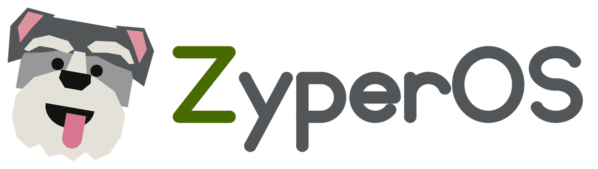
  </picture>
</p>

<h3 align="center">A fast, light firmware for the GKD Pixel 2 and the TrimUI Brick that plays your whole retro library.</h3>

<p align="center">
  <b>On in about 2 seconds. The stock firmware takes 30 to 40.</b><br>
  Turn it off mid-game; turn it on, and 2 seconds later you're back where you were.<br>
  Forty-five systems with their box art, PortMaster ports, RetroAchievements, and your music and videos. Free and open source.
</p>

<p align="center">
  <a href="https://github.com/tarikbc/ZyperOS/releases/latest"></a>&nbsp;
  <a href="#install-in-three-steps"></a>&nbsp;
  <a href="https://discord.gg/Ust8sE22Tm"></a>&nbsp;
  <a href="https://github.com/tarikbc/ZyperOS/releases"></a>
</p>

<p align="center">
  <a href="https://zyperos.com"><b>zyperos.com</b></a> &nbsp;·&nbsp; <a href="#why-zyperos">Why ZyperOS</a> &nbsp;·&nbsp; <a href="#features">Features</a> &nbsp;·&nbsp;
  <a href="#supported-systems">Systems</a> &nbsp;·&nbsp; <a href="#try-it-on-your-mac">Try it on a Mac</a> &nbsp;·&nbsp; <a href="docs/guide.md">Guide</a> &nbsp;·&nbsp; <a href="https://discord.gg/Ust8sE22Tm">Discord</a>
</p>

<p align="center">
  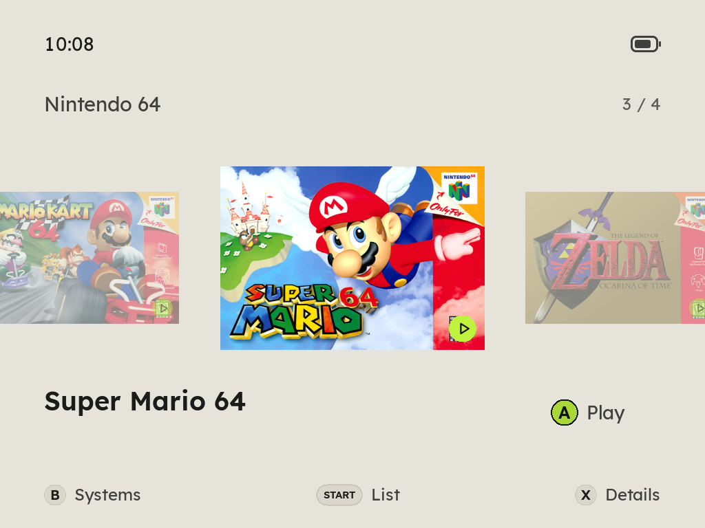
</p>

## Why ZyperOS

- **Your library looks the part.** Every game shows its real box art, found on the handheld itself from libretro, ScreenScraper and SteamGridDB, and a few seconds of video when you rest on it.
- **On in about 2 seconds.** The stock firmware takes 30 to 40 (my test, on my Pixel 2). Turn it off mid-game, and the next start puts you back where you were, 2 seconds later. Games start the moment you press A.
- **Plays more, smoothly.** Forty-five systems, the PSP among them, and PortMaster's ports. On my Pixel 2, Super Mario 64 keeps its 30 frames a second, and Mario Kart DS holds 60 in light scenes and drops to about 40 in a busy race.
- **No more taking the card out.** Add games, music and saves from any browser over Wi-Fi or the USB cable, and update ZyperOS the same way.
- **Made to be picked up.** A first start that teaches every button, eight languages, light and dark, and a menu that never makes you wait.
- **Free and open source,** under GPL-3.0, with nothing locked behind a payment.

## Two handhelds

- **GKD Pixel 2:** the handheld ZyperOS began on. It has no Wi-Fi of its own: a USB Wi-Fi adapter gives it Wi-Fi, and the USB cable moves files without one.
- **TrimUI Brick (TG3040), from 1.0.6:** drawn for its own 1024x768 screen and its keys, with Wi-Fi built in. It runs from its own microSD card and never writes to the Brick's storage: take the card out, and the Brick starts its own system again. PortMaster's ports and a few extras are not there yet ([the list](docs/guide.md#the-trimui-brick)).

## Install in three steps

1. **Download ZyperOS Installer** for macOS, Windows or Linux from [the latest release](https://github.com/tarikbc/ZyperOS/releases/latest).
2. **Write the card.** Put the microSD card in the computer, pick the GKD Pixel 2 or the TrimUI Brick, the latest release and the card, and choose **Fresh install**.
3. **Play.** Put the card in the handheld and turn it on. The first start sets the card up in about a minute, then shows you each button.

Then add games over Wi-Fi, the USB cable or the card itself. [The guide](docs/guide.md#installing) covers the card image, updates and the Wi-Fi adapter.

Questions, ideas, or want to help build it? Come say hi on [the ZyperOS Discord](https://discord.gg/Ust8sE22Tm).

<!-- tour-video: the tour on zyperos.com (video/README.md) -->
<p align="center">
  <a href="https://zyperos.com/zyperos-tour.mp4">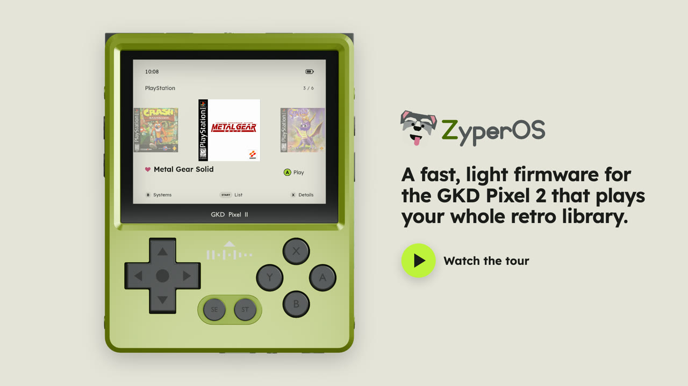</a><br>
  <sub>The 1.0.5 video tour. See the <a href="https://zyperos.com/#tour">current screens</a> on zyperos.com.</sub>
</p>
<!-- /tour-video -->

## Screens

<div align="center">

<table>
<tr><td align="center">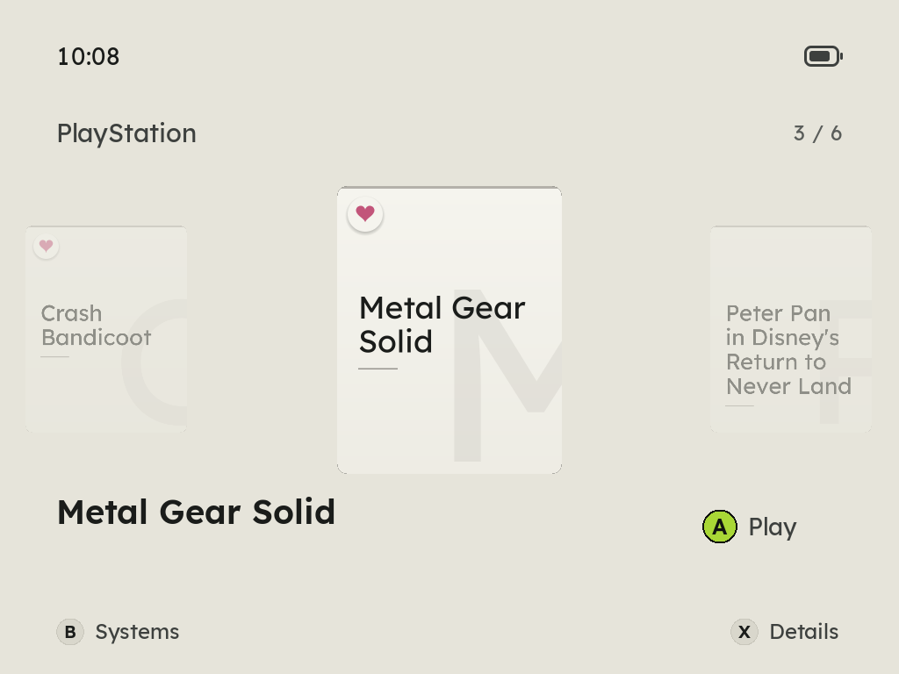<br><sub>Your games, cover by cover</sub></td><td align="center">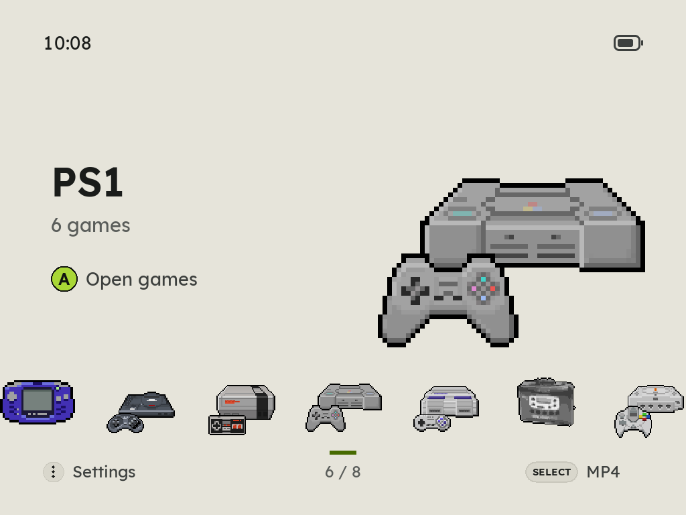<br><sub>Every system, in pixel art</sub></td><td align="center">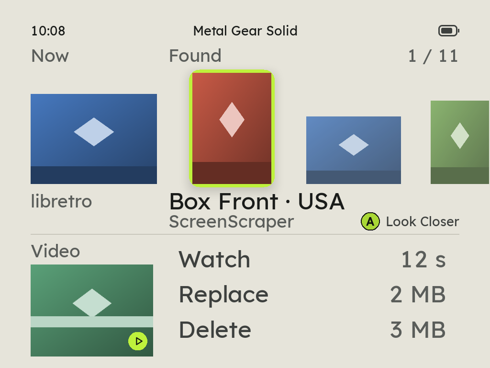<br><sub>Pick a cover, and see it first</sub></td></tr>
<tr><td align="center">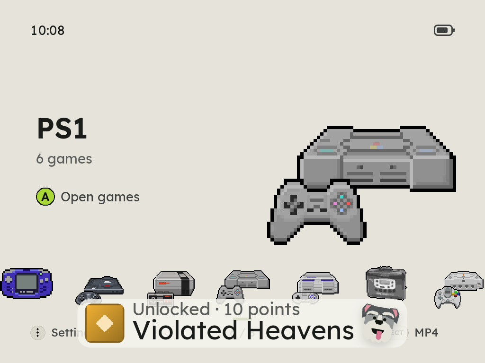<br><sub>RetroAchievements, and Zyper cheers</sub></td><td align="center">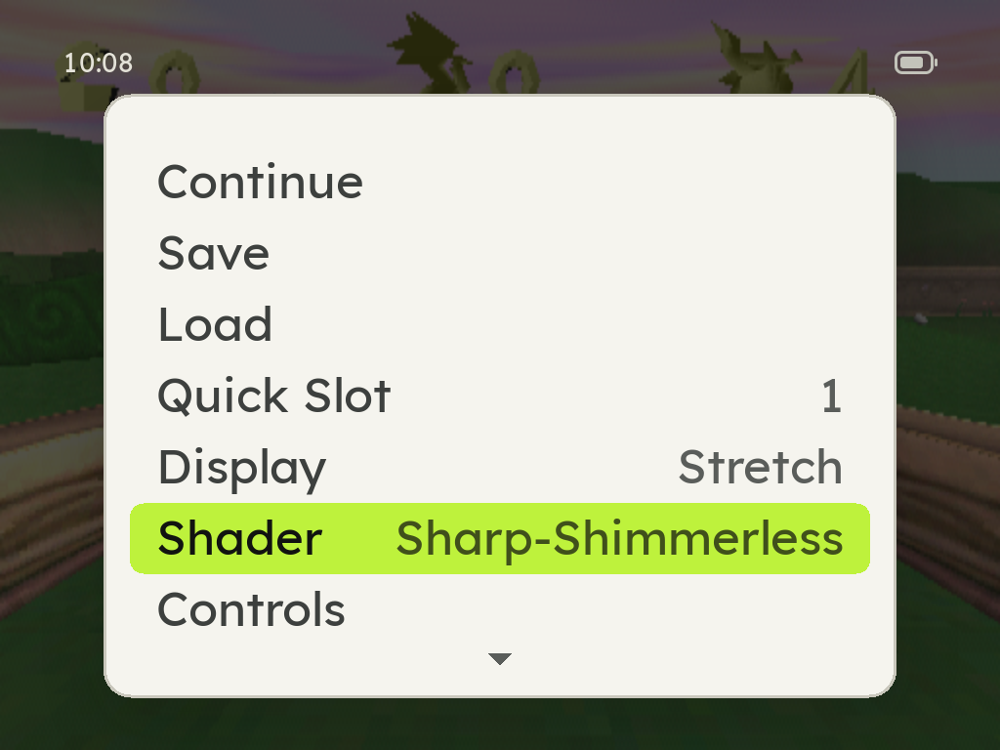<br><sub>A shader for each system, in the Display tab</sub></td><td align="center">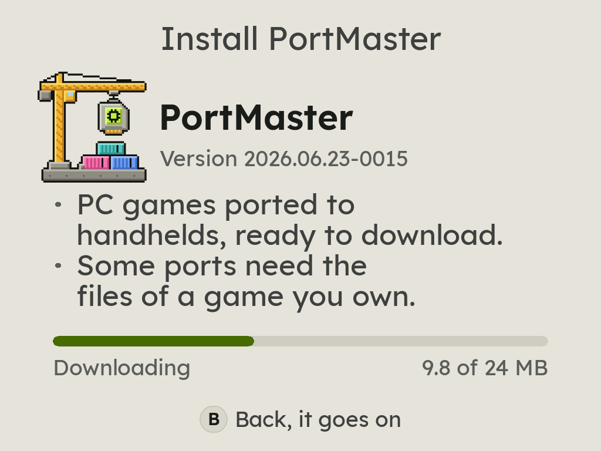<br><sub>PortMaster with one press</sub></td></tr>
<tr><td align="center">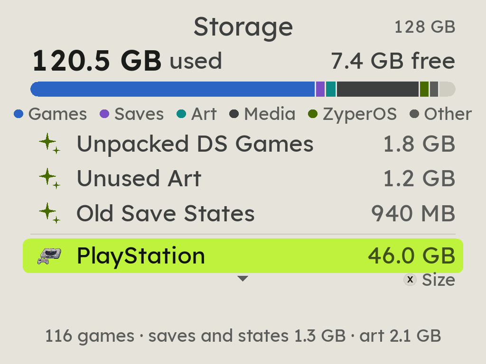 Storage: the card in one bar by part, three recommendations, then every system by size"><br><sub>What fills the card</sub></td><td align="center"><br><sub>Or the Grid home, 18 systems at once</sub></td><td align="center"><br><sub>The same, on the TrimUI Brick</sub></td></tr>
</table>

<sub>The shots show real box art to show what the Scraper does. The games and their art belong to their owners: ZyperOS comes with no games and no art.</sub>

</div>

## Features

Each line has its details in [the guide](docs/guide.md).

- **Forty-five systems,** from the Atari 2600 and the SG-1000 to the PSP, Dreamcast and Saturn, with Arcade, MAME, Doom, ScummVM, PICO-8 and OpenBOR ([the list](#supported-systems)).
- **Ports:** the Ports shelf installs the official [PortMaster](https://portmaster.games) with one press and runs its games, such as Stardew Valley and Celeste, with ZyperOS's in-game menu over every port ([how](docs/guide.md#portmaster)).
- **Your own PICO-8:** add the PICO-8 for Raspberry Pi zip you bought from Lexaloffle with ZyperOS Installer, or copy it to the card, and your PICO-8 plays the carts, with Splore, its online cart browser, first on the PICO-8 shelf, and your hotkeys, Reset and your own buttons over it. ZyperOS never ships or downloads PICO-8; without it, FAKE-08 plays the carts ([how](docs/guide.md#pico-8)).
- **Nintendo DS your way:** [DSperate](https://github.com/beebono/DSperate) with three screen layouts, a d-pad stylus and a language you pick for each game ([notes](docs/guide.md#nintendo-ds)).
- **Nintendo 64 and Dreamcast:** ParallelN64 with Glide64 holds Super Mario 64 and Mario Kart 64 at 30 frames a second on my Pixel 2, and flycast2021 runs the Dreamcast ([Dreamcast](docs/guide.md#dreamcast)).
- **Zipped games** read stored, Deflate or LZMA, and a zip it cannot read says so on the shelf.
- **Two Game Boy cores:** mGBA, or Gambatte from the Game Boy and Game Boy Color shelves' Core row.
- **Smooth or exact timing** in the Game Boy, Game Boy Advance, DS and Genesis shelves: one game frame for each screen refresh, or the console's own speed for timers and rhythm games.
- **A home in pixel art:** every system as its own animated console on a Spotlight, Gallery or Grid home, with Favorites, Recents and a choice of which systems show ([the shelf](docs/guide.md#the-shelf)).
- **Recents where you stopped:** Recents can show each game's last screen, its cover small in the corner, instead of the cover, and says when you last played each game, PICO-8 carts and ports too.
- **Your folders, a grid or a list:** folders on the card show as folders, a game on several discs shows once by its `.m3u`, and a system's games show as a row of covers, a grid shaped like the art, or a list.
- **A Video view:** each game's video snap on the whole screen as you move, its cover in a row at the foot.
- **Collections of your own:** put any game in a list from its details, mix systems, and find your lists in a group on the home ([collections](docs/guide.md#collections)).
- **MENU in six tabs,** with **Search Games** and **Random Game** for any system ([menus](docs/guide.md#controls-and-menus)).
- **Your look:** light and dark, or Auto by Night Mode's hours, ten accents, three backgrounds for each theme, a folder color, rounded or square corners, how the game or system in focus is marked (a bar, a border, a lift, or none), and Zyper on or off ([light and dark](docs/guide.md#light-and-dark)).
- **Screen Colors and Night Mode:** temperature, tint, contrast, saturation and gamma, ready-made looks, set from MENU or a game's own menu, and a warm screen for the night ([how](docs/guide.md#screen-colors-and-night-mode)).
- **Shaders:** Sharp-Shimmerless for even pixels, and CRT, CRT Curved, Scanlines and LCD Grid for an old screen, each at a strength you set ([how they look](docs/guide.md#shaders)).
- **Borders round a handheld game:** the three Game Boys' own faces drawn around the game at its scale (the Game Boy Color in its six colors), the game blurred, or a picture of your own ([Border](docs/guide.md#the-system-menu)).
- **Eight languages,** chosen on the first start or in **MENU > Language**, with every word following it, down to the charging screen ([languages](docs/guide.md#languages)).
- **A first start that asks:** Zyper teaches each button, then asks for the theme, the home screen, the button sounds and the menu music ([the first start](docs/guide.md#the-first-start)).
- **Box art the device finds itself** from libretro, ScreenScraper and SteamGridDB, with **Cover and Video** to pick a cover and see it first ([Scraper](docs/guide.md#scraper)).
- **Every download in one place:** **MENU > Downloads** gets covers, video snaps, names, every game's achievements and cheats at once, side by side, and keeps going behind the menus while you browse ([Downloads](docs/guide.md#downloads)).
- **Video snaps and a screensaver:** rest on a game and its cover turns into a few seconds of the game itself, and after a minute on the shelf the snaps of random games play over the whole screen ([how](docs/guide.md#screensaver)).
- **RetroAchievements,** signed in on the device and working offline: an unlock shows at once and goes to your account when Wi-Fi is back, dated when you earned it ([how](docs/guide.md#achievements)).
- **Coming from Knulli, ROCKNIX, ArkOS or ROGUE OS:** copy their `roms` folders over as they are, with the covers, video snaps, names and favorites their scrapers left ([what ZyperOS reads](docs/guide.md#coming-from-emulationstation)).
- **Rename or delete a game** on the handheld: its saves, states, cover and play time follow the new name or go with the game ([Delete Game](docs/guide.md#delete-game)).
- **Storage, as a phone shows it:** what fills the card by part, by system and by game, with three recommendations for room to clear ([Storage](docs/guide.md#storage)).
- **Wi-Fi and USB File Transfer:** move games, music, videos, saves and covers from any browser behind a PIN; with no Wi-Fi around the handheld makes its own network, and an upload that loses Wi-Fi goes on where it stopped ([how](docs/guide.md#file-transfer)).
- **USB that only charges until you say so,** and an Android phone's USB tethering that gives the Pixel 2 the phone's internet ([plugging in](docs/guide.md#plugging-something-in)).
- **System Update** over Wi-Fi or the USB cable: only what changed, signed, with roll back ([how](docs/guide.md#system-update)).
- **Player 2 on a friend's phone,** in NES games on the Pixel 2, with no app and no account ([how](docs/guide.md#player-2)).
- **Autosave and resume,** six save slots, quick save and quick load on **SELECT + R1** and **L1**, **Undo Load**, and a **Disc** row for games on more than one disc ([in a game](docs/guide.md#in-a-game)).
- **Faster and slower** (1.5x, 2x and 3x), **turbo** buttons and **On-Screen Stats** over the game ([in a game](docs/guide.md#in-a-game)).
- **Hotkeys you choose,** SELECT and a button, for a screenshot, the next shader or display, reset and quit, for every game, a system or one game ([hotkeys](docs/guide.md#controls-and-menus)).
- **Your screenshots on the home:** every shot in a group of its own, OpenBOR's too, newest first, opened on the whole screen ([screenshots](docs/guide.md#screenshots)).
- **Change what a button does,** for one game or a whole system, two buttons on one game button if you like, a button that turns the d-pad into the stick (each press, or while held) among the choices, with the handheld drawn beside the rows, and every control listed in the game with the handheld's own buttons ([controls](docs/guide.md#controls-and-menus)).
- **Cheats** from libretro's cheat list or a `.cht` file of your own, on and off per game in the in-game menu; achievements wait while one is on ([cheats](docs/guide.md#cheats)).
- **Rumble** on the Pixel 2 for Dreamcast, PlayStation, Game Boy Color and Nintendo 64 games, Off, Low, Medium or Full for every game or one ([rumble](docs/guide.md#rumble)).
- **Sound your way:** a USB-C headphone adapter on the Pixel 2, Bluetooth headphones on the Brick (untried so far), and mono audio for anyone who hears with one ear ([audio](docs/guide.md#audio)).
- **Louder than the top:** hold VOL+ a second at the top, or press it three more times, for up to +18 dB on quiet films and games, with a limiter; the brightness key lifts a dark picture the same way ([boost](docs/guide.md#past-the-top-the-boost)).
- **An equalizer for everything you hear:** Bass, Voice, Treble or five bands of your own, one preset for the speaker and one for headphones, heard live as you tune it ([equalizer](docs/guide.md#equalizer)).
- **MP4 and menu music:** a player for your music, audiobooks and videos that keeps playing behind the shelf and comes back paused where it was after a power-off, its albums as covers, a grid or a list (START turns them), showing a song as its cover, a cassette whose reels turn, a record in the cover's color, or bars that move to the music, and ten free 8-bit tracks, or your own, behind the menus ([MP4](docs/guide.md#mp4)).
- **The top bar and side lights:** the clock, Wi-Fi and the battery with its time left, and on the Pixel 2 side lights for the battery, volume, transfers and achievements.
- **Battery care:** a charging screen while it is off, a charge limit of 80, 85 or 90%, a warning before it gets hot, a Power Button that asks for a hold, and clocks for each system that save battery ([battery and power](docs/guide.md#battery-and-power)).
- **Play Time,** **Continue** or start from the start, favorites, sorting, a QWERTY keyboard that keeps up with the d-pad, and **MENU + START** for a way out of anything.

## Supported systems

| | |
|---|---|
| **Nintendo** | NES, SNES, Nintendo 64, Game Boy, Game Boy Color, Game Boy Advance, Nintendo DS, Virtual Boy, Pokémon Mini, Game & Watch |
| **Sega** | SG-1000, Master System, Genesis, Game Gear, Sega CD, 32X, Saturn, Dreamcast |
| **Sony** | PlayStation, PSP |
| **Atari** | Atari 2600, Atari 5200, Atari 7800, Atari Lynx |
| **Others** | TurboGrafx-16 and CD, Neo Geo, Neo Geo CD, Neo Geo Pocket and Color, WonderSwan and Color, ColecoVision, Vectrex, MSX2, 3DO |
| **Arcade and more** | Arcade, MAME, NAOMI, Atomiswave, Doom, ScummVM, PICO-8, TIC-80, OpenBOR, J2ME, and PortMaster's ports |

Each system's games go in its folder under `Roms/`, and EmulationStation's folder names (`nds`, `gba`, `psx`, `megadrive` and the rest) work as they are. BIOS files go loose in `Bios/`; a Famicom Disk System game (`.fds`) needs `disksys.rom` there. A picture of your own in `Borders/<system>/` fills the space around a handheld game (NextUI's `Overlays/` work too). [The guide](docs/guide.md#supported-systems) has every folder, file type and core, and [each BIOS file](docs/guide.md#bios-files).

## Try it on your Mac

No handheld yet? ZyperOS runs on a Mac in a window drawn as the handheld itself, in two ways. [The full walk-through](https://zyperos.com/blog/try-zyperos-on-mac/) is on the blog.

<div align="center">

<table>
<tr><td align="center"><br><sub>Desk mode, each key's letter on show</sub></td><td align="center"><br><sub>A game and its in-game menu</sub></td><td align="center"><br><sub>The same, as the TrimUI Brick</sub></td></tr>
<tr><td align="center" colspan="3"> <br><sub>The ZyperOS Simulator: the first start, and the side lights while it charges</sub></td></tr>
</table>

</div>

**Desk mode** is the launcher itself, built for your Mac: the menus, the settings, the themes and a game, at 60 frames a second. With Xcode's command-line tools and [Homebrew](https://brew.sh):

```sh
brew install sdl2 sdl2_image sdl2_ttf xz
git clone https://github.com/tarikbc/ZyperOS && cd ZyperOS
make desk          # the GKD Pixel 2; make desk-brick for the TrimUI Brick
```

The first run takes a few minutes: it builds the launcher, Diatom and a NES core, and makes a sample card with a game on each system. The keyboard is the buttons: the arrows for the d-pad, X Z S A for A B X Y, Q W E R for L1 R1 L2 R2, Return for START, Right Shift for SELECT and Esc for MENU. The mouse presses the drawn keys, Option shows each key's letter, and F1 lists the rest. Linux works too ([Building](docs/building.md#work-on-the-ui-without-a-device)).

**The [ZyperOS Simulator](docs/simulator.md)** is the whole system in QEMU on a Mac with Apple silicon: the boot, the first-start setup, the battery, the charger and the side lights, with a panel for what a player can't press. Every release from 1.1.0 on has its QEMU image, and `tools/qemu-run.sh fetch` downloads the latest one and checks it against the release's `SHA256SUMS`. To build the image yourself instead, plastron does it in Docker (`make -C plastron qemu`, [how](docs/qemu.md#setting-it-up)): a few hours the first time, then minutes. Either way there is no SSH key to set up: `tools/qemu-run.sh` hands the VM yours, or makes one for it.

```sh
brew install qemu
tools/qemu-run.sh fetch          # the latest release's image; or make -C plastron qemu
simulator/scripts/build-app.sh
open "simulator/build/ZyperOS Simulator.app"
```

## More

- **[The guide](docs/guide.md):** installing, every system's folder and BIOS, every control, menu and setting, File Transfer, System Update, PortMaster and the questions people ask.
- **[zyperos.com](https://zyperos.com):** the screens, the video tour and the blog. **[The Discord](https://discord.gg/Ust8sE22Tm)** is for questions, ideas and help building it.
- **[The releases](https://github.com/tarikbc/ZyperOS/releases)** have the card images and ZyperOS Installer. **[Issues](https://github.com/tarikbc/ZyperOS/issues)** are for bugs.

## The name

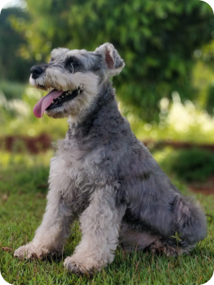

ZyperOS is named after **Zyper**, my dog, who passed away. He was quick, light on his feet and full of energy, and that is what this system tries to be.

The name is also two words in one: **zippy** and **hyper**. Games start the moment you press A, the menus never make you wait, and the whole system is small enough to come up in about two seconds.

## For developers

ZyperOS is C and SDL2, in two repositories that build together. [ZyperOS](https://github.com/tarikbc/ZyperOS) (this one) holds the launcher, the card's scripts and the tools, [`diatom/`](diatom/), the libretro frontend that starts once at boot (its own Makefile, under the Mozilla Public License 2.0), and [`installer/`](installer/), ZyperOS Installer (Rust and Tauri). [`plastron/`](plastron/) is the Linux under it, built with Buildroot in Docker, under the GNU GPL version 3. [Building](docs/building.md) covers the toolchain, the card, QEMU, the simulator, releasing, developer mode and the checks.

To run it on your computer first, see [Try it on your Mac](#try-it-on-your-mac).

## Credits

ZyperOS stands on other people's work:

- **Eric Reinsmidt**, for [TortOS](https://github.com/ericreinsmidt/TortOS), [TortOS Installer](https://github.com/ericreinsmidt/TortOS-Installer), [plastron](https://github.com/ericreinsmidt/plastron) and [Diatom](https://github.com/ericreinsmidt/diatom), where ZyperOS's launcher, installer, Linux and emulator started. His code in ZyperOS keeps his copyright and notices.
- **[ROCKNIX](https://github.com/ROCKNIX/distribution)**, for the RK3326 kernel patches, the Pixel 2 device tree, the U-Boot setup and the DDR clock driver.
- **[PortMaster](https://portmaster.games)**, for the ports and the runtimes they run on.
- **[plorpOS](https://github.com/thwonp/plorpOS)** by Thwonp, for the DSperate libretro wrapper and the FAKE-08 patches.
- **congusbongus** (Napping on a Cloud), **Zane Little Music** (Apple Cider, Hush Hamlet), **HydroGene** (Truth), **Spring Spring** (Scheatt), **TAD** (Ice Cave), **John Oestmann** (Starfall Island), **nene** (Leap), **LordZintick** (The Arplands) and **Joth** (Bossa Nova), whose free 8-bit tracks are the menu music a fresh card plays, all given away under CC0 on [OpenGameArt](https://opengameart.org) ([THIRD-PARTY-LICENSES.md](THIRD-PARTY-LICENSES.md)).
- **The libretro core authors**, ScummVM's, YabaSanshiro's and FreeJ2ME-Plus's among them, whose emulators do the real work, each under its own license ([THIRD-PARTY-LICENSES.md](THIRD-PARTY-LICENSES.md)).
- **[OpenBOR](https://github.com/DCurrent/openbor)**, by Senile Team and the OpenBOR Team, which runs the OpenBOR shelf.
- **Eclipse Temurin** (OpenJDK) and **DejaVu Sans**, the Java runtime and the font J2ME games run with.
- **minimp3** by lieff and **stb_vorbis** by Sean Barrett, which decode the menu music.
- **zadpos**, for [Sharp-Shimmerless](https://github.com/Woohyun-Kang/Sharp-Shimmerless-Shader) and its scanlines and grid (CC0), and **Timothy Lottes**, for his CRT shader, CRTS (public domain), which the Shader row draws with.
- **Rockchip**, for the firmware that starts the Pixel 2 and runs its memory at full speed.

## License

ZyperOS is open source, under the [GNU General Public License, version 3](LICENSE) (GPL-3.0-only), so anyone can build on it. The [NOTICE](NOTICE) adds two terms that section 7 of the GPL allows. The first keeps the name ZyperOS, ZyperOS Installer, Zyper (the miniature schnauzer the system is named after) and his art, the logo and the website as trademarks, so a fork needs its own name and mascot; naming ZyperOS to say where your work came from is always fine. The second asks you to keep the copyright notice, the NOTICE and the attribution in the About screen when you share it. [TRADEMARK.md](TRADEMARK.md) says in plain words what is and is not fine. Versions published before 2026-11-06 were under the GNU General Public License, version 3 or later, and for a short time after that ZyperOS was under the PolyForm Shield License 1.0.0; this is GPL-3.0-only. Eric Reinsmidt's TortOS code in ZyperOS is from TortOS's MIT-licensed versions and keeps his MIT notice ([LICENSES/](LICENSES/)). plastron stays under the GNU GPL version 3 and Diatom under the Mozilla Public License 2.0. The cores keep their own licenses, some of them non-commercial. OpenBOR, a program of its own on the card, is under the BSD 3-Clause License. Flycast 2.7 is a separate program, not part of ZyperOS. Full notices are in [THIRD-PARTY-LICENSES.md](THIRD-PARTY-LICENSES.md).
