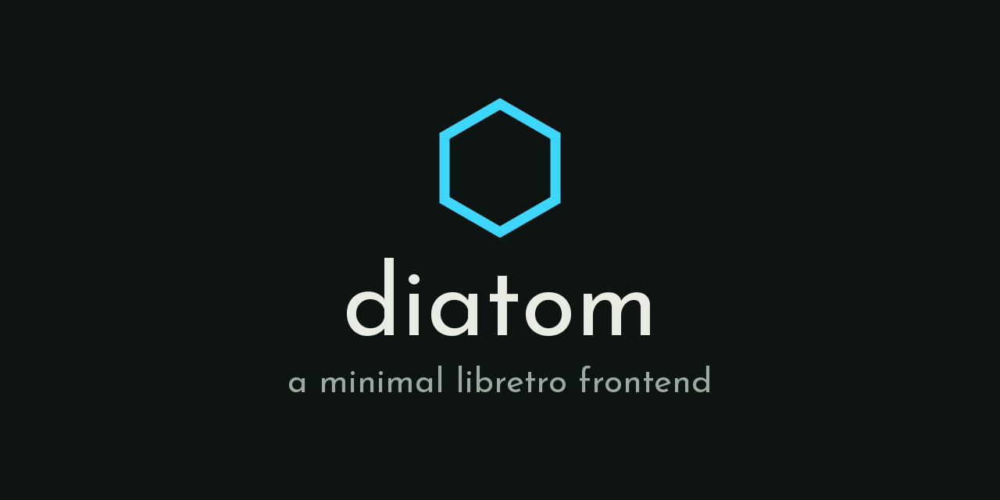

  

A minimal libretro frontend for low-power ARM Linux handhelds (~1GB RAM). It is
the emulator behind [ZyperOS](https://github.com/tarikbc/ZyperOS), which
drives it over a Unix socket, and an open base for any other firmware that
wants one. It lives in ZyperOS's repository, in this `diatom/` folder, with
its own Makefile and license, since 2026-11-04 (before that, tarikbc/diatom).
It began as Eric Reinsmidt's [diatom](https://github.com/ericreinsmidt/diatom)
and keeps his notices.

**Mozilla Public License 2.0** ([LICENSE](LICENSE)). Diatom's own files stay
open: whoever changes them and shares the result shares their changes too. But
the license stops at Diatom's files, so Diatom can still host cores under any
license - which is what `libretro.h` is permissive for - and it loads whatever
core it is handed and ships none of them. It was MIT until 2026-10-25.

**Status: running on hardware, shipping in ZyperOS.** It runs the libretro
cores on ZyperOS's shelf, on the TrimUI Brick and the GKD Pixel 2. Six of those
cores are pinned and measured here ([CORES.md](CORES.md)): `fceumm` (NES),
`snes9x2010` (SNES), `mgba` (Game Boy, Game Boy Color, GBA),
`genesis_plus_gx` (Genesis, Master System, Game Gear), `mednafen_pce_fast`
(PC Engine, HuCard and CD) and `pcsx_rearmed` (PlayStation, measured in a
container and not yet on a device). The others, `mednafen_ngp` for the two
Neo Geo Pocket systems among them, are pinned by ZyperOS
(`mk/fetch-vendor.sh`) and not yet measured here.

    diatom --core snes9x2010_libretro.so --rom parodius.sfc

A Nintendo DS core's frame is two screens, top over bottom. Told so
(`--screens 2`, or `screens=2` on the launcher's RUN), diatom cuts it in two
and lays the screens out - stacked, one large with the other small beside it,
or one at a time, the top one alone to start - and gives a pad with no touch
panel a stylus. L1 and R1 are the DS's L and R. L2 brings the other screen
in front; R2 turns the stylus on (the bottom screen comes in front), the
d-pad moves a cursor over it and A touches, and R2 again goes back
(`src/screens.h`, THE BUTTONS). Played with DSperate on the GKD Pixel 2.

    diatom --core dsperate_libretro.so --rom mkds.nds --screens 2 --layout focus

Standalone is the primary mode. A launcher driving a resident diatom over a
Unix socket is an
additional mode, not the fundamental one - designing for a program that stands
alone is a stricter test than designing for one embedder.

---

## Building

    make                        desktop (SDL2), for iteration
    make check                  the checks below; run before committing

The devices' builds are [plastron](../plastron/)'s:
its Buildroot builds Diatom for the TrimUI Brick and the GKD Pixel 2 with its
own compiler and SDL2 (`PORT=brick` or `PORT=pixel2`, SDL2 found with
pkg-config), from this working tree.

`make check` is not advice. It fails on a port including `libretro.h`,
on a launcher file copied into `port/` no longer matching ZyperOS's `src/`,
on documented core measurements describing binaries the
project no longer ships, on any sample rate stated as current truth that the
generated core facts do not record, on a RetroAchievements address failing to
reach the byte it names, on a zip or a protocol line read past its buffer,
on a save state that does not come back byte for byte from its packed file
or an old one no longer read, on the launcher protocol not reaching the
socket, on
the launcher state plane end to end against the stub core, and on the port's
audio contract. Each of those exists because the rule it guards decayed the
moment nothing failed when it was broken.

One suite sits outside it because it needs a build, and is named here so it
does not quietly stop being run:

    make conform-check          determinism, RSS, allocations (~20s, no device)

`conform` is where the memory claims stop being claims: the frame loop
**allocates nothing** (the count is identical at N and 2N frames). Measured on
a Brick, diatom peaks at **8.2 to 8.4 MB** with FCEUmm running.

## Layout

| Path | What it is |
|---|---|
| `src/` | The host: core loading, environment callbacks, frame loop, resampling, saves, the launcher protocol, volume and brightness, a DS frame's two screens and its stylus, and what runs now for the device's tools (`now.h`) |
| `port/` | Per-device backends. `desktop` (SDL2), `brick` (raw fbdev) and `pixel2` (GLES on KMS). Pixels, samples, buttons, time, and the hardware under the levels - nothing else |
| `include/diatom_port.h` | The one load-bearing seam, and the rules that keep it honest |
| `test/stubcore.c` | A libretro core that is not an emulator, so the frontend can be exercised with no third-party binary |
| `tools/` | The checks, and the allocation counter `conform` links in |
| `test/` | The stub core, and the suites that exercise the frontend against it |
| `docs/reference/core-facts.md` | What the shipped cores actually report, measured on the device rather than transcribed |
