# ZyperOS guide

The [README](../README.md) is the short version: what ZyperOS is, its features,
how it compares and how to install it. This is the long version: installing,
every system's folder and BIOS file, every control, menu row and setting, and
the reasons behind them.

**On this page**

- [Installing](#installing), [the first start](#the-first-start) and [the TrimUI Brick](#the-trimui-brick)
- [Supported systems](#supported-systems), [BIOS files](#bios-files) and a note for [each system](#nintendo-ds)
- [Controls and menus](#controls-and-menus), [Scraper](#scraper), [Achievements](#achievements), [Screensaver](#screensaver), [Date & Time](#date--time), [Shaders](#shaders) and [in a game](#in-a-game)
- [Languages](#languages), [Light and dark](#light-and-dark), [Screen Colors and Night Mode](#screen-colors-and-night-mode), [Battery and power](#battery-and-power) and [Rumble](#rumble)
- [File transfer](#file-transfer), [System Update](#system-update) and [PortMaster](#portmaster)
- [Changing discs](#changing-discs), [Player 2](#player-2), [Audio](#audio), [Equalizer](#equalizer) and [MP4](#mp4)
- [The shelf](#the-shelf), [Delete Game](#delete-game), [Storage](#storage), [Ports](#ports) and [Coming from EmulationStation](#coming-from-emulationstation)
- [Questions](#questions), [How it compares](#how-it-compares) and [Screens](#screens)

## Installing

ZyperOS 1.0.6 is out for the GKD Pixel 2 and, for the first time, the TrimUI Brick, released in November 2026. [The latest release](https://github.com/tarikbc/ZyperOS/releases/latest) on GitHub has the card images and [ZyperOS Installer](../installer/) for macOS, Windows and Linux. On the Brick, the installer also adds the closed files its graphics and Wi-Fi need, which ZyperOS does not pass on, so install the Brick with the installer, not an image writer. The consoles whose cores draw with the GPU (Dreamcast, NAOMI, Atomiswave, Nintendo 64, PSP and Saturn) are hidden on the Brick for now.

1. **Write the card.** Download ZyperOS Installer for your computer from [the latest release](https://github.com/tarikbc/ZyperOS/releases/latest): the `.zip` for macOS, the `.exe` for Windows, the `.deb` or `.rpm` for Linux. Put the microSD card in the computer, pick the GKD Pixel 2 or the TrimUI Brick, the latest release and the card, then choose **Fresh install**, which erases the card. For the Pixel 2, you can also download the card image, `ZyperOS-v<version>-pixel2.img.xz`, and write it with any program that writes disk images, like Raspberry Pi Imager. The Brick needs the installer, which adds its closed files ([on the TrimUI Brick](#the-trimui-brick)).
2. **Put the card in the handheld and turn it on.** The first start sets the card up in about a minute, turning the rest of it into space for games, music and saves. Every boot after that comes straight up, and the first one ends with [the tutorial](#the-first-start). If it ever stops partway, the card's PX2BOOT drive has `zyperos-setup.txt`, a record of what it did: send it to me in [an issue](https://github.com/tarikbc/ZyperOS/issues).
3. **The time zone sets itself.** **MENU > Date & Time** starts on **Auto**, which asks ipwho.is where you are each time the handheld gets internet ([how](#date--time)). To use your own zone, pick it there, which turns Auto off. Wi-Fi sets the time whenever it connects; without it, set the time there too, and it keeps it.
4. **Add games** to the folders in `Roms/`. Put the card back in the computer, where it shows up as ZYPEROS, or send them over, with Wi-Fi or the USB cable: [a card with no games](#file-transfer) shows both ways. Windows may also ask to format two drives it can't read: those are ZyperOS's system, so choose **Cancel** ([the card in a computer](#the-card-in-a-computer)).
5. **Add the extras you want.** [PortMaster](#portmaster) installs from the Ports shelf over Wi-Fi. Copy Flycast to `Emulators/Flycast`. A shelf with nothing in it stays hidden, except Ports, which holds PortMaster's entry until you install it.

New versions come to the handheld with [System Update](#system-update) over Wi-Fi, or over the USB cable from [the File Transfer page](#the-file-transfer-page). On a computer, the installer's **Update** puts a new version on a card that has ZyperOS and keeps its games, music and saves. To build the card image yourself instead, see [building.md](building.md).

Each device's card is a disk image written over the whole card, so a fresh
install erases it.

The image is [plastron](../plastron/), the small
Linux both devices run ZyperOS on: a boot partition and the system itself,
read-only, and on the Brick also a small partition for system data such as
Bluetooth pairings. At the first boot, in about a minute, the rest of the
card becomes ZYPEROS, an exFAT partition, with ZyperOS on it. Games, music,
saves and settings live there, and it is the partition a computer sees.

The first start writes down what it does as it goes, in `zyperos-setup.txt`
on the card's small PX2BOOT partition, which a computer shows as a drive of
its own: the handheld's memory, the card and how fast it runs, then a line
every second with how far the copy has got, the clocks, the temperature and
the battery, and every message from the system. If the first start ever
stops, or the handheld restarts in the middle of it, put the card in a
computer and send me that file ([a GitHub issue](https://github.com/tarikbc/ZyperOS/issues)
or the Discord): it says what happened up to that moment. Each start adds to
it, so a card that tried twice has both. When the handheld restarted by
itself, the next start also puts in the system's own report of what went
wrong, which it keeps in memory across the restart. Turning the handheld off
with the power button loses that report, so if it freezes, wait a minute
before you do.

The device itself is never written to. The Brick boots from the card before
its own system, so **removing the card brings the stock system back**;
[Undoing it](#undoing-it) covers the rest.

Copying from macOS leaves `._name` metadata files beside everything. They are
harmless - the launcher skips every name beginning with a dot, so they never
show up as games - and `dot_clean /Volumes/ZYPEROS` removes them if they
bother you.

### The card in a computer

On the Pixel 2 the card has four partitions, in an MBR table:

| | | |
|---|---|---|
| PX2BOOT | FAT, 64 MB | the boot partition: each system's kernel and the file that says which one starts. Leave it as it is |
| (none) | 512 MB | system slot A, read-only (squashfs) |
| (none) | 512 MB | system slot B, where System Update puts the next version |
| ZYPEROS | exFAT, the rest of the card | games, music, saves and settings |

PX2BOOT and ZYPEROS have the partition types a Mac, Windows and Linux open
(0x0C and 0x07). A Mac shows both. Windows shows both too, and can give
the two system slots a drive letter as well, then ask for each, **You need
to format the disk in drive X: before you can use it**: choose **Cancel**. Formatting a slot erases
that system, and the card may no longer start.

If ZYPEROS has no drive letter in Windows, right-click Start, open **Disk
Management**, find the card (a Removable disk the card's size), right-click
the large exFAT partition, choose **Change Drive Letter and Paths**, then
**Add**. If Disk Management shows the card as **No Media**, or not at all,
the reader does not see the card: try another reader, or leave the card in
the handheld and use [Flash Drive](#plugging-into-a-computer), which gives
the computer ZYPEROS alone.

Building it yourself instead is in [building.md](building.md).

BIOS files go **loose in `Bios/`**, not in a folder per system: that directory
is handed to the core as its system directory, and a core asks for a filename
inside it. [BIOS files](#bios-files) lists each one.

The consoles on the shelf come from `systems.cfg`, so the list in
[Supported systems](#supported-systems) is the shipped one rather than a fixed
one: a line removed from the config takes its shelf with it, and a system whose
folder is empty is hidden until there is something in it.

### Wi-Fi on the Pixel 2

The Pixel 2 has no radio of its own. A USB Wi-Fi adapter in its USB-C port gives it Wi-Fi while it's plugged in, and with it box art, RetroAchievements and Wi-Fi File Transfer: one whose Realtek chip ZyperOS has a driver for, like the TP-Link TL-WN725N on a USB-C adapter. Its power saving is off while it is on a network, since this chip is known to drop off some routers over and over with it on. Without one, USB File Transfer (below) moves files over the USB cable. There's no Bluetooth.

### The first start

The first time ZyperOS starts on a handheld, Zyper says hello in each of its eight languages in turn, each named in its own words: **UP** and **DOWN** look, the screen speaks the one you are on, and **A** keeps it (**MENU > Language** changes it later). Then he teaches the buttons, one step each: the D-pad, A, B, X, Y (a favorite, in the details), MENU, SELECT, the volume, the brightness and POWER. A small picture of the handheld, turned to show where each one is, shows what it does, and the step waits for you to press it. The shoulder keys come with two of them, lit beside the D-pad (L1/R1 jump) and SELECT (L2/R2 change the song). A press of another button gets Zyper's answer, which button that was and which to try. POWER does not turn the handheld off in its own step, so it can be tried, and the volume and brightness keys change the real levels.

Then he asks four things, each shown as you look at it: the theme, the home screen, the button sounds (Wood, Glass, Bubble or Off) and, on a card with tracks, the menu music, which plays while On is chosen. **LEFT** and **RIGHT** look, **A** keeps it, and **START** skips the rest at any point. The whole start takes about a minute. Each choice is a MENU row later, and **MENU > Show Tutorial** runs the tutorial again. A start straight back into a game skips it until the next start that comes to the shelf, and a handheld turned off before the power step starts it again. A handheld updated from a ZyperOS that had no tutorial shows it once too.

<div align="center">

<table>
  <tr>
    <td align="center">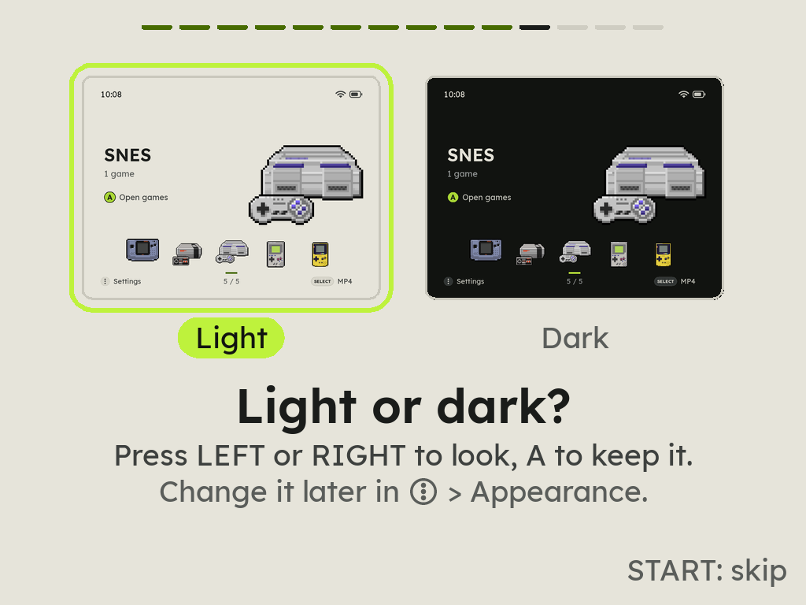<br><sub>Light or dark?</sub></td>
    <td align="center">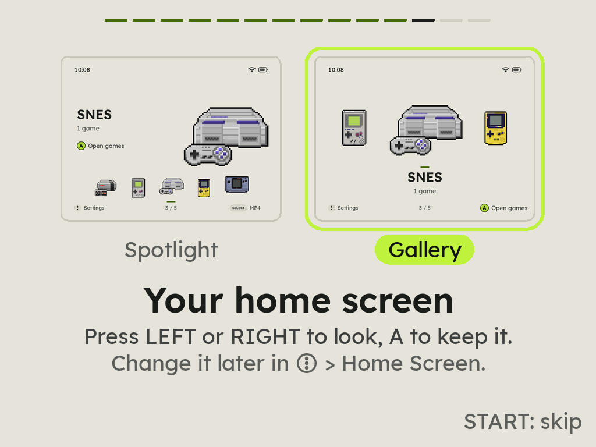<br><sub>Your home screen</sub></td>
  </tr>
  <tr>
    <td align="center">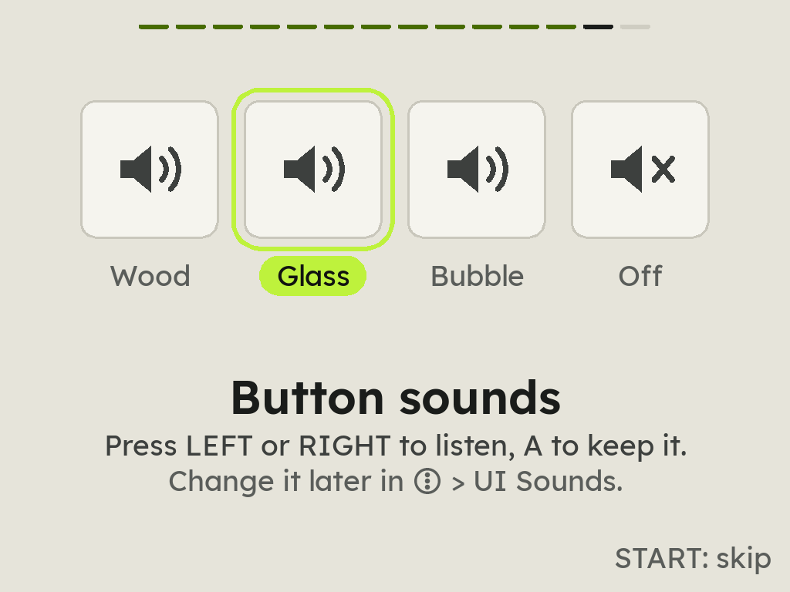<br><sub>Button sounds</sub></td>
    <td align="center">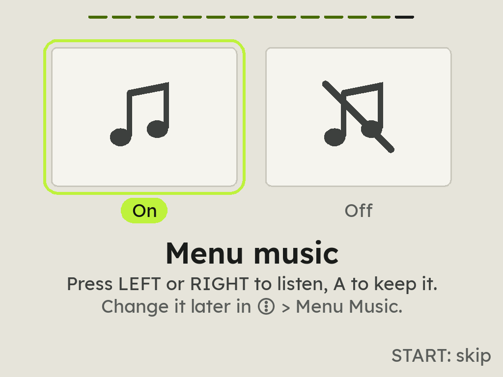<br><sub>Menu music</sub></td>
  </tr>
</table>

</div>

### Undoing it

On the Brick, remove the card: ZyperOS never writes to the device, so the
Brick's own system starts as before. On the Pixel 2 the system lives on the
card, so a card with another system takes its place.

ZyperOS keeps everything on the card: battery saves in `Saves/`; settings,
states and achievements in `.userdata/`; Wi-Fi networks and their passwords
in `.userdata/brick/wifi/` (`pixel2` on the Pixel 2); and on the Brick, the
Bluetooth pairings in its small system partition. Reformat the card and all
of it goes, with nothing kept anywhere else, so wipe the card before you give
it away.

Keep the stock card as your way back: ZyperOS goes on a second card, and
swapping cards switches systems ([keeping the stock card
safe](https://zyperos.com/blog/gkd-pixel-2-stock-firmware/)). Your games come
over as files, each into its console's folder under `Roms/` ([the
folders](#supported-systems)).

## The TrimUI Brick

<p align="center">
  
  
</p>

From 1.0.6, ZyperOS runs on a second handheld, the TrimUI Brick (TG3040), drawn for its own 1024x768 screen and its keys. It runs from its own microSD card and never writes to the Brick's storage: take the card out, and the Brick starts its own system, as before.

- **Install it with ZyperOS Installer.** Pick **TrimUI Brick**. The Brick's graphics and Wi-Fi need closed files made for its chips (Imagination's GPU driver and XRadio's Wi-Fi firmware), which ZyperOS does not pass on, so the installer downloads them from where they are published, Creality's Sonic Pad SDK on GitHub, checks each one, and puts them only on your card. An image writer gives the card none of them, so use the installer.
- **Wi-Fi is built in,** so File Transfer, box art, achievements and System Update need no adapter.
- **The 3D systems are hidden for now:** Dreamcast, NAOMI, Atomiswave, Nintendo 64, PSP and Saturn, whose cores draw with the GPU. They come once those cores run on the Brick's graphics chip.
- **Not there yet:** PortMaster's ports, your own PICO-8 and Splore (FAKE-08 plays the carts), Flash Drive, Screen Colors, the old-screen shaders (CRT, CRT Curved, Scanlines and LCD Grid; Sharp-Shimmerless is there), NES Player 2, the charge limit and the Brick's lights. Nobody has tried Bluetooth headphones with ZyperOS on a Brick yet.
- **The Brick Hammer** runs the same card, but nobody has tried one yet. The Brick Pro isn't supported yet.

I don't have a Brick myself: players on [the ZyperOS Discord](https://discord.gg/Ust8sE22Tm) test it for me. If you have one, your logs help a lot (**Download logs** on File Transfer's page, or the card's `.userdata/brick/logs`).

## Supported systems

Every system has a folder under `Roms/`, and a system with nothing in its folder is hidden. The consoles come from `config/systems.cfg`.

| Console | Put games in | File types | Core |
|---|---|---|---|
| Atari 2600 | `Roms/Atari 2600` | `.a26` `.bin` `.zip` | Stella 2014 |
| Game & Watch | `Roms/Game & Watch` | `.mgw` | Game & Watch |
| ColecoVision | `Roms/ColecoVision` | `.col` `.cv` `.bin` `.rom` `.zip` | Gearcoleco |
| Atari 5200 | `Roms/Atari 5200` | `.a52` `.bin` `.zip` | a5200 |
| Vectrex | `Roms/Vectrex` | `.vec` `.bin` `.zip` | vecx |
| SG-1000 | `Roms/SG-1000` | `.sg` `.zip` | Genesis Plus GX |
| NES | `Roms/NES` | `.nes` `.fds` `.unf` `.unif` `.zip` | FCEUmm |
| MSX2 | `Roms/MSX2` | `.rom` `.mx1` `.mx2` `.dsk` `.cas` `.zip` | blueMSX |
| Atari 7800 | `Roms/Atari 7800` | `.a78` `.bin` `.zip` | ProSystem |
| Master System | `Roms/Master System` | `.sms` `.zip` | Genesis Plus GX |
| Game Boy | `Roms/Game Boy` | `.gb` `.dmg` `.zip` | mGBA, or Gambatte |
| Genesis | `Roms/Genesis` | `.md` `.gen` `.bin` `.smd` `.zip` | Genesis Plus GX |
| TurboGrafx-16 and CD | `Roms/TurboGrafx-16` | `.pce` `.sgx` `.cue` `.ccd` `.chd` `.toc` `.m3u` `.zip` | Beetle PCE Fast |
| Atari Lynx | `Roms/Atari Lynx` | `.lnx` `.o` `.zip` | Handy |
| Game Gear | `Roms/Game Gear` | `.gg` `.zip` | Genesis Plus GX |
| Neo Geo | `Roms/Neo Geo` | `.zip` `.7z` | FinalBurn Neo |
| SNES | `Roms/SNES` | `.sfc` `.smc` `.zip` | Snes9x 2010 |
| Sega CD | `Roms/Sega CD` | `.chd` `.cue` `.iso` `.m3u` | PicoDrive |
| 3DO | `Roms/3DO` | `.iso` `.chd` `.cue` | Opera |
| Doom | `Roms/Doom` | `.wad` `.iwad` `.pwad` `.m3u` | PrBoom |
| 32X | `Roms/32X` | `.32x` `.zip` | PicoDrive |
| Saturn | `Roms/Saturn` | `.cue` `.chd` `.iso` `.ccd` `.mds` | YabaSanshiro |
| Virtual Boy | `Roms/Virtual Boy` | `.vb` `.vboy` `.zip` | Beetle VB |
| PlayStation | `Roms/PlayStation` | `.cue` `.chd` `.pbp` `.m3u` `.ccd` `.toc` `.iso` `.mdf` `.cbn` `.exe` | PCSX ReARMed |
| Neo Geo CD | `Roms/Neo Geo CD` | `.chd` `.cue` | NeoCD |
| Nintendo 64 | `Roms/Nintendo 64` | `.n64` `.z64` `.v64` `.zip` | ParallelN64, or Mupen64Plus-Next |
| Neo Geo Pocket | `Roms/Neo Geo Pocket` | `.ngp` `.ngc` `.ngpc` `.npc` `.zip` | Beetle NeoPop |
| Game Boy Color | `Roms/Game Boy Color` | `.gbc` `.cgb` `.zip` | mGBA, or Gambatte |
| WonderSwan | `Roms/WonderSwan` | `.ws` `.wsc` `.zip` | Beetle WonderSwan |
| Neo Geo Pocket Color | `Roms/Neo Geo Pocket Color` | `.ngp` `.ngc` `.ngpc` `.npc` `.zip` | Beetle NeoPop |
| Dreamcast | `Roms/Dreamcast` | `.chd` `.cdi` `.gdi` `.cue` | flycast2021, or Flycast if you add it |
| WonderSwan Color | `Roms/WonderSwan Color` | `.ws` `.wsc` `.zip` | Beetle WonderSwan |
| J2ME | `Roms/J2ME` | `.jar` `.kjx` | FreeJ2ME-Plus |
| Game Boy Advance | `Roms/Game Boy Advance` | `.gba` `.agb` `.zip` | mGBA |
| ScummVM | `Roms/ScummVM` | a folder per game | ScummVM |
| Pokémon Mini | `Roms/Pokemon Mini` | `.min` `.zip` | PokeMini |
| OpenBOR | `Roms/OpenBOR` | `.pak` | OpenBOR |
| Nintendo DS | `Roms/Nintendo DS` | `.nds` `.zip` | DSperate |
| PSP | `Roms/PSP` | `.iso` `.cso` `.chd` `.pbp` | PPSSPP |
| PICO-8 | `Roms/PICO-8` | `.p8` `.png` | Your own PICO-8 ([how](#pico-8)), or FAKE-08 |
| TIC-80 | `Roms/TIC-80` | `.tic` `.png` | TIC-80 |
| Arcade | `Roms/Arcade` | `.zip` `.7z` | FinalBurn Neo |
| MAME | `Roms/MAME` | `.zip` | MAME 2003-Plus |
| NAOMI | `Roms/NAOMI` | `.zip` `.7z` | flycast2021 |
| Atomiswave | `Roms/Atomiswave` | `.zip` `.7z` | flycast2021 |
| Ports | `Roms/Ports` | `.sh`, with the port's folder beside it | PortMaster |

EmulationStation's folder names work too, as they are: `nds`, `gba`, `psx`, `megadrive`, `pcengine` and the rest ([coming from EmulationStation](#coming-from-emulationstation)).

### BIOS files

BIOS files go loose in `Bios/`. TurboGrafx-CD games need `syscard3.pce` and PlayStation games `scph5501.bin`. Sega CD games need `bios_CD_U.bin`, and a European or Japanese disc `bios_CD_E.bin` or `bios_CD_J.bin` as well. Neo Geo CD games need the Neo Geo CD BIOS in a folder of its own, `Bios/neocd/neocd.bin`. The 32X needs no BIOS. A multi-disc PlayStation game goes in a folder of its own with an `.m3u` listing its discs; in the game, **MENU > Disc** (on the Game tab, under Quick Slot) changes the disc. Game Boy Advance runs without its BIOS; add `gba_bios.bin` if you want the original boot animation. The Atari 7800 runs without one too; add `7800 BIOS (U).rom` for the Atari logo at start. The Dreamcast, NAOMI and Atomiswave need their BIOS in `Bios/dc/`: `dc_boot.bin`, `naomi.zip` and `awbios.zip`. The 3DO needs `panafz10.bin` and the Lynx `lynxboot.img`; the Atari 5200 and the Pokémon Mini run without theirs (`5200.rom`, `bios.min`). MSX2 games need blueMSX's `Machines` and `Databases` folders in `Bios/`. Saturn games need the Saturn's BIOS, `saturn_bios.bin` (or `sega_101.bin` or `mpr-17933.bin`). ColecoVision games need the ColecoVision's BIOS, `coleco.rom` (or `colecovision.rom` or `os7.u2`): without it the shelf says so under the game. A Famicom Disk System game (an `.fds` file on the NES shelf) needs the Disk System's BIOS, `disksys.rom` (8 KB), while the NES's cartridges need nothing: without it the shelf says "Needs disksys.rom in Bios" under the game. In the game, **L1** turns the disk to its other side while it is out of the drive and **R1** puts it in or takes it out; a pop-up says which disk and side ("Disk 1 · Side B"). The Super Game Boy needs no BIOS (its row is in the Game Boy's menu, below). A BIOS file of the wrong size, such as an empty or cut-short copy, is named under the game with the size it should be ("Bios/saturn_bios.bin is 0 bytes; it should be 512 KB"), instead of a black screen. When a good copy under one of its other names is there too, the shelf tells you to delete the bad one. The PSP and the SG-1000 need no BIOS.

A PC Engine CD will not start without `syscard3.pce`, and ZyperOS says so by name rather than letting the core refuse the disc. HuCards on the same shelf need nothing and are unaffected.

### Nintendo DS

Nintendo DS runs on DSperate, which ZyperOS ships, with ZyperOS's own in-game menu. A game starts with the top screen alone. While it runs, DSperate gives its threads a core each, as its own frontend does, and the CPU stays at its top clock. On my Pixel 2, light scenes hold 60 frames a second, and a busy Mario Kart DS race drops to about 40: the game keeps its speed and sound, and the frames it cannot draw in time are left out. **L1** and **R1** are the DS's L and R. **L2** shows the other screen. **R2** shows the bottom screen and turns the stylus on: the d-pad moves a cursor and **A** touches. **R2** again turns the stylus off and goes back. The in-game menu's Display tab also has **Screens** (Single, Stacked or Top Focus), **Swap Screens** and **Stylus**. A DraStic save (`Saves/<game>.dsv`, from ROGUE OS or another system) is taken over the first time a game runs on DSperate. Encrypted ROM dumps need `bios7.bin`, `bios9.bin` and `firmware.bin` in `Bios/`. A DS game reads its language from the firmware, and a `firmware.bin` carries the language of the console it was dumped from, so ZyperOS tells DSperate which language to use with each game and leaves the file alone. **Game Language** in the console's menu, under **Core**, is **Auto** to start with (the language of **MENU > Language** where the DS has it, English where it doesn't, as Português (Brasil) and 简体中文 are not on a DS) or one of English, Español, Français, Deutsch, Italiano, 日本語 and 简体中文 outright; 简体中文 is for the iQue DS's games, which are the only ones that have it. A game resumes where you left it only in the language it was left in: after a change of **Game Language** it starts fresh, in the new one, with a note that says why, and its battery save keeps your progress. A save state you load yourself keeps the language it was saved in, and **Reset** in the in-game menu starts the game again in the row's language.

### Arcade and Neo Geo

A cartridge game can be zipped, one game a zip, as No-Intro sets come: ZyperOS unpacks its largest file, the game, whether the zip stores it, or compresses it with Deflate (every zip tool's usual way) or LZMA (7-Zip's option). A zip compressed with bzip2 or Zstandard is not read; the shelf says so under the game, and zipping it again with Deflate fixes it. Its saves are named after the zip, as before.

Arcade games are ROM sets, one `.zip` per game, named the way FinalBurn Neo names it (`ssf2.zip` is Super Street Fighter II). Keep the name and keep the zip whole: the name says which game it is, and the core checks every chip inside. Vertical games such as 1941 are turned upright on their own. **Neo Geo games** are FinalBurn Neo sets too (`mslug.zip` is Metal Slug), and every one needs `neogeo.zip`, the Neo Geo's own BIOS set, in `Bios/` or beside the game.

### ScummVM

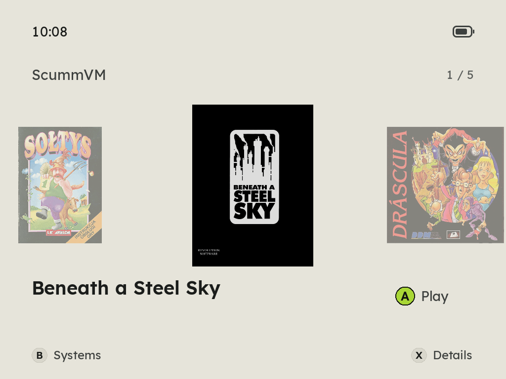

ScummVM games are folders: copy each game's folder, as it came, into `Roms/ScummVM`, and the shelf shows it under the folder's name. ScummVM works out which game it is from the files. A `.scummvm` file in the folder, holding the game's ScummVM ID (`sky` for Beneath a Steel Sky, `queen` for Flight of the Amazon Queen), names it for certain, for the rare folder ScummVM reads as more than one game. **A** clicks, **B** right-clicks and the d-pad moves the pointer (**R1** or **R2** held makes it slow); **Y** skips a cutscene, **START** opens ScummVM's menu, where the game saves and loads, and **SELECT** a keyboard. ScummVM has no save states, so save from that menu before you quit.

<br clear="right">

### J2ME

J2ME games are the `.jar` files of the Java phones. They run on FreeJ2ME-Plus, which brings its own Java: the first J2ME game you start unpacks it into `Bios/` (about 60 MB), which takes a little while once. A phone's keys are on the pad: the d-pad is its arrows, **A** its OK key, **SELECT** and **START** the left and right soft keys, **X** 0, **B** 7, **Y** 9, **L1** 1, **R1** 3, **L2** `*` and **R2** `#`.

### OpenBOR

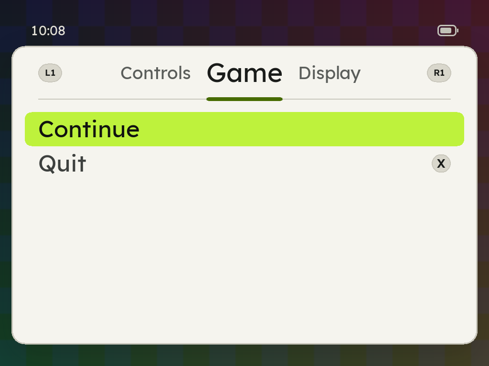

OpenBOR games are modules, one `.pak` file each, run by OpenBOR itself rather than a libretro core. A module that came as a folder has to be packed into a `.pak` first. The Pixel 2 only. Its buttons, and the in-game menu over it, are under [Controls and menus](#controls-and-menus).

<br clear="right">

### Saturn

Saturn games run on YabaSanshiro and need the Saturn's BIOS in `Bios/` (above). The Saturn is the most a Pixel 2 is asked to run: it runs some games, and not at full speed. Flicky's Flock, a homebrew game, ran at about 37 frames a second of 60; Virtua Fighter 2, in its high-resolution mode, at about a third of its speed.

The Saturn pad has six face buttons, A, B and C in a row with X, Y and Z over them, and L and R on top. Each face cap is the Saturn button it names (A, B, X, Y), **R1** is **C**, **L1** is **Z**, and L2 and R2 are the Saturn's L and R, as most Saturn emulators lay them out. In a game played on A, B and C, such as Virtua Fighter 2, the third one is on R1. The Controls tab in the game's menu changes any of them.

### PICO-8

PICO-8 carts are `.p8` files or `.p8.png` images. Copy them into `Roms/PICO-8`. They run on FAKE-08, an open reimplementation, so you don't need Lexaloffle's PICO-8.

**Your own PICO-8.** On the GKD Pixel 2, ZyperOS can also run the PICO-8 you bought from Lexaloffle. It plays every cart as PICO-8 does, and it adds **Splore**, PICO-8's online cart browser. ZyperOS never comes with PICO-8 and never downloads it: it is Lexaloffle's to sell, and you add your own copy. Every PICO-8 purchase includes the **PICO-8 for Raspberry Pi** download, `pico-8_<version>_raspi.zip` (0.2.7 is the newest). Only that zip has `pico8_64`, the build the handheld runs.

There are two ways to add it:

- **With ZyperOS Installer:** choose the zip in the installer's **PICO-8** group. **Update** and **Fresh install** add it with ZyperOS, and **Add PICO-8** adds it alone to a card that already has ZyperOS, with no password and no system write. The installer only reads the zip on your computer and copies two files to your card. It sends nothing anywhere and keeps no copy.
- **By hand:** copy the zip as it comes, or its two files `pico8_64` and `pico8.dat`, into `Bios/PICO-8` on the card (with File Transfer, Computer Connected, or the card in a computer). At the next start, or after **Rescan**, ZyperOS takes the two files out of the zip and says so. Another zip there, such as the Windows one, gets a message that says it is not the Raspberry Pi zip.

Once your PICO-8 is on the card:

- **Carts open in it.** MENU on the PICO-8 shelf, **Core**, goes back to fake08 and forward again. FAKE-08 keeps save states, Resume and Undo Load; PICO-8 has no save states.
- **Splore** is the PICO-8 shelf's first entry. It needs Wi-Fi to list and download carts. With Wi-Fi off, ZyperOS asks first: **Turn On Wi-Fi** joins your saved network, and **Open Offline** opens Splore with the carts it downloaded before. Its favourites stay in Splore.
- **A cart's own saves** (high scores, progress) are one set for both players, in `Saves/cdata`, so you can switch players and keep them. PICO-8's settings and Splore's downloads are in `Saves/PICO-8`.
- **The picture** follows the shelf's **Display** row, as FAKE-08's does: **Full Screen** fills the screen, **Original Shape** and **Square Pixels** fill its height (480 x 480), **Sharp Pixels** is three times PICO-8's 128 pixels (384 x 384), **Sharp Pixels, Zoomed** and **Fill, Edges Cut** fill its width and cut the top and the bottom, and **Actual Size** is 128 x 128. Until you pick a mode, your PICO-8 plays at **Original Shape**. **MENU** in a cart has **Display** too: a new mode starts the cart again (play since its last save is lost), so ZyperOS asks first. **On-Screen Stats** there shows the frames a second and the rest of its line over PICO-8, and the low-battery dot shows as over any game.
- **Its buttons:** the d-pad is PICO-8's arrows, **B** its O button, **A** its X button, and **START** its own pause menu (its **shutdown** ends it). **MENU** opens ZyperOS's menu over it, and **X** there quits. **MENU+START** held for a second goes back home, even when PICO-8 stops answering. The volume keys and **MENU+VOL** work as in any game, and **POWER** ends PICO-8 before the handheld turns off.
- **Your own buttons:** **MENU**, **Controls** over it gives each button what you choose, for this cart or every PICO-8 cart, as in any game. PICO-8 takes new buttons only as it starts, so ZyperOS asks to start it again: **Start Again** does it now (play since the cart last saved is lost), **Cancel** keeps them for the next start.
- **Reset:** **MENU**, **Reset** starts the cart again, after a question.
- **Hotkeys:** the ones you set (SELECT and a button, in **MENU** > **System** > **Hotkeys** or **Controls** > **Hotkeys**) work over it too: **Screenshot** saves PICO-8's own 128 x 128 picture in `Screenshots/PICO-8`, and **Reset Game**, **Quit**, **Next Shader** and **Next Display** do what they do in a game. Quick Save, Quick Load, Faster and Slower do nothing, as PICO-8 has no save states. As in a game, the cart never sees a hotkey's buttons; SELECT alone still reaches it.
- **Auto Off** turns the handheld off after its time with no button pressed, as in a game (not on the charger). Play since the cart last saved is lost.

Before your PICO-8 is on the card, Splore shows **Not installed**, and **A** opens a page that says how to add it. The TrimUI Brick gets your own PICO-8 together with its ports ([the Brick](#the-trimui-brick)); until then its PICO-8 shelf plays on FAKE-08.

### PSP

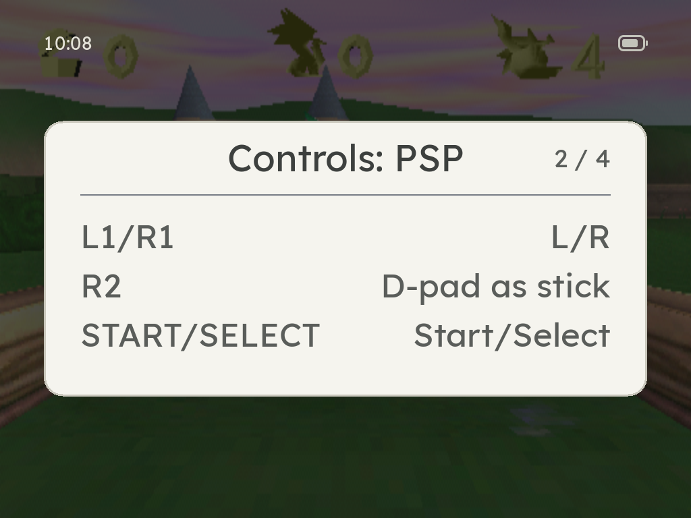

PSP games run on PPSSPP, with no BIOS: copy the `.iso`, `.cso`, `.chd` or `.pbp` into `Roms/PSP`. ZyperOS ships PPSSPP's own files, the PSP's fonts among them, and puts them in `Bios/PPSSPP`. The PSP's buttons are where a PlayStation pad has them, **L1** and **R1** its L and R. The Pixel 2 has no analog stick, and a PSP game moves with its stick or with its d-pad, game by game. A game starts with the d-pad as the d-pad; **R2** turns it into the analog stick, and **R2** again turns it back; **D-pad as Stick** in the in-game menu's Controls tab does the same. ZyperOS remembers this for each game, so a game you play with the stick starts with it the next time. A game's own saves are in `Saves/PSP/SAVEDATA`, as on a PSP's memory stick, so saves from PPSSPP on another system copy straight in. PPSSPP runs at the PSP's own 480x272 and draws every frame. A heavy 3D game can still run slower than a real PSP on the Pixel 2.

<br clear="right">

### Doom

Doom games are WADs, run by PrBoom. An IWAD is a whole game: `doom.wad`, `doom2.wad`, `tnt.wad` and `plutonia.wad` from id Software's games, or `freedoom1.wad` and `freedoom2.wad` from [Freedoom](https://freedoom.github.io), which are free. A mod is a PWAD: put it beside its IWAD, and it runs with the first IWAD it finds there, Doom II's first. For a mod that wants another IWAD, or several mods at once, write an `.m3u` that lists the IWAD and then the mods, one file a line. The d-pad walks and turns, **B** fires, **A** opens doors and presses switches, **L1** and **R1** step sideways, **L2** and **R2** change the weapon, **SELECT** shows the map and **START** opens Doom's menu. You run all the time, and the d-pad turns as fast as the original game's keyboard does; hold **Y** to walk. The handheld rumbles, softly, when you fire and when you are hit. **Quit Game** in Doom's menu quits to the shelf, as the in-game menu's Quit does. Save states work inside a level. PrBoom's own settings: ZyperOS keeps its base ones in `Bios/prboom/prboom.cfg`; put a `prboom.cfg` of your own in `Roms/Doom` for every Doom game, or `<game>.prboom.cfg` for one, and the core saves what you change in its menus to `Saves/<game>/prboom.cfg`.

### ColecoVision

ColecoVision games run on Gearcoleco and need its BIOS (above). **B** and **A** are the controller's left and right buttons. Its keypad is on the rest: **Y** 1, **X** 2, **L1** 3, **R1** 4, **L2** 5, **R2** 6, **START** `*` and **SELECT** `#`. A game's menu asks for 1 to 4 for a one-player game.

### SG-1000

SG-1000 games are `.sg` files and run on Genesis Plus GX, the Master System's core. **B** and **A** are the controller's buttons 1 and 2, **Y** and **X** press them for you as turbo, and **START** is the console's PAUSE button.

### TIC-80

TIC-80 carts are `.tic` files, or `.png` cart images, and run on TIC-80's own core, in any of its languages: Lua, MoonScript, Fennel, JavaScript, Python, Wren, Squirrel, Janet, Scheme or WebAssembly. A cart's saved data is kept, but TIC-80 has no save states.

### Dreamcast

Dreamcast games run on flycast2021, the 2021 libretro [Flycast](https://github.com/flyinghead/flycast), drawn on the GPU inside the emulator, with saves, states and resume like any other system. Standalone Flycast is the second choice if you add it.


## Controls and menus

| | |
|---|---|
| **Left/Right** | move left or right along the shelf |
| **Up/Down** | jump to the previous or next initial on the games shelf. On a shelf shown as a list (MENU > View), Up and Down step along it and Left and Right jump an initial; in the grid, Up and Down move a row and stop at the top and bottom |
| **L1/R1** | jump three systems on the systems row, a screenful on a games shelf, coming round at the ends. In the grid, a screenful or to the last game, then round to the first |
| **L2/R2** | the previous / next song on the systems row and a games shelf: MP4's while it plays (a book's chapter, as L1/R1 in MP4), else the menu music's. Zyper pops up with its name |
| **A** | open a system, a folder of games, or start a game |
| **B** | up one folder of games, or back to the systems row from a shelf's top |
| **X** | game info for the card under the cursor |
| **Y** | start the game from the start, without its resume point, when it has one. In a game's details (X), Y favorites it - Favorites is a shelf of its own. Nothing on MP4's shelf |
| **START** | on a games shelf: the row of covers turns into the grid, the grid into a list of names, and the list back into covers. It is MENU > View's setting, kept for each shelf. Nothing on MP4's shelf. On the home: Spotlight turns into Gallery, Gallery into Grid, and Grid back into Spotlight, MENU > Home Screen's setting |
| **Volume rocker** | volume, everywhere, including in game |
| **F1/F2** | brightness, everywhere, including in game |
| **MENU** (on the systems row) | the ZyperOS menu - settings that are about the firmware |
| **MENU** (inside a system) | that system's menu, below |
| **MENU** (in game) | the in-game menu, in four tabs that L1 and R1 go round: **Game** (Continue, Save, Load, Undo Load after a load, Quick Slot, Disc in a game on more than one disc, Player 2 in an NES game on the Pixel 2, Achievements, Reset, Quit), **Display** (Display, Shader, Strength while the shader is an old screen, a DS game's Screens, Swap Screens and Stylus, and On-Screen Stats), **Controls** (what each button does, Pak in a Nintendo 64 game) and **Achievements** (the game's list, A opening one, or why it has none; A on the Game tab's Achievements row turns to it). See **Changing a button** below and **Player 2**. It opens when you let go, so MENU can be held for brightness, and it opens on the tab and row you left while you play the same game |
| **X** (in the in-game menu) | Quit, from any row of any tab: the game ends and the shelf comes back, as A on Quit does. The Quit row shows the X button to remind you |
| **SELECT+R1** (in game) | quick save: a state into the Quick Slot |
| **SELECT+L1** (in game) | quick load: the state in the Quick Slot |
| **SELECT+R2** (in game) | faster: 1.5x, 2x, 3x |
| **SELECT+L2** (in game) | slower, a step a press, back to normal speed |
| **SELECT + a button you choose** (in game) | your own hotkeys: Screenshot, Next Shader, Next Display, Reset Game and Quit, none until you set them in **Hotkeys** (below) |
| **MENU** (inside any menu) | closes the whole menu, however deep in it you are. B goes back one screen |
| **SELECT** | MP4, the music, audiobook and video player, from anywhere but a running game - the in-game menu included. Again to close it |
| **POWER** | powers off. In a game, the game is saved first, and the next start goes straight back into it. After a crash or a power cut, the next start is the home instead. With **MENU > Power Button** on **Hold**, POWER has to be held for a second, and a press alone does nothing: a bar at the top of the screen fills while it is held, on the home, in a game and over a port |

**On the Pixel 2:**

| | |
|---|---|
| **MENU** (the FUNCTION key) | opens the menu when it is let go, and works as a modifier when held |
| **MENU+VOL** | brighter / dimmer (VOL+ / VOL-), everywhere, including in game: the Pixel 2 has no brightness keys of its own |
| **MENU+START**, held a second | the way out of anything: whatever runs ends (a game, saved as POWER saves it; a port; a screen that stopped answering) and the home comes back. Use it when a game or a port will not let you out |
| **L2+R2** (outside a game) | flash the battery level on the side lights, below. L2 or R2 alone is the menu music's song, and acts as it is let go, so the pair never changes the song |

**The Pixel 2's four side lights** show the battery, and a few things worth a
glance:

| | |
|---|---|
| **charging** | a bar fills up from the bottom, starting from a light for each full quarter it already has: at 50% the bottom two stay lit and the other two fill in. A full battery holds all four, still, and so does a battery held at the **Charge Limit**, at its level |
| **below 10%**, on the battery | the bottom light flashes red every five seconds; below 5%, twice every two seconds |
| **volume or brightness** changing | the level, in eight steps: each light is two, and a blinking light is a half. Volume at 0 is the bottom light red |
| **files moving**, in Flash Drive and on File Transfer's page | a wave fills the four lights and empties them: from the top down while files come in to the card, from the bottom up while they go out. It moves faster for a faster transfer; with both ways moving, it shows the way that moves more |
| **files or covers done** | a light climbs the four twice when a File Transfer batch is in, or the Scraper finishes |
| **an achievement** | a sparkle: two pairs of lights take turns |
| **L2+R2** (outside a game) | the level, flashed four times: all four lights at 75% and up, three at 50, two at 25, one at 10, the bottom light red below that |
| **Battery Level**, if you turn it on | the same level, held still, off the cable (and on it with Charging Bar off), on the home and in games. Everything above shows over it, then it comes back; below 10% the red flash says it instead |
| **the rest of the time** | dark |

MENU > Side Lights turns the first six on or off: one switch each, and one,
Files and Covers, for files moving and files or covers done; and Battery
Level, which is off until you turn it on. The red flash shows through
everything else; L2+R2 flashes the level whatever is chosen. The lights are
on or off, with nothing between, so there is no brightness to set.

MENU means three different menus depending on where you are, and each one is
about the thing you are looking at: the firmware on the systems row, one
console inside it, the running game in a game. Inside any of them MENU closes
the whole menu at once - from Play Time or Wi-Fi straight back to where you
were, or back into the game - and B goes back one screen at a time.

**MENU is in six tabs:** Games, Display, Sound, Connections, System and About,
with **L1** and **R1** going round them. MENU opens on the tab you left it on,
and every list goes round: Down on the last row goes to the first, and a long
list carries on past its end, while a held button stops at the end.

**Search Games and Random Game.** **MENU > Search Games** finds any game by a
few letters of its name, on any system. **Random Game** picks one and starts
it, from every system in MENU or from one shelf in that system's menu.

**MENU > Controls** lists the buttons on six pages, each drawn as your
handheld prints it (the Pixel 2's round SE and ST keys, the Brick's square and
play keys), with "+" for buttons held together and "," for one press after the
other.
Left and right change the page, and the top right of each says which it is, "2 / 6". The pages cover movement, the shelf, games, hotkeys, MP4, and common controls.
The shelf always runs horizontally.

**Changing a button.** The in-game menu's **Controls** tab (MENU in a game, then
R1 twice from Game, or L1 once) lists the Pixel 2's buttons one by one: A, B,
X, Y, L1, R1, L2, R2, START and SELECT. The Pixel 2 is drawn beside the rows,
and it lights the button the row is about, so you do not have to guess which
cap "R2" is. Each row says what that button does in this game, in the game
system's own words: on a PlayStation game the faces are the cross, circle,
triangle and square.

- **Left and Right** step through what the button can do: any button the
  system has, then a turbo of each face button, then Nothing. **A** opens the
  same choices as a list, with a tick on what it does now and "default" beside
  what ZyperOS gives it. A on a choice takes it, and B goes back with no change.
- **Giving a button what another already does swaps them.** Make Y the
  PlayStation's cross and B becomes the square, so nothing is lost by accident.
  A turbo and Nothing never swap: Y can be a turbo cross while B stays a cross.
- **A game button left with no button** gets a quiet row under the button that
  caused it, "Cross has no button now". A turbo of it counts as a button.
- **A value that differs from its default** is drawn in the accent color.
- **It works at once.** Press Continue and the game plays with the new buttons.
  MENU, SELECT with a shoulder, the volume keys and POWER cannot be changed, and
  the hotkeys stay where they are whatever you set.

**One game or a whole system.** **Applies To**, the tab's first row, is **This
Game** or the system by name ("PlayStation"). Changes under **This Game** are
kept for that game alone, and then it keeps its own buttons: a change to the
system's later does not reach it. Changes under the system's name reach every
game of it that has no buttons of its own, from its next start, and this one
at once. Both are kept on the card. A game with buttons of its own shows
**Applies To** in the accent color, and **Buttons: This Game** on its details
page on the shelf (X on the game); A on that row opens the same list, to change
buttons for the next start. Undoing a change, so the buttons are back to the
default, takes its mark away too. **Reset Buttons**, near the end of the tab, is
live when what shows differs from its default; it asks first, and puts back the
game's buttons, or ZyperOS's for every game of the system. Rename and Delete
Game take a game's buttons with them.

**The d-pad as the stick.** The Pixel 2 has no analog stick, and some games
need one. **D-pad as Stick**, On or Off for each game, makes the d-pad the
left stick in Nintendo 64 games (On to start with), Dreamcast, PlayStation and
PSP games. In a Nintendo 64 or Dreamcast game, SELECT then the d-pad is the
system's own d-pad (the tab's SELECT row says "C buttons" or "Held: D-pad"). On
the PSP, R2 in the game turns it on and off, and the row agrees. A
PlayStation game moves with the stick only in the pad's analog mode, which many
games turn on themselves.

On those four systems any button but SELECT can turn the d-pad too: give it
**Stick On/Off**, and each press turns the d-pad into the stick and back (a
pop-up says which, and the game keeps it), or **Stick While Held**, and the
d-pad is the stick while you hold the button and the d-pad again when you let
go (with D-pad as Stick on, the other way round). They are the last two of a
button's choices. The PSP's R2 is Stick On/Off from the start; give it to
another button, or make R2 something else.

**Two buttons on one game button.** Giving a button what another button
gives swaps the two, so nothing is lost by accident. To have both, open the
button's list with A, move to the choice the other button gives, and press
**Y** instead of A: the foot of the list says what each key does. Both rows
then show the other button's small glyph after the value, and the handheld
lights both. Give either row something else to undo it.

**Face Buttons** (Dreamcast, Saturn and Neo Geo Pocket games) swaps all four
faces at once: **By Letter**, each cap gives the button it names, or **By
Place**, each cap gives the button in its place on the original pad. It reads
Mixed after a change to one face.

**Hotkeys.** Every hotkey is SELECT held and one more button, and you choose
which: **MENU > System > Hotkeys** for every game, or the Controls tab's
**Hotkeys** row in a game, where **Applies To** says This Game, the system or
Every Game, as Changing a button does. Each row is an action and its buttons:
**Quick Save** (SELECT+R1 to start with), **Quick Load** (SELECT+L1),
**Faster** (SELECT+R2), **Slower** (SELECT+L2), and five that do nothing
until you give them buttons: **Screenshot**, **Next Shader**, **Next
Display**, **Reset Game** and **Quit**. Press A on a row, hold SELECT, press
the button you want, and let go. If those buttons already do something else,
ZyperOS asks whether to swap the two. Reset Game pauses and asks first, since
a reset loses what you played since your last save. Quit leaves at once, and
the game resumes where you left it next time. **Reset Hotkeys** puts them
back. MENU+START, the way home, and POWER never change.

A **screenshot** is the game's own picture, saved as a PNG in
`Screenshots/<system>/` on the card, named after the game and the time; a
pop-up shows it small, and the home's **Screenshots** group has it (see
[Screenshots](#screenshots)). **Next Shader** and **Next Display** turn on the
system's next shader or display mode and say which.

The Hotkeys list's last row in a game, **All Controls**, opens what you could
always read here: what a system adds (the Nintendo 64's C buttons, hold
SELECT and press X, A, B or Y, and which Pak is in; a DS game's two screens
and the stylus), then your hotkeys, and under them "SELECT alone stays the
game's", then the last page, In a game: MENU, MENU then X (Quit), volume,
brightness and POWER. Left and right change the page, B goes back, and MENU
goes back to the game.

**OpenBOR has the in-game menu too**, though it runs as a program of its
own rather than a libretro core. MENU stops the game where it is and opens
the menu over it with three rows: Continue, Controls and Quit. Controls lists
OpenBOR's buttons (A attacks, B jumps, X is the second attack, Y the special,
L1 and R1 the third and fourth, START pauses into OpenBOR's own menu, SELECT
saves a screenshot) and then In a game, where POWER quits and turns the
handheld off. OpenBOR keeps its own saves and has no save states, so there is
no Save, Load or Reset. Quit ends the game and goes back to the shelf, and X
does the same from any row, as in every in-game menu.
The standalone Flycast, when a card has it for the Dreamcast, gets the same
three rows. Its buttons are set in its own menus, so Controls there has only
the In a game page.

**About ZyperOS has two pages**, changed with Left/Right. The first shows the
version, network address, battery charge and awake time. The second shows the
card's used, available and total storage in decimal GB, then estimated battery
health, full-charge capacity and design capacity in mAh. Health is the battery
controller's full-charge capacity divided by its design capacity, rounded and
capped at 100%. It is an estimate, not an independent battery-wear measurement.
A device that does not report the capacities shows "unknown" instead. The page
refreshes its storage and capacity readings every two seconds; the charge state
uses the status corner's shared fast cache. About also tells the story of the name beside a photo of Zyper ([the name](../README.md#the-name)), and thanks the projects ZyperOS is built on ([credits](../README.md#credits)).

The ZyperOS menu opens from the systems row and is about the device rather
than any one console:

| | |
|---|---|
| **Play Time** | per game or per system, by day, week, month, year or all time |
| **Wi-Fi** | the network's name when connected, or why it is not |
| **Bluetooth** | the connected headset, or `Not connected` - pair, connect and forget |
| **Audio Output** | `Auto` or `Speaker`, and where Auto landed - see **Audio** below |
| **Audio Channels** | `Auto`, `Stereo`, `Mono`, `Mono left` or `Mono right` - see **Audio** below. `Auto` on a new device and after an upgrade |
| **Equalizer** | the preset of the output in use, `Off` on a new card; **A** opens its page: the speaker's or the headphones' preset and five bands - see [Equalizer](#equalizer) |
| **Rumble** | the Pixel 2: `Off`, `Low`, `Medium` or `Full` for every game, each step felt as you choose it - see [Rumble](#rumble). `Full` on a new card |
| **Wi-Fi File Transfer** | the file server; needs Wi-Fi and says so when there is none. On the Pixel 2 with no network it says `Hotspot`, and makes the handheld its own network for a phone to join - see below. While a computer is on the USB cable it is **USB File Transfer** instead, at `http://zyperos.local`, or always at `10.55.0.2` on the Brick and `10.42.0.1` on the Pixel 2 |
| **Date & Time** | the clock and the time zone, set with left and right - see below |
| **Clock** | `12-hour` or `24-hour`, for the clock on the shelf and here. `12-hour` on a new device |
| **Auto Off** | how long without a button before the device powers itself down. It waits while a long job runs (a scraper run, a System Update download, PortMaster's install, Storage measuring the card, files moving over File Transfer) and counts again from the start when the job ends. On the charger it does not power down; on the shelf the screen goes off instead, and any button (power too) lights it again. On USB File Transfer the screen goes off when nothing is moving, and only dims while files are on their way; a button, a browser coming to the page or files starting to move light it fully, and files keep moving while it is dark |
| **Screensaver** | `Off`, `30s`, `1m`, `2m`, `5m` or `10m` with nothing pressed on the shelf before the video snaps of random games play over the whole screen, each with its game's name and system. START boots the game on screen; any other button goes back. `1m` on a new device. It never starts in a game, a menu, MP4 or File Transfer, while music plays or a long job runs, or under 20% on battery; on battery it ends by itself after 10 minutes, and Auto Off still powers the device off at its own time. With no video snaps on the card it shows covers instead, and with neither, nothing - see **Screensaver** below |
| **Side Lights** | the Pixel 2 only: a page of switches for what the side lights show on their own, `Charging Bar`, `Low Battery`, `Volume and Brightness`, `Files and Covers` and `Achievements`, each `On` or `Off`, and the row under the cursor plays its pattern on the lights; the row says how many are on. L2+R2 shows the level in all four. `All on` on a new device |
| **System Order** | the home's systems `A to Z` by name, on a new device and after an upgrade, or by `Release Date`. Favorites stays first, then Recents, and Ports and MP4 stay last |
| **Home Systems** | which shelves the home shows: `All`, or how many are on. A opens a switch for Favorites, Recents (the ten games played last), Collections (once you have one), Screenshots (once you have one) and every system with games; Left, Right or A turns one on or off. A hidden system leaves the home, Random Game and Search; its games stay on Favorites, Recents, Collections and the card. The last system on stays on |
| **Appearance** | `Light`, `Dark` or `Auto`, which is dark in Night Mode's hours (**Night From** to **Until**, 9:00 PM to 7:00 AM to start) and light the rest of the day. `Light` on a new device. A handheld that had `Auto` in 1.0.5 keeps it, on the hours it had; one that 1.0.6 turned to `Light` or `Dark` keeps that - see [Light and dark](#light-and-dark) |
| **Theme** | your look, in Display: **Accent** (ten colors, the same in both themes), **Light Background** and **Dark Background** (three tones each), **Folder Color**, **Corners** (`Rounded` or `Square`), **Highlight**, **Zyper** (`On` or `Off`) and **Reset to Default**. Left and right change a row at once; A opens its list, where the whole screen shows the choice under the cursor and B puts back what you had. **Folder Color** is the color of the folders of games on the shelves and of the consoles' folders on the File Transfer page: `System Colors`, each folder in its own system's color, or one of the ten accents for every folder. Its list shows three folders in the color under the cursor. **Highlight** is how the game or system in focus is marked on the home and the shelves: `Bar` (it grows a little, a short bar under it), `Border` (a ring in the accent round it), `Lift` (it rises on a soft shadow) or `None` (it grows, nothing else); in each, the others step back a little. Its list shows three of your systems marked that way. Menus keep their highlight bar whatever it says. `Lime`, `Warm`, `Black`, `System Colors`, `Rounded`, `Bar` and Zyper `On` on a new device and after an upgrade |
| **Scraper** | box art, its sources and video snaps - see below. Its value is how many games have no cover, or `Complete` |
| **Achievements** | the RetroAchievements account, or `Sign in`. **A** opens its page, which downloads every game's achievements for offline play - see **Achievements** below |
| **Shader** | `Off`, `CRT`, `CRT Curved`, `Scanlines` or `LCD Grid` for ZyperOS's own screens: the home, the shelves, the menus and every screen while no game is on. A opens the list, and the choice under the cursor shows on the whole screen until you choose. Each system's games keep their own shader, set in the system's menu or in a game. `Off` on a new device and after an upgrade. Not on the Brick - see **Shaders** below |
| **Strength** | right under Shader while it is an old screen: `10%` to `100%`, how dark its lines and grid are on ZyperOS's screens. Left and right step it 10% at a time and stop at the ends. `100%` on a new device and after an upgrade |
| **Controls** | every button and what it does, a page per place |
| **Show Tutorial** | the tutorial a new handheld starts with, again - see [The first start](#the-first-start) |
| **Developer Mode** | development images on the Pixel 2 only: `On` keeps the USB link to a computer always up, `Off` asks when one is plugged in - see **Plugging into a computer** |
| **About ZyperOS** | two pages: version, address, charge and uptime; then storage and estimated battery health |

The Pixel 2 has no radio, so the rows that need Wi-Fi show only while a
USB Wi-Fi adapter is plugged in: Wi-Fi and Wi-Fi File Transfer here (USB
File Transfer stays, with a computer on the cable), and Album Art in MP4's.
Downloads stays, here and in a console's menu: its download says it needs
Wi-Fi, and its counts, Systems and accounts need none. Bluetooth is never
there. A phone's USB tethering is internet too (see **File transfer**):
while it is on, Album Art is back, and Downloads' download works.

### Downloads

MENU > **Downloads** is every download of game data in one place: covers,
video snaps, names and details, and achievements. It is a page of its own,
with Zyper beside its heading; under the heading, about how long a download
takes (`about 12 min`), `Needs Wi-Fi`, or `Everything is here`. The page
draws at once and says `Counting…` while it looks at the card, a system at a
time; the next time it opens it shows what it counted and counts again
behind it.

| Row | What it is |
|---|---|
| **Download** | first, so **A**, **A** from MENU gets everything: every kind that is in it, the servers at the same time. Its value says how much and how long (`186 MB · about 12 min`), `Nothing to fetch`, `Needs Wi-Fi`, or how far a download has got (`Downloading · 41%`); over the keys, what it adds and what the card has (`186 MB to fetch · 11.2 GB free`), in red when the card would keep less than 200 MB, and then **A** says `Not enough room on the card` |
| **Covers**, **Videos**, **Names and Details**, **Achievements**, **Cheats** | each kind with its mark and what is still missing (`41 missing`, `63 to fetch`, `199 to look up`, `150 to download`, `640 to check`), `Complete`, `Ready offline`, `Off`, `Needs ScreenScraper` or `Sign in first`. **LEFT** and **RIGHT** take a kind in or out of **Download**, and its size and time change at once. Over the keys, where it comes from and its room on the card. **A** opens the kind's own page, below |
| **Y** Systems | a table: a row per system, a column per kind. A cell says what is missing, a tick when nothing is, or a dash when it is off for that system. **A** switches the cell, **X** deletes its videos or achievement sets (after a question), **Y** opens the system's games |
| **START** Settings | **ScreenScraper**, **RetroAchievements** and **SteamGridDB**, each with its account; **Video Snaps**; **Names and Details** (`On` or `Off`, the same as its row); and **On the Card**, each kind's room, where **A** deletes every video snap or every achievement set, after a question |

Every kind is in **Download** to start, but each system's videos stay off
until you switch them on (a snap is a megabyte or three), and achievements
need a RetroAchievements sign-in.

**Cheats** come from libretro's cheat list (libretro-database, CC BY-SA 4.0):
a download reads the list's index once (about 4 MB) and then takes only the
files of the games on your card, a few KB each, so the game's Cheats list
has them with no network. Your own `.cht` file in `Cheats/<console>/` is never
replaced. libretro rebuilds its list every day; **Download** looks for
changes once a day and takes again only the games whose files changed. On the
Card deletes the downloaded cheats; your own files stay, and cheats that were
on turn off.

**A kind's page** has each system's icon over a tick, lit when the system
lacks nothing (dim when its switch is off), and two tiles: what the card
has, and what a download adds. **A** downloads that kind alone. Videos' page
has **X** Videos For: **All Games**, **Favorites** or **Played**, for every
system with videos on, each with how many and how much. **Achievements**
opens its own page, below.

**A system's games** (**Y** on Systems) lists them with a mark per kind:
lit when the card has it, dim when it does not, struck through when
RetroAchievements has nothing for the game. Under the list, what the game
under the cursor has and lacks. **A** opens the game's panel: its cover,
video, names and achievements, each with its value. **A** on the cover or the
video opens its **Cover and Video** page; **A** on the names or the
achievements gets them, and **Get What's Missing** gets everything it lacks,
one after another, each value turning as its file lands.

**The download** shows one stream: the game it is asking about beside Zyper,
its system, its kind and its source, a bar and how far (`214 / 573`). What
came last lands big, the six before it move along, each with its kind's mark
(a set has its count). Over the keys, how many of each kind came and the time
left, or why it waits: `Waiting for Wi-Fi`, or `RetroAchievements asked for a
pause · 0:42`. **B** continues in the background; **Y** stops. Then **All
done** (or **Stopped**, and why): what came, as a wall, the counts, and **A**
again for what is missing.

A console's own menu has **Downloads** where Box Art was: the same page for
that console alone, its name as the heading.

### Where covers, names and videos come from

A download gets every system's covers first, then the names, years and synopses
of games that already have a cover but no name, unless **Names and Details**
is off: then a run fetches only what is missing, the covers and the videos. It asks ScreenScraper first when it is
linked, libretro right after each game ScreenScraper does not have, and
SteamGridDB last. A game ScreenScraper does not know is not asked about
again for 30 days.

| In Downloads' Settings | What it is |
|---|---|
| **ScreenScraper** | its account, `Link`, or `Not in this build`. Its page links the account (user, then password, checked once), says how many requests are left today, and unlinks it. It brings covers with each game's year, genre and synopsis, and the video snaps. A build needs ScreenScraper's developer pair for any of it |
| **RetroAchievements** | its account, or `Sign in`. Its page signs in again or signs out, after a question: what you earned stays on your account, and unlocks still waiting are kept for your next sign-in |
| **SteamGridDB** | the API key as its last four characters (`••••1a2b`), `Key refused`, or `Link`. Its page types a key in, checks it once, and unlinks it; the File Transfer page takes one pasted. Covers the other two do not have |
| **Video Snaps** | the Video Snaps page, below |
| **Names and Details** | `On` to start: a run also looks up the names, years and synopses of games that have a cover and no name, one ScreenScraper request each. Covers that came by File Transfer or from libretro have none, so on a card full of them that is the long part of a run. `Off` skips it; **A** switches it |

libretro needs no account: covers by file name, and for zipped games by
checksum.

**Video Snaps** are a few seconds of a game's own screen, from ScreenScraper.
After three seconds on a game, its cover turns wide into its snap, which loops;
it goes back to the cover when the focus moves or a menu opens. Its page:

| Row | What it is |
|---|---|
| **Play on the Shelf** | `On` to start |
| **Sound** | `Muted` (to start), `Quiet` or `Full`. Never over music playing in MP4; Menu Music dips under it |
| each console | `On` or `Off`: whether that console's snaps play on the shelf, and the room they take |
| **Delete All** | deletes every snap, after a question |

A snap is `Roms/<console>/.media/<name>.mp4`, beside its cover, so one put
there by hand plays too.

**A download goes on behind the menus.** **B** on a download closes the
page and it goes on: the corner by the battery shows an arrow into a tray in
a ring that fills as it goes, and MENU's Downloads row says how far. Open
the page again to see it where it is, or how it ended. While you play a game
it waits, and it goes on when you leave the game. When it ends well behind
the screens, Zyper says so on the shelf (`Downloads done`, `41 covers · 150
achievement sets`). Powering off stops it; the next one starts from what is
missing.

**Auto Off waits for a download.** While a download, from MENU or a
console's menu, is fetching, Auto Off does not count, so a library left to
scrape overnight is not cut short; the count starts again, whole, when the run
ends. The power button still powers the device off, and so does the battery
running flat. System Update's download, PortMaster's install, Storage
measuring the card and files moving over File Transfer wait the same way.

For what neither has, like homebrew, hacks and ports, give it a free [SteamGridDB](https://www.steamgriddb.com) API key (steamgriddb.com, Preferences, API) in **MENU > Downloads > Settings**, or paste the key on the File Transfer page, which beats typing 32 characters. A run then asks SteamGridDB last, for a portrait cover by the game's name. The key stays on the card's settings and shows only its last four characters.

**Your own covers.** Some games aren't in any collection, like fan translations. Add your own: a PNG named exactly like the game file, in `Roms/<console>/.media/`. `Black Castle.gb` wants `Black Castle.png`. Around 512 pixels on the long side is plenty.

Covers go over USB or Wi-Fi File Transfer too: drag a console's `.media` folder onto that console's folder on the page, and its covers land in the card's `.media` (Cmd-Shift-. shows hidden folders in Finder). Safari leaves hidden folders out of a folder it sends, so a whole console's folder sent from Safari arrives without its covers: send its `.media` folder on its own. The litter a Mac leaves, `.DS_Store` and `._` files, always stays behind.

### Achievements

Sign in under **MENU > Downloads > Settings > RetroAchievements** with your RetroAchievements account. A game's first start needs Wi-Fi, to identify the game and fetch its achievements. From then on it plays offline too: what you unlock without Wi-Fi shows at once, with its notice and Zyper, and waits on the card. When the handheld is on Wi-Fi again, on the shelf, the waiting unlocks go to your account by themselves, and Zyper says how many went. Each one is dated when you earned it, up to 14 days back, the most RetroAchievements takes.

While some wait, the game's list says how many under its name, and an achievement opened with A says "earned, not sent yet". A game you have never played with Wi-Fi says "not checked yet" on its Achievements row, and A on the row says how it gets its achievements. A game ZyperOS cannot identify says so instead, with or without Wi-Fi: "not for this system" for systems whose games are all discs it has no reader for (Sega CD, Saturn, 3DO, Neo Geo CD), and "not for this file" for a kind of file it cannot read where another works, like a PlayStation `.ccd` (a `.cue` and `.bin` gets its achievements). Offline unlocks are softcore, the only mode ZyperOS plays.

**MENU > Downloads > Achievements** gets them for every game at once, ahead of time, so a game you first play on a plane has its achievements too.

| On the page | What it is |
|---|---|
| the systems | each system's icon over a tick, lit when every game of it has been checked |
| **Ready Offline** | the games whose achievements are on the card, and on how many systems |
| **To Download** | the games never checked, and about how much they will add to the card (`+14 MB`); `all checked` when there are none |
| under the heading | about how long a download takes (`about 3 min`), `Every game checked`, `Sign in to download`, or `Needs Wi-Fi` |
| over the keys | what a download will add (with the card's room when it has less than 2 GB free) and how many games RetroAchievements has nothing for (`23 games have none`: a hack, a copy it does not know, or a game with no achievements) |
| **A** Download | asks RetroAchievements about every game: the game it is asking about, its system and how many games it has looked at (`214 / 553`). Each set that arrives shows with its badges (`Just added: ...`). **B** continues in the background, **Y** stops. Then **All done**: the games ready offline and the achievements your account already had for them; or **Stopped**, with why; or **Sign in again** when RetroAchievements refused the account, and **A** signs in |
| **Y** Account | signs in again, or as somebody else. Signed out, **A** signs in |

A download asks only what is missing. A game whose achievements are already
on the card is checked against RetroAchievements' count, and fetched again
only when its set changed there; the achievements your account already has
come along, so a game shows them as earned offline too. The first download
reads each new game once to tell which game it is (a big PSP `.pbp` takes a
while); later ones read only files that are new or changed. It keeps to
RetroAchievements' pace, one request at a time; if RetroAchievements asks for
a pause, the page says so and counts it down. If Wi-Fi drops, the page says
`Waiting for Wi-Fi` and goes on by itself when it is back; stopped any other
way, the next download picks up where it left off. Auto Off waits for it, as
for a Scraper run.

In a game, **MENU** has an **Achievements** tab, one **L1** from Game: the game's list with your count and points on top, each achievement with its badge, its points (or its count while it moves) and, once you have it, the earned color. **A** opens one, and the list goes round. A game with no list says why there: not signed in, never played with Wi-Fi, on their way, none on RetroAchievements, or a system or kind of file ZyperOS cannot identify. The Game tab's Achievements row keeps the count, and **A** on it turns to the tab.

**Which files.** A PlayStation game is identified by its boot program on the disc, as RetroAchievements does, so a `.cue` and `.bin`, an `.iso`, a `.chd`, a `.pbp` (PSone Classics, its first disc) and an `.m3u` (its first disc) of the same game get the same achievements. A PSP game is identified by its `PARAM.SFO` and `EBOOT.BIN`, from an `.iso`, a `.cso` or a `.chd` alike; a PSP `.pbp` (a PSN game) is identified by the whole file, as RetroAchievements does. A Dreamcast game is identified by its `IP.BIN` and the boot program it names, from a `.gdi`, a `.cue`, a `.chd` or a `.cdi` alike. ZyperOS reads only the part of the disc it needs, never the whole image, except a PSP `.pbp`, which it reads once, in the background, the first time you play it with Wi-Fi. A CHD made with zstd (`chdman -c cdzs`) can't be read yet; chdman's usual CHD (`createcd`, `createdvd`) can.

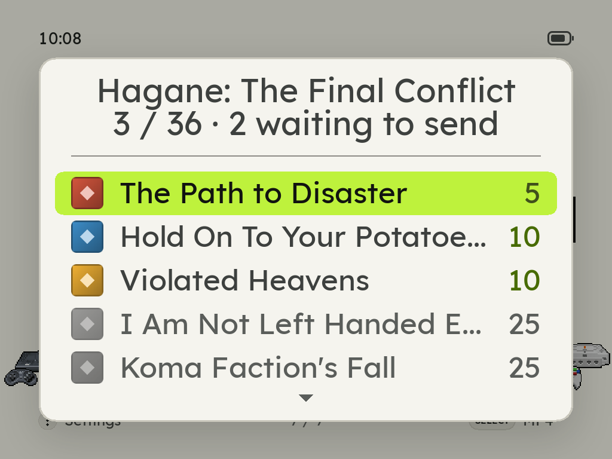

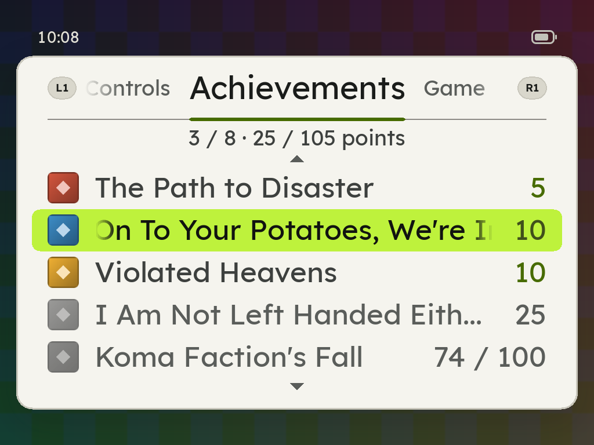

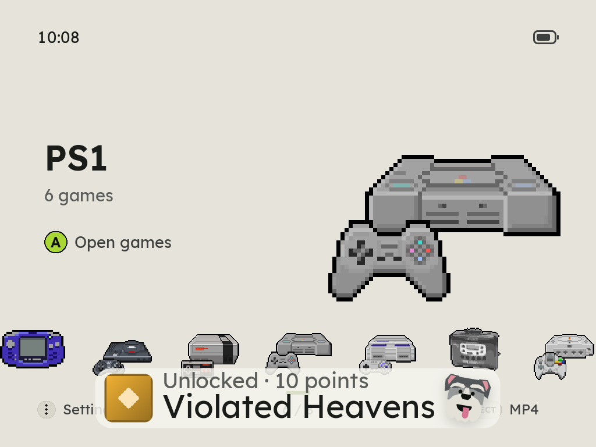

An unlock shows its badge, its name and its points for a few seconds, with Zyper at the right. Each achievement's badge is a small picture (64 pixels) from RetroAchievements, kept on the card beside the game's achievements. It is fetched when the handheld is online and the game is not running, never during a game, so no frame waits on the network. Until a badge is on the card, in the list and in the pop-up a trophy takes its place, and it changes to the badge by itself. A handheld that is never online can get them from a computer: `tools/ra-sets.py` puts each game's achievements and badges on the card.

### Screensaver

<div align="center">
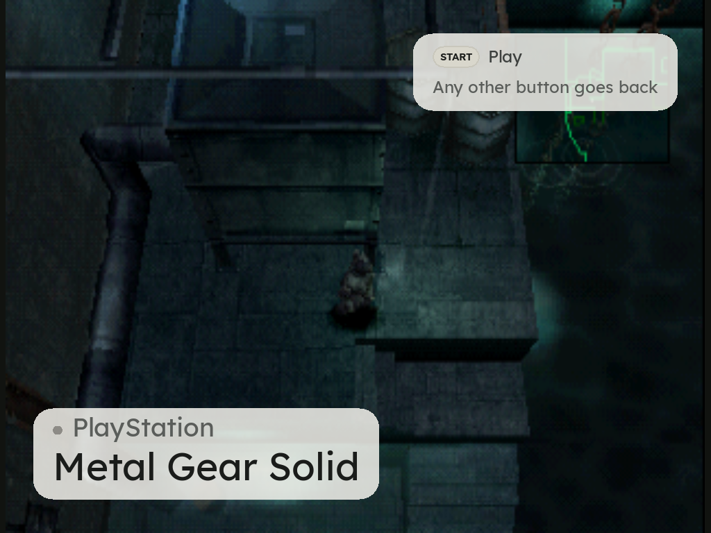
</div>

MENU > **Screensaver** plays the video snaps of random games over the whole
screen after the delay you pick, `Off` or 30 seconds to 10 minutes, `1m` to
start with, when nothing has been pressed on the shelf. Each clip shows for
15 seconds with its game's name and system, then the next fades in.

- **START** boots the game on screen, as A on its card would.
- **Any other button** goes back to the shelf as it was, and does nothing else.
  The volume and brightness buttons change their own setting and leave it be.
- It never starts in a game or over a menu, MP4 or File Transfer, while music
  plays, File Transfer is on or a long job (a fetch, an update, PortMaster's
  install) runs, or under 20% on battery.
- **It never keeps the device on past Auto Off.** Auto Off powers the device
  off at its own time with the screensaver up; on the cable, its time turns the
  screen off as it does for the shelf. A delay as long as Auto Off's is never
  seen on battery.
- **It is cheap:** muted, drawn only when the picture changes, and on battery
  it ends by itself after 10 minutes, or when the chip gets hot or the battery
  falls under 20%, and waits for a button.
- It plays the snaps on the card (`Roms/<console>/.media/<name>.mp4`) of the
  consoles whose Video Snaps are on. **With no snaps on the card it shows the
  games' covers**, each for 8 seconds; with no covers either, it does nothing.

### Date & Time

Date & Time has a row for each part of the clock and one for the time zone,
each changed with left and right and set the moment it changes, so the time
holds through a power-off. The zones are one or two cities per hour of offset,
west to east. **A** on the time zone row opens a list of every choice, Auto
first, with a tick on the one that is on: **A** picks one and **B** goes back
with nothing changed. Each time Wi-Fi connects it sets the clock, so with
Wi-Fi this screen is mainly for the zone. A Pixel 2 with no adapter cannot get the time
from a network: set it here once.

The time zone sets itself. Its row starts on **Auto**, the first choice,
left of Honolulu: each time the handheld gets internet, over Wi-Fi or a
phone's USB tethering, it asks [ipwho.is](https://ipwho.is), a free service,
where you are, by the handheld's internet address, and sets that time zone,
so a trip to another zone needs nothing from you. Picking a zone on the row
turns Auto off, and your zone stays; left back to Auto turns it on again. The
row says what Auto found, `Auto (Sao Paulo)`, and just `Auto` until its first
answer, while the zone you had stays. It asks once a connection and at most
every three hours, and with no answer it keeps the zone it has. It sets the
zone's own name, so daylight saving and half-hour zones follow on their own.
The clock is still set as above, by the network, each time Wi-Fi or the
phone's tethering connects. A card from before 1.0.5 is switched to Auto
once, at its first start of 1.0.5.

Games read the same zone: a game with a clock of its own, such as Pokemon's
day and night, keeps the time of the zone chosen here, and a new zone
reaches the next game started.

The shelf shows the time at its top left, and Wi-Fi and the battery at its
top right, with a Bluetooth headset on the Brick while one is connected, and a
headphone mark while headphones are in the jack. Wi-Fi's fan is crossed
while the radio is on and not connected, and gone when it is off. The battery
turns red at 10%, its fill blinks at 5%, and it shows a bolt while it charges.
The clock is not shown until it is set to 2026 or later, so a Pixel 2 that was
never set does not show a time that is not now. The same header is on every
MP4 screen - its shelf, an album's tracks, Now Playing and a video with its
controls - and over the menu of a paused game. While music plays, the song's
name stands in the header's middle, after a note; a name too long for its room
slides back and forth there, as a long game title does on the shelf, and one
that fits stays still.

Wi-Fi File Transfer and Scraper's fetch need a network, and go quiet without one rather than
disappearing - a row that vanishes teaches nobody why. Achievements stays reachable
either way, because signing in is the thing you go there to do, and Bluetooth
and Play Time need no network at all.

### Wi-Fi File Transfer with no network

On the Pixel 2 with a Wi-Fi adapter in and no network joined - Wi-Fi off,
or on with nothing in range - Wi-Fi File Transfer makes the handheld its own
Wi-Fi network for as long as the screen is open. The row says `Hotspot`.

1. Open **Wi-Fi File Transfer**. The screen shows a QR code, the network's name
   (`ZyperOS-` and four characters of the adapter's address), its password and
   the PIN. **B** closes it.
2. Point the phone's camera at the code and join the network it offers. A
   laptop joins by the name and the password instead.
3. The phone opens the transfer page by itself, in its sign-in sheet, at
   `10.42.1.1`. Type the PIN.

The password and the PIN are new every time the screen opens. Close the
screen and the network goes, and Wi-Fi comes back as it was: on and joining
your saved networks if it was on, off if it was off.

The sign-in sheet is a small browser and cannot do everything. On an iPhone
it uploads but cannot save a download; on Android it downloads but cannot
pick a file to upload. The page says so at the top, and how to open it in the
real browser instead: on an iPhone, tap **Cancel**, then **Use Without
Internet**, and open `10.42.1.1` in Safari; on Android, tap the menu, then **Use
this network as is**, and open `10.42.1.1` in Chrome. The phone has no
internet on this network; it comes back when the phone leaves it.

The adapter needs a driver that can be an access point. The TL-WN725N v2/v3
(RTL8188EUS) can, with Realtek's own driver, which plastron gives it. An
adapter that cannot shows **Could not start the hotspot.**

On a network, that driver's power saving is off: with it on, this chip is
known to drop off some routers over and over. Each join and each drop, with
the reason the network or the adapter gave, goes in
`.userdata/pixel2/logs/wifi.log`, which File Transfer's **Download logs**
packs with the other logs. While joined, the signal goes there too: its
strength, speed and channel every minute and when it changes a lot, and at
each drop the last one seen, so a log says whether the adapter was on a weak
signal when it lost the network.

A drop in the middle of joining used to count as a wrong password: the
network then stayed off for 10 seconds, and longer each time it happened
again. A network that already joined with its password now tries again at
once instead, one time for each join, so a password that really changed
still waits as before.

On the Play Time screen, **left and right** change the window - all time, this
year, this month, this week, today - and **Y** switches between one row per
game and one per system. The row under the cursor gets its own line at the
bottom: how many times it has been launched, its longest single session, when
it was last played, and how many of those sessions ended in a flat battery or
a crash rather than a quit. That last number only appears when it is not zero.

On the Wi-Fi screen, **Y** rescans and **X** forgets the network under the
cursor, behind a confirm. Forgetting the one you are connected through is
allowed - refusing would leave a row that is visibly saved and visibly
un-forgettable, which is worse to explain than the consequence.

### The system menu

The system menu opens on a shelf of games and applies to that system alone:

| | |
|---|---|
| **Games** | how many the shelf found |
| **Core** | which core runs them; left/right/A choose on a shelf that has two (the Game Boy's and the Game Boy Color's, mGBA or Gambatte; the Nintendo 64's; the Dreamcast's). The next game started runs on it. A game left on the other core starts fresh and says so: a resume point is one core's own. Its battery save is the same file for both; a cartridge with a clock (Pokémon Gold, Silver and Crystal) keeps the clock apart on Gambatte, in a `.rtc` file beside the save, so after a change of core its clock may need setting again. A game's details (X) say which core it starts on while its shelf has two |
| **Game Language** | the Nintendo DS shelf's: left/right/A go round `Auto`, English, Español, Français, Deutsch, Italiano, 日本語 and 简体中文, saved the moment it changes. `Auto` is the language of MENU > Language where the DS has it and English where it does not, and the row says which. The next game started speaks it, whatever the language of the `firmware.bin` in `Bios/`. A game whose resume point was left in another language starts fresh in this one, with a note that says so, its battery save kept; a save state you load keeps its own language until Reset |
| **Super Game Boy** | the Game Boy and Game Boy Color shelves', under Core, on mGBA: `Off` to start with, as before, or `Its Games`, where a game made for the Super Game Boy starts as one, in its own colors and border (no BIOS needed; other games start as before). For this system alone, saved the moment it changes, for the next game started. With its border the picture is 256x224: 2x on the Pixel 2, 3x on the Brick at Sharp Pixels |
| **Timing** | the Game Boy, Game Boy Color, Game Boy Advance, Nintendo DS and Genesis shelves', under Core (and under Game Language on the DS's): `Smooth` to start with, or `Exact`, for this system alone; left/right/A flip it, saved the moment it changes, for the next game started. The screen refreshes 60.08 times a second and these consoles make 59.7 to 59.9 frames. `Smooth` shows one game frame each refresh, so motion is even, and the game runs up to 0.6% faster than the console: a GBA game 3.5 seconds fast in 10 minutes. `Exact` keeps the console's own speed, for timers and rhythm games, and about every 3 seconds one frame stays on the screen for two refreshes |
| **Sort By** | left/right; `Name`, `Play Time`, `Last Played` or `Recently Added` |
| **View** | left/right, or A for the list; `Covers`, the row of covers, `Grid`, two rows of covers in cells shaped like the shelf's own art, `List`, the games as a list of names with the focused one's cover beside it, or `Video`, the focused game's video snap on the whole screen with the covers in a band at the foot; after 2 seconds with no press while a snap plays, the band goes down to a thin strip so the video has the screen, and any button brings it back. START on the shelf steps it too, without the menu |
| **Display** | how the picture fills the screen: Full Screen, Original Shape, Square Pixels, Sharp Pixels, Sharp Pixels, Tall, Sharp Pixels, Zoomed, Fill, Edges Cut or Actual Size; left/right cycles it, and A opens the list, with a small picture of your game in the mode under the cursor and a line that says what it does; saved the moment it changes. `Square Pixels` (1.1.0) draws every pixel of the game square, whatever shape its core asks for, as tall as the screen (as wide, for a wide game such as the GBA's): an NES or SNES game at 8:7, a Game Gear game at 10:9, a PC Engine game at 16:15, as RetroArch's 1:1 PAR does with integer scaling off. `Sharp Pixels` draws them square too, at a whole number of times their size, so it can leave a border all round |
| **Border** | under Display, while the display mode leaves room around the system's games, and always on the Game Boys (the Game Boys and other handhelds, a Sharp Pixels picture smaller than the screen): `Off` to start with, black as before; `Blur`, the game's own picture blurred and darker around it (Pixel 2); on the Game Boy, Game Boy Color and Game Boy Advance, in any display mode, `Handheld`, a drawing of the handheld's own face around the game at its full size, cut at the screen's edge, and `Handheld, Whole`, the game smaller so the whole screen glass and some of the body show (not for the Advance on the Pixel 2, where the game would be tiny); choosing either turns the system's Display to Sharp Pixels, the size the frames are drawn for; or `Your Own`, the first PNG in `Borders/<the system's folder>/` on the card (or in NextUI's `Overlays/<tag>/`), shown only when there is one. For this system alone; the same row is in a game's Display tab, where it changes the game's at once |
| **Handheld Color** | under Border while it is a Game Boy Color frame: the handheld's color, `Yellow`, `Red`, `Purple`, `Green`, `Teal` or `Clear Purple` |
| **Shader** | `Off`, `Sharp-Shimmerless`, `CRT`, `CRT Curved`, `Scanlines` or `LCD Grid`, and on the Game Boy, Game Boy Color and Game Boy Advance `LCD No Backlight` too, for this system alone: left, right or A steps it, saved the moment it changes. The next game started plays with it |
| **Strength** | right under Shader while it is `CRT`, `CRT Curved`, `Scanlines`, `LCD Grid` or `LCD No Backlight`: `10%` to `100%`, for this system alone. Left and right step it 10% at a time and stop at the ends |
| **Downloads** | MENU > Downloads for this system alone (below): what it is missing, and **Download** gets it |
| **Rescan Folder** | read the card again, for ROMs that arrived since boot |

On Favorites and Recents the menu is only Games, Random Game, Sort By and View; Recents has
**Card Picture** too: `Cover`, as it starts, or `Last Screen`, each card the screen where you left
the game (the picture saved with its resume point) with its cover small in the corner. A game with
no resume point shows its cover. A opens the two as a list with a picture of each. On Collections it
is the collection's own (see [Collections](#collections)). The rest is about one
console, and a game there takes its console's Display wherever it was
started from.

### Collections

A collection is a list of games of your own, from any system: couch games, RPGs to finish, the
kids' games. Press X on a game and choose **Add to Collection**: a tick shows each collection the
game is in, A puts it in or takes it out, and **New Collection** names a new one on the keyboard,
with the game as its first. The row's value says how many collections the game is in.

Once a collection has a game, the home has a **Collections** group after Favorites and Recents.
Its shelf shows each collection as a folder with its count; A opens it, and B goes back. Inside,
games of every system mix, each with its system under its name, and each starts on its own
system's core. MENU on the shelf, headed by the collection's name:

| Row | What it does |
|---|---|
| **Games** | in a collection: how many games it has |
| **Random Game** | in a collection: one of its games, picked and started |
| **Sort By** | `Added` (the order the games went in, to start with), `Name`, `Last Played` or `System` (the home's order of the systems). One order for every collection |
| **View** | `Covers`, `Grid` or `List`, as on any shelf |
| **Rename** | a new name for the collection, on the keyboard |
| **Remove from Collection** | in a collection: the game under the cursor out of it. The game stays on the card |
| **Delete Collection** | asks first, the cursor on **Cancel**. The list goes; its games stay on the card |

MENU > Home Systems can hide the group. A game you rename or delete on the handheld follows into
every list.

On the card, each collection is a text file, `Collections/<name>.txt`, one game a line, as its
path from the card's root: `/Roms/SNES/Chrono Trigger (USA).sfc`. This is the format MinUI and
NextUI use, so a list from another handheld, or one you write by hand, shows up after a rescan.
A line for a game that is not on the card stays in the file and comes back with the game. Lines
starting with `#` are notes. ZyperOS reads up to 36 collections.

### Screenshots

Once you have taken a screenshot (a Screenshot hotkey, under Hotkeys above),
the home has a **Screenshots** group after Favorites, Recents and
Collections. Its shelf holds every shot, the newest first, each with its
game's cover small in its corner, and under its name the system and when you
took it. **A** opens a shot on the whole screen: Left and Right step through
them, L1 and R1 go to the next or the last game's shots, and B goes back. The
game itself starts from its own shelf. **X** deletes the shot after asking,
the cursor on **Cancel**; the game stays. MENU on the shelf has
**Sort By** (`Recently Added` to start with, `Name` or `System`) and **View**,
as on any shelf. MENU > Home Systems can hide the group.

The shots stay on the card in `Screenshots/<system>/`, where File Transfer
shows them too. A shot of a game you renamed or deleted stays. OpenBOR's own
screenshots, which it takes with SELECT into `Saves/openbor/ScreenShots`, are
on the shelf too, under OpenBOR.

Display is per-system, because a Game Boy and a Genesis do not want the
same answer. Set here it applies from the next launch; the same row in the
in-game menu changes the running game as you press it, which is the one to use
when you want to see the difference rather than guess at it. Either way it is
written the moment it changes - there is no confirm step to hang the save off.

Sort By is per-system for the same reason. Alphabetical is the only sane way
to find a title you can name, and no help at all when you are coming back to
the two or three you are actually playing, which on a large shelf are
scattered through the alphabet. Play Time and Last Played read the same
session rows the Play Time screen does; Recently Added is the ROM's timestamp
on the card. Whichever order you pick, games it knows nothing about sort to
the bottom rather than into the middle, and two games it cannot tell apart
fall back to name - a shelf that reshuffles itself when nothing has changed
reads as broken even when the top of it is right.

View is per-system too: a shelf with good covers reads well as a row, a
shelf where you want more covers at once as the grid, and an Arcade shelf
or a library of hundreds of games better as a list. The grid takes its
cells' shape from the shelf's art: tall boxes, square thumbnails or wide
screenshots each fill their cells, and art of another shape sits whole over
its own colors. START on a shelf steps it at a press, the same setting as
the menu's row, and the foot says where it goes: `Grid` under the covers,
`List` under the grid, `Covers` under the list.

**Folders of games.** A folder inside a system's folder on the card is a
folder on its shelf, as deep as you like (`Roms/Game Boy Advance/Rom Hacks/Translations/Mother 3.gba`
shows as the folder Rom Hacks, with Translations in it): the folders come first, A to Z,
each a pixel-art folder in the system's color (or one color for every
folder: **Folder Color** in MENU > Display > Theme) with how many games it
holds, then the games loose in
it, in the shelf's Sort By order. A opens a folder and B goes back up one,
onto the folder you left. A folder is one game when it holds that game's
set: an `.m3u`, a PSP game's `EBOOT.PBP`, two or more discs of the one game,
or a `.cue` (or `.gdi`) with its tracks; or when its one disc image is named
as the folder is (`God of War/God of War (USA).iso`). An `.m3u` loose beside
its discs is one game too: the discs it lists are not on the shelf, in the
Grid, in Search Games or in Random Game, and the `.m3u` starts the game. A ScummVM game's folder is one game too. Any other folder
is a folder of games, also with one game in it, so `PSP/Favorites/Ridge Racer (USA).iso`
shows as the folder Favorites with Ridge Racer in it. Saves and save states go by the game's file name,
as they always have, so two copies of one game in two folders share them. In the list (MENU > View >
List) the focused game's video snap plays where its cover is. The Ports shelf never looks into its folders: they are the ports'
own. Favorites, Search Games, Random Game, Storage, Delete Game and Play
Time all find the games in folders, and after a game the shelf comes back
in the folder it was in.

Rescan Folder is what makes a ROM that arrived after boot appear without a
restart. Wi-Fi File Transfer already does it for you on the way out of the transfer
screen; this is the same thing by hand, for a card written some other way.

### Shaders

How a game's picture is drawn onto the screen at its last step.
`Off` draws each of the game's pixels as the nearest screen pixels, so at a
size that is not a whole number of times the game's (a 256-wide NES picture
stretched to 640 is 2.5 times) some of its pixels are two screen pixels wide
and some three, and a scrolling picture shimmers as they swap.
`Sharp-Shimmerless`, zadpos's shader, keeps every pixel the same size: a
screen pixel inside one of the game's pixels is that pixel exactly, and only
one that falls across two of them mixes the two, by how much of it each
covers. The picture stays as sharp as it can at that size and a scroll stays
steady. At a whole number of times (Sharp Pixels, Actual Size) the two are the
same. Square Pixels is seldom a whole number of times (a 224-line NES picture on
the Brick's 768 lines is about 3.4 times), so it looks its best with
Sharp-Shimmerless.

The other four draw an old screen. `CRT` is Timothy Lottes's CRT shader: a
dark line between the picture's lines, and one of each three columns of the
screen dimmed in red, green or blue, as the stripes of a TV tube, with the
light they take given back. `CRT Curved` is the same with the glass curved
and the corners round, and the picture's edges go into the curve.
`Scanlines` is Sharp-Shimmerless with a dark band under each of the game's
lines, and nothing more; `LCD Grid` has the band around each of its pixels,
as on a Game Boy's screen. The CRT's lines are most even where the
picture's height is a whole number of times the game's: Sharp Pixels, Tall draws
a 224-line SNES game at twice its height. These four are the Pixel 2's,
whose last step is its GPU's; the Brick draws them as Sharp-Shimmerless, and
its rows step over them.

`LCD No Backlight` is for the Game Boy, the Game Boy Color and the Game Boy
Advance alone, and only their Shader rows offer it. Their screens had no
light behind them: a light pixel let the light through to the screen's
dull grey backing, so a white background looked like the screen itself,
not a glowing white, and many games were drawn for that. This is LCD Grid
with each pixel faded toward that backing by how light it is: white
becomes the backing, black stays black, and the colors between move a
little. A dark pixel also casts a faint shadow down and to the right on
the backing, which shows next to light pixels. On the Pixel 2, as the
other four. An idea from mattakins's Pixel Transparency for RetroArch;
ZyperOS draws it with its own shader.

The in-game menu's **Shader** row, in its Display tab right under Display, changes it for
the game's system, from the next frame after Continue (the paused picture
behind the menu stays as it was); the system menu's row does the same from
the shelf. A system that never had its own plays with what **MENU >
Display > Shader** set for every system before 1.0.6, so your games look as
they did.

**MENU > Display > Shader**, opened from the home, is for ZyperOS's own
screens: the home, the shelves, the menus and every screen while no game is
on. It offers `Off` and the four old screens. The screen keeps its own
sharp pixels, words and all, and the old screen's lines, grille or grid go
over it, as a white picture through that shader would show them; `CRT
Curved` curves the whole screen too. While a game is on, its own shader is
the one you see, its in-game menu included, and a video in the player plays
as it is. It is `Off` to start with, and with `Off` the screen is drawn
exactly as before. On the Pixel 2 only, as the old screens are.

Under each Shader row, while the shader is one of the old screens, a
**Strength** row says how strongly it is drawn: `100%` is the shader as it
is, and each step of 10% down makes the dark lines and grid lighter, down to
`10%`, a faint hint of them. On the CRT it softens the scanlines and the
stripes together; a curved CRT keeps its curve. On `LCD No Backlight` the
backing, its shadows and the grid fade together. Like Shader, it is kept per
system, and **MENU > Display > Strength** is ZyperOS's own screens'. It is
`100%` to start with, the shaders as they were before the row.

Here are the six looks on the Pixel 2's 640x480 screen, a part of the picture at twice its size:

<div align="center">

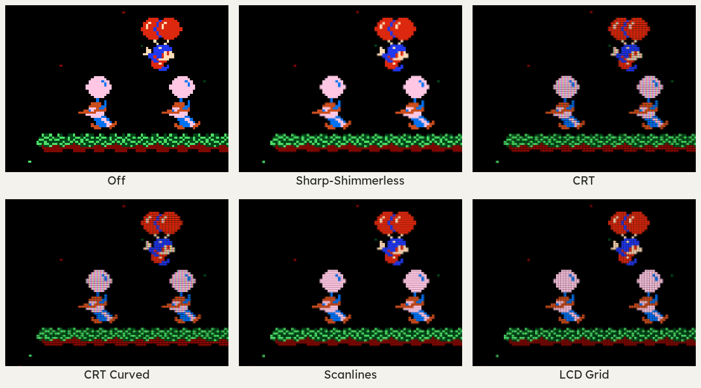

</div>

Sharp-Shimmerless is zadpos's, and so are the scanlines and the grid; the CRT is Timothy Lottes's. Each is in the public domain ([Credits](../README.md#credits)).

### In a game

**In a game, X and Y are turbo A and turbo B** - hold one down and it presses
the button repeatedly for you instead of you mashing it. It applies to a whole
system rather than to one game.

Ten systems have it: **NES, SG-1000, Master System, TurboGrafx-16, Game Boy,
Game Boy Color, Game Boy Advance, Game Gear, Neo Geo Pocket and Neo Geo Pocket
Color**. Those consoles had two face buttons,
so X and Y are spare and turbo can have them. Genesis and SNES are left out
because their pads use X and Y for real buttons.

Diatom does the pulsing, not the emulator core, which is why it works the same
on all ten rather than only on the one core that happens to implement turbo.

**On Game Boy Advance, L2 and R2 are turbo L and turbo R.** That one is the
emulator's own turbo rather than ZyperOS's, so it is only there on Game Boy
Advance; on Game Boy and Game Boy Color, which have no L and R, they do nothing.

**Faster and slower** are SELECT+R2 and SELECT+L2 in a game. Each press of R2
steps the speed to 1.5x, 2x and 3x, each press of L2 back down to normal, and
the step shows at the bottom of the screen. The game is silent while it's
fast, and the picture moves in steps rather than smoothly, because the
handheld draws every other frame to give the game more time. Each game starts
at normal speed, and the speed stays where you left it through the in-game
menu. MENU+R1 was fast forward until 1.0.2.

The speed is as fast as the game can go, up to the step. NES games reach it,
and Genesis comes close. A heavy SNES or Game Boy Advance game tops out at
about 2.5x, so there 3x means as fast as that game can go.

**Quick save and quick load** are SELECT+R1 and SELECT+L1 in a game: a state
saved into the in-game menu's **Quick Slot**, and loaded back from it, with a
pop-up that names the slot. The game keeps running while the state is
written. Quick Slot is one of the six slots of Save and Load, slot 1 until you
pick another, and each system remembers its own. A system whose emulator keeps
no states (ScummVM, J2ME) has no Quick Slot, and there R1 and L1 under SELECT
are the game's.

**On-Screen Stats.** The last row of the in-game menu's Display tab draws a
small line over the game, for every game until you turn it off. Left and
right turn it on and off; A opens its page:

| | |
|---|---|
| **On-Screen Stats** | `On` or `Off` |
| **Shows** | A opens the list of items, each `On` or `Off`: FPS (the new pictures the game draws a second, so `30` for a game that draws every second frame), Speed (how fast the game runs against its own speed, only when it is not at full speed, as `0.8x` when the game runs slow or `2x` in fast forward; a game that draws 30 pictures a second at full speed is `1x`, so it shows no speed), CPU Temperature, CPU Load, CPU Clock, Battery and Time. One stays on. `FPS` and `Speed` to start with |
| **Corner** | `Top Left`, `Top Right`, `Bottom Left` or `Bottom Right`. In a top corner it moves under the volume bar, or left of the low-battery dot, rather than meet them |
| **Edge Distance** | `Close`, `Normal` or `Far` from the screen's edges |
| **Background** | `Pill`, a rounded box in the theme's colors, or `Shadow` around the text alone |
| **Opacity** | `100%`, `75%` or `50%` |
| **Text Color** | `Theme`, `White`, `Green` or `Yellow`. White, green and yellow take the dark pill in the light theme, so they read |
| **Size** | `Normal` or `Small` |

A band at the top of the page shows the corner of your game at its real size,
with the line in it as each row changes it. Diatom reads the temperature, load,
clock and battery twice a second, and only for the items that are on.

**Undo Load.** Every load you make, the in-game menu's Load or SELECT+L1,
first keeps the game as it was a moment before. After a load the in-game
menu's Game tab has **Undo Load**, under Load: A on it takes the game back to
that moment, so a slot loaded by mistake costs nothing. One is kept, for each
game, until the next load replaces it.

**Save states are packed** as they are written, the six slots and the resume
point alike, so they take little of the card: a Nintendo 64 game's is about
1.5 MB where it was 16, and a PSP game's is no longer 40 MB on every quit.
States made before 1.0.5 load as they did. ZyperOS 1.0.4 and older cannot
read the new ones: there a game starts from its beginning instead, its
battery save kept.

**The Nintendo 64's Pak.** An N64 game's controller holds the Rumble Pak, so
the Pixel 2 shakes. A game that saves to the Controller Pak, the N64's memory
card (Mario Kart 64's ghosts, and games that save nowhere else), takes it in
the **Pak** row of the in-game menu's Controls tab: left, right or A turns it, at once, and the
game keeps it. The Controller Pak's saves are kept in the game's own save
file in `Saves/`, whichever Pak is in.

**The Nintendo 64's two cores.** N64 games run on ParallelN64 with Glide64,
which keeps Super Mario 64 and Mario Kart 64 at full speed on the Pixel 2.
For a game it draws badly, pick Mupen64Plus-Next in the N64 shelf's menu,
on the **Core** row; the shelf keeps the choice. Both read the same battery
saves, and the buttons work the same on both: A and B are the N64's A and
B, L2 is Z, the d-pad is the stick, SELECT with X, A, B or Y is a C button,
and the Pak row is there too. A
save state is one core's own, so a game left on the other core starts from
the beginning, says so as it starts, and keeps its battery save.

**SELECT stays a game button.** Most systems have a SELECT of their own, so a
press of SELECT is either the game's or the hotkeys', decided by what comes
next. SELECT and then a shoulder (R1, L1, R2, L2) is a hotkey, and the game
never sees that SELECT. Pressed together, either may come first: a shoulder
up to a tenth of a second before SELECT is a hotkey too. SELECT and then any
other button goes to the game at once, with that button, so A+B+START+SELECT
still resets a game. SELECT pressed alone reaches the game as you let go of
it, for as long as you held it, and SELECT held alone for longer than 0.4
seconds is the game's, held; a shoulder pressed after that is still a hotkey,
until you press another button under that SELECT.

Volume and brightness show the same bar at the top of the screen in the
launcher, in a game, in the in-game menu and over a port: a pill with a mark
at its left and a segment for each step. The mark says which of the two it
is: a speaker whose waves grow with the volume, and a cross at silence, and a
sun whose rays grow with the brightness. The mark and the segments are lime
for volume and amber for brightness, on a bar in the theme that is on, light
or dark.

### Past the top: the boost

Some films and games are quiet even at the top of the volume. At the top,
**hold VOL+ one second more**, or **press it three more times**, each press
within a second of the last. The bar's end pushes out and a big red cell
fills as you hold or press; let go early and it drains back. Full, it opens
red boost cells past the top, each a little taller than the last, and you
feel a short buzz (at your Rumble level). Each cell makes the sound 3 dB
louder, up to six cells, +18 dB; a limiter keeps the loudest moments from
clipping, so a quiet film gets louder and a loud one only gets flatter. The
top three cells compress harder, so a game or a cart that is loud already
gets louder too: cells 1 to 3 sound as clean as ever, and cells 4 to 6 trade
some of the sound's cleanness for loudness, a little at cell 4 and plainly
at cell 6. A held key stops at the first cell: press for each next one. **VOL-** empties
the cells one by one, stops at the top, and the next press folds them away.

The boost works in a game, in MP4 and over a port, and stays as the volume
does, also after a restart, until you turn it down under the top. MP4's lock
screen never opens it, so a key held in a pocket cannot. While MP4 plays
behind the home or a menu, the volume keys there work on its boost exactly as
in the player: the bar shows the cells, and you open, fill and empty them the
same way. In a game's menu the keys work on the game's boost the same way, so
VOL- there empties one cell, as in the game. With music playing behind a
game, each boost step you make in the game is heard in the music at once.
With nothing playing, the bar in the other menus is the plain one and the
menu music is never boosted. Plugging headphones in or out closes it.

Brightness works the same way (**F2** on the Brick, **MENU+VOL+** on the
Pixel 2), with three cells. The top rung is already the backlight's brightest,
so the boost cannot make more light: it lifts the dark and middle tones of the
picture instead, which helps a dark game, and makes a bright scene look a
little flatter. It costs no speed and no battery.

## Languages

ZyperOS speaks English, 简体中文, Español, Português (Brasil), Français, Deutsch, 日本語 and Italiano. The first start asks for yours before anything else, and **MENU > Language** changes it at once, with no restart. Every screen follows it, down to the charging screen and the boot screen's line, and the File Transfer page follows the handheld. Chinese and Japanese each have a face of their own. Text is never cut to fit: where a language's words run long, that place gets a short form of its own. Switching languages costs no speed.

<div align="center">

<table>
  <tr>
    <td align="center">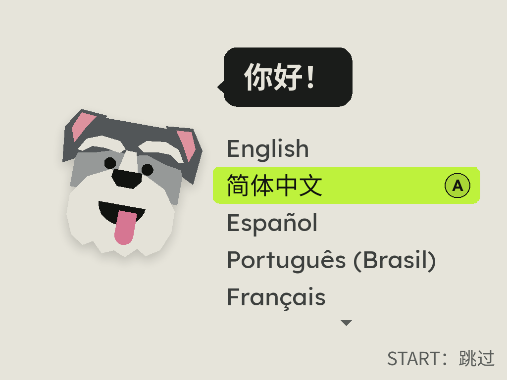<br><sub>Your language first</sub></td>
    <td align="center">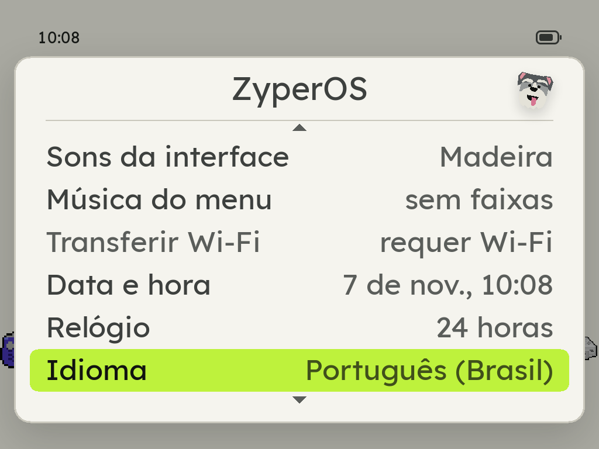<br><sub>MENU in Português</sub></td>
    <td align="center">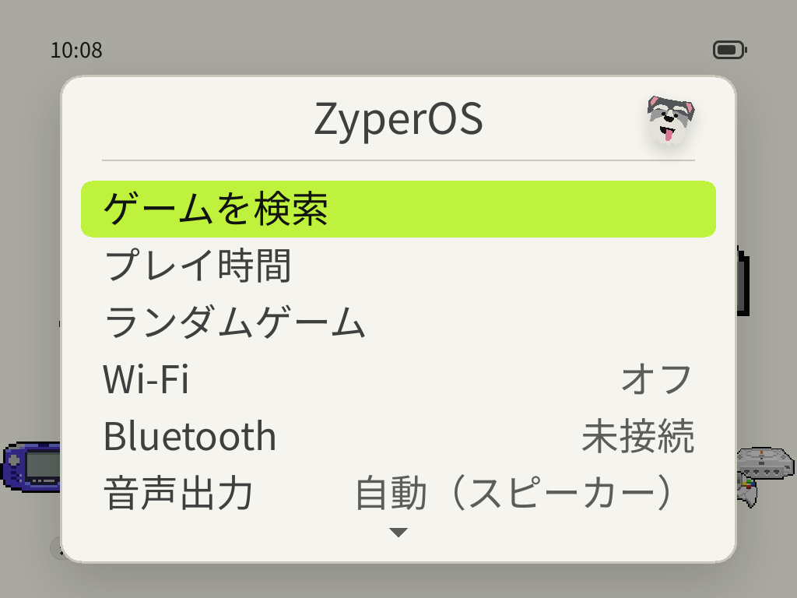<br><sub>MENU in 日本語</sub></td>
  </tr>
</table>

</div>

## Light and dark

ZyperOS has two themes, Beard in light and Salt & Pepper in dark. **MENU > Display > Appearance** chooses `Light`, `Dark` or `Auto`, and the first start asks Light or Dark too. Auto is dark in Night Mode's hours and light the rest of the day: set the hours with **Night From** and **Until** on the **Night Mode** page (9:00 PM to 7:00 AM to start), whether Night Mode itself is on or not. Auto only follows those hours: Night Mode still decides the warmth on its own, and nothing in Night Mode changes when you pick or leave Auto. At Night From and Until the theme turns together with Night Mode's warmth, in the menus and under a game, and on the Pixel 2 the boot screen follows it. Every screen follows it. The File Transfer page follows the phone or computer it is open on instead. For the night, the Pixel 2 has **Night Mode** on the same tab: it warms the whole screen, always or by the same hours, and never changes the theme.

**MENU > Display > Theme** makes them yours: an accent from ten (lime, green, teal, blue, purple, pink, red, orange, yellow and silver), a background for each theme (warm, neutral or cool grey in light; black, deep blue or dark grey in dark), the folders' color (System Colors, each folder in its system's own, or one of the ten accents for every folder), rounded or square corners, and Zyper on or off. Both themes are drawn small at the top as you change them, and **Reset to Default** puts them back. ZyperOS works out every other color from the two you pick and keeps every word at the contrast it has as it ships.

<table>
  <tr>
    <td>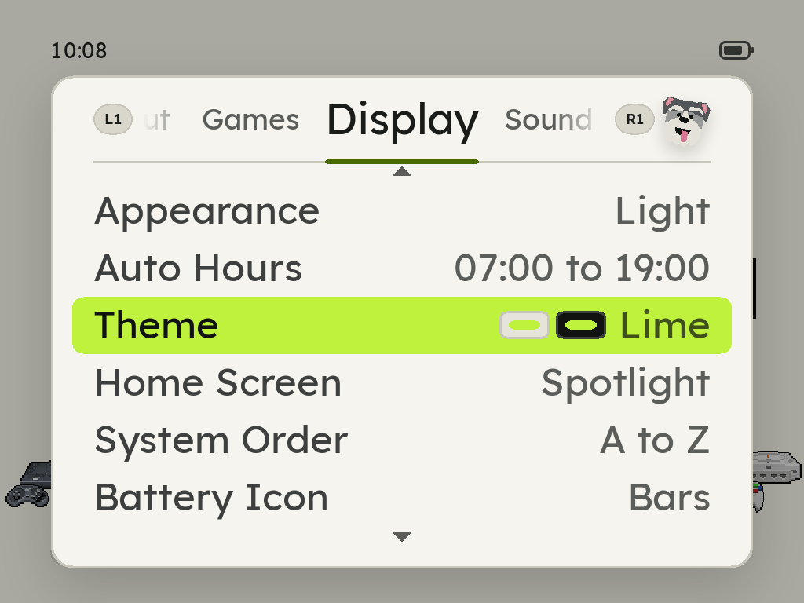</td>
    <td>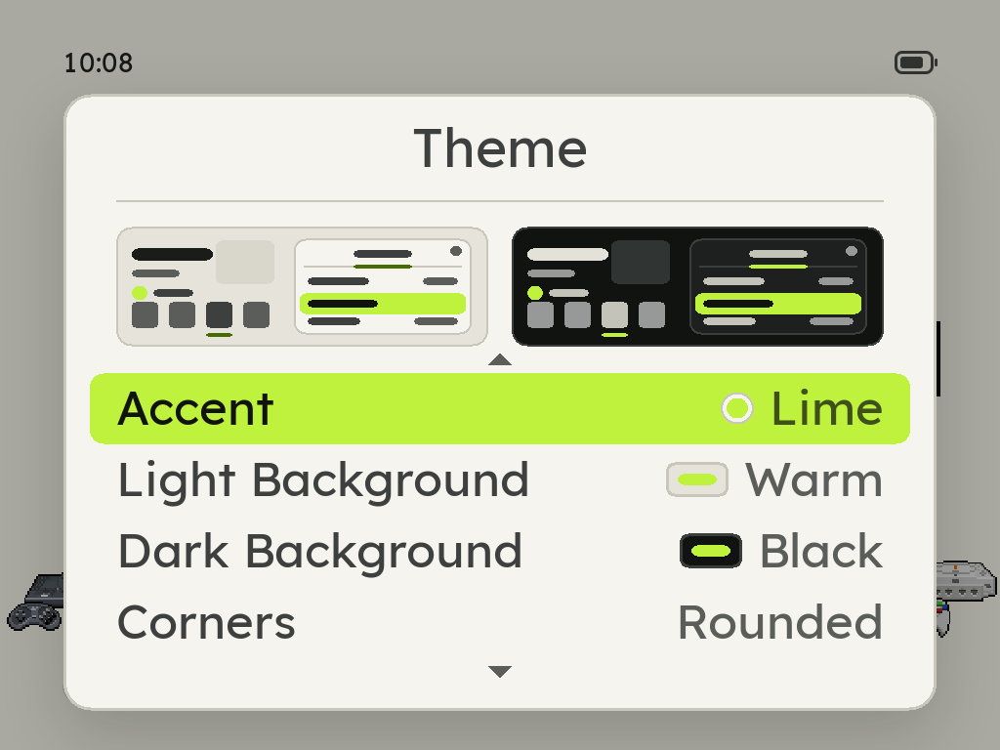</td>
  </tr>
</table>

<div align="center">

<table>
  <tr>
    <th>Light (Beard)</th>
    <th>Dark (Salt &amp; Pepper)</th>
  </tr>
  <tr>
    <td>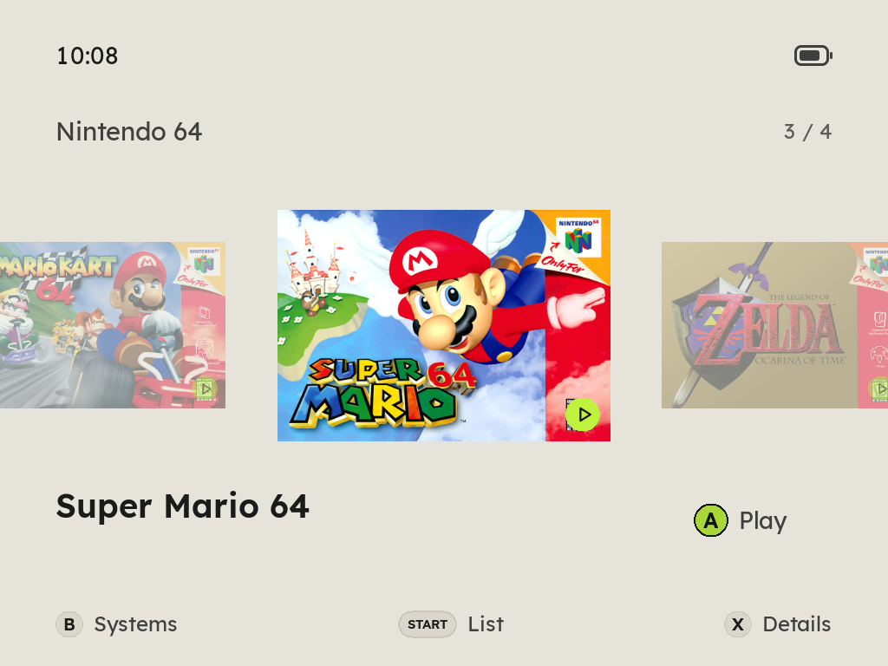</td>
    <td>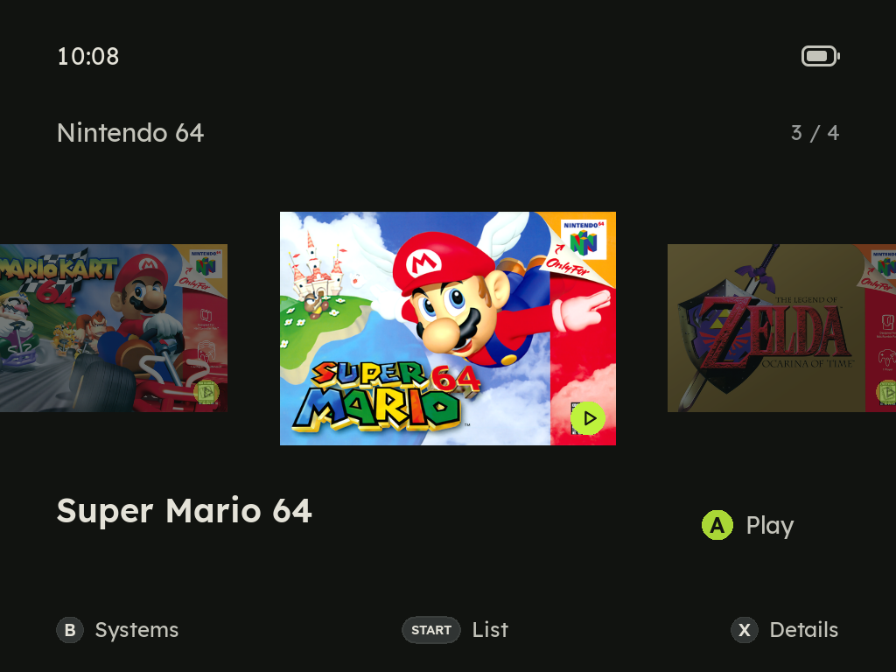</td>
  </tr>
  <tr>
    <td>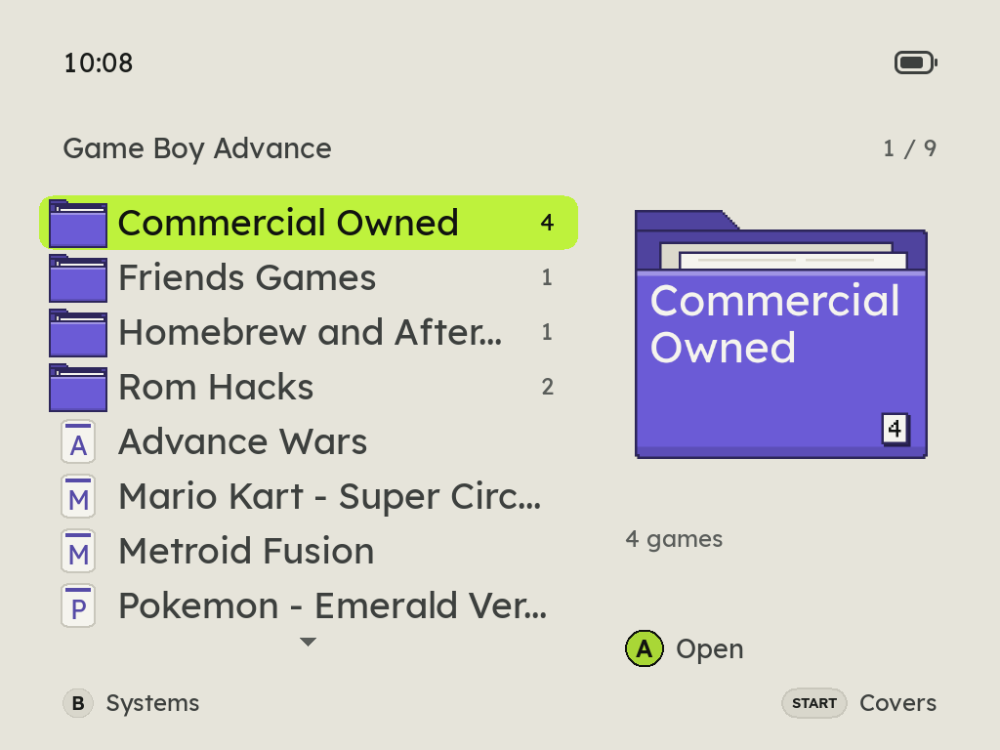</td>
    <td>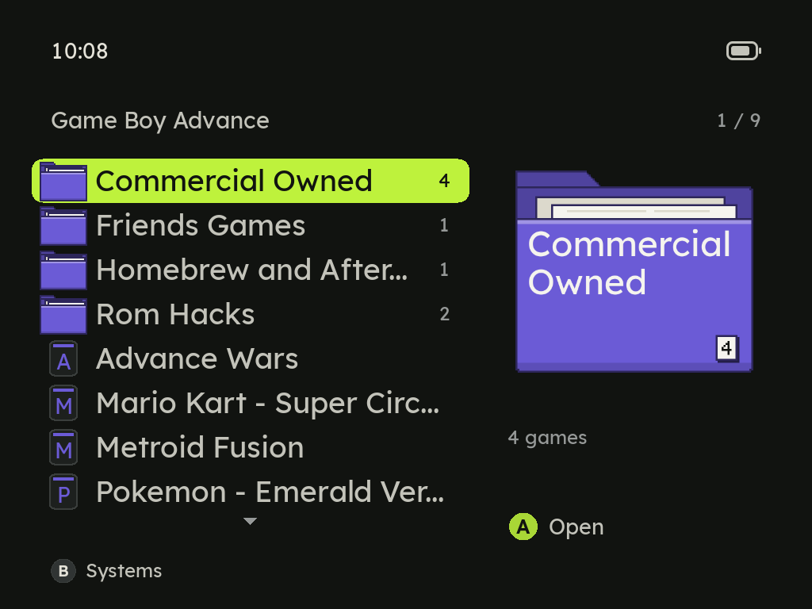</td>
  </tr>
  <tr>
    <td></td>
    <td></td>
  </tr>
  <tr>
    <td>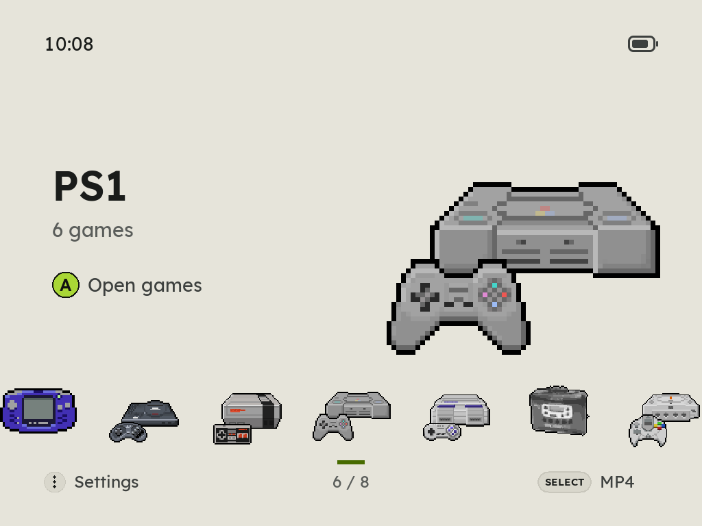</td>
    <td>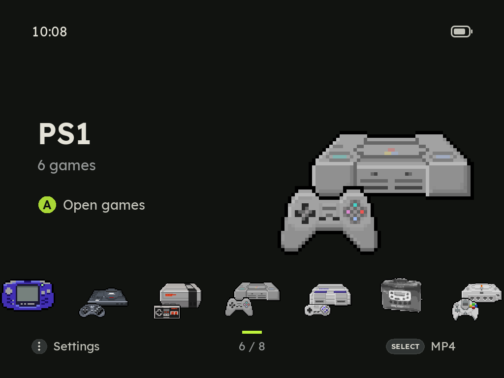</td>
  </tr>
  <tr>
    <td></td>
    <td></td>
  </tr>
  <tr>
    <td>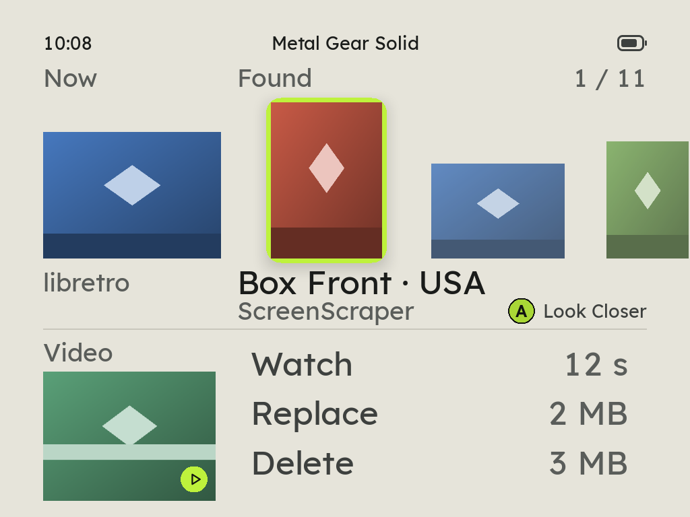</td>
    <td>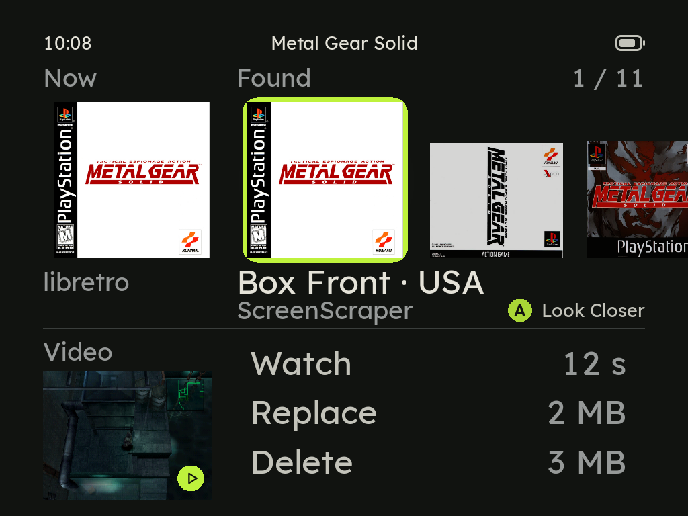</td>
  </tr>
</table>

</div>

## Screen Colors and Night Mode

On the GKD Pixel 2.

### Screen Colors

**MENU > Display > Screen Colors** sets Temperature (cooler to warmer), Tint, Contrast, Saturation and Gamma, each from -10 to +10, or a ready-made look: Vivid, Intense, Warm, Cool or Muted. The Look list shows each look on the whole screen as you move to it. They change the whole screen, the shelf and every game alike, in the display itself, so no game slows down. Standard, as it ships, leaves every color as the game draws it.

In a game, the in-game menu's **Display** tab has a **Screen Colors** row too: A opens the same page over the paused game, so you can fix colors or contrast while you look at the game behind it. A change is kept for the whole screen, as from MENU, and **B** goes back to the menu.

### Night Mode

**MENU > Display > Night Mode** opens its page, which warms the whole screen for the night, on top of your Screen Colors: always, or **By Hours** between **Night From** and **Until** (9:00 PM to 7:00 AM as it ships). **Night Warmth** sets how warm, from 1 to 10. It turns on and off at the hour in games and ports too. **Appearance**'s `Auto` turns dark by the same Night From and Until, so with Appearance on Auto the two rows are there to set even while Night Mode is off.

## Battery and power

### Battery care

A battery too low to start says so and charges first; a charger plugged in while the Pixel 2 is off shows the charge and the time to full (hold POWER to start); **Getting hot** warns before the handheld slows down to cool, over a game or a port; and **MENU > Charge Limit** stops charging at 80, 85 or 90% to keep the battery young, and holds it within 2 points of the limit on the cable (78 to 80% at 80%). Need it all for a trip? **Y** on the charging screen charges to 100% this time; the limit is back when the cable comes out.

### Clocks per system

8-bit and handheld systems run the CPU, memory and GPU under lower ceilings, measured to keep every frame, and so does the 16-bit generation a step higher. Lower clocks run at lower voltage, which saves battery. At the first frame that comes late, a game goes back to full clocks for the rest of the session.

## Rumble

Dreamcast games, PlayStation games (as a DualShock) and Game Boy Color rumble cartridges shake the handheld, and Nintendo 64 games get a Rumble Pak. (The Controller Pak is under [In a game](#in-a-game).) The motor stops while the in-game menu is open.

**How strong.** **MENU > Sound > Rumble** is `Off`, `Low`, `Medium` or `Full` for every game: none, 35%, 65% or all of what a game asks the motor for. `Full` on a new card, as ZyperOS always ran it. Each step buzzes the motor once at its level, so you feel it before you leave the row; in its list, the level under the cursor buzzes as you reach it. In a game whose core uses the motor, the in-game menu's Controls tab has a **Rumble** row too, for **This Game** or the whole system, as **Applies To** says: a game without its own level follows its system's, and a system without its own follows MENU's, which its list marks `Default`. A change reaches the paused game at once. A system that shakes harder than the handheld wants keeps its own share under every level: Doom's rumble is 35%, so `Low` there is 12%. The Pixel 2 only for now: the TrimUI Brick's motor waits for its first test on the Brick.

## Cheats

Cheats are RetroArch's `.cht` files: libretro's cheat list, or a file of your own. They are switched on and off per game in the in-game menu.

**Getting them.** **MENU > Downloads** fetches libretro's cheats for the games on your card, only their files, a few KB each (libretro-database, CC BY-SA 4.0). After that they work with no Wi-Fi. A file of your own goes in `Cheats/<System>/` on the card, named as the game without its extension: `Cheats/SNES/Super Metroid (USA).cht` for `Roms/SNES/Super Metroid (USA).sfc`. A card from NextUI moves over as it is: its names (`Super Metroid (USA).sfc.cht`) and its tag folders (`Cheats/SFC/`) count too. Your file is shown first, and a download never replaces it.

**In a game**, the Game tab's **Cheats** row says how many are on (`2 On`, or `None`). A opens the game's list: your file first, then libretro's files, each under its code type (`Game Genie`, `GameShark`). A, left or right turns a cheat on or off at once. **Turn All Off** is the last row. **Y** searches the list with the keyboard, and **X** puts the ones that are on first. A game with no cheats says why: libretro has none for it, or Downloads has not looked yet, and how to add a file by hand.

**Achievements stop while a cheat is on.** From the first cheat you turn on, the game's achievements wait until the game starts again with every cheat off: the Achievements row says `Paused`, and the Achievements tab says why. Turning the cheats off again does not bring them back in the same session, because what a cheat changed in the game stays. Signed in to RetroAchievements, the first cheat in a game with achievements asks first, with the cursor on Cancel. It asks once a game.

**On the shelf**, a game with cheats on says `2 cheats on` under its name, after its play time and achievements. **Starting a game** with cheats on shows a pop-up, `2 cheats on`, so none is forgotten. A game that stopped by itself last time with cheats on asks whether to start without them; **Without Cheats** starts it with none this time and keeps them set for later.

Whether a code works is up to the game's emulator core: a cheat in the list that the core cannot use does nothing. A cheat can also break a game or its save, so save a state before you try one.

## File transfer

**Wi-Fi File Transfer** (MENU, with Wi-Fi) and **USB File Transfer** (the same
row while a computer is on the USB cable) put the card's folders in a web
browser: ROMs, Music, Audiobooks, Videos, Menu Music, BIOS, Saves and Save
States. The screen
shows the handheld's address, its name (`zyperos.local`) and a four-digit
PIN, new each time it opens. Either opens the page; the name is the easier
one to type, and the address works where the name does not. Over the USB
cable the name comes first, `http://zyperos.local`, with the address and the
PIN under it: only the computer is on that link. Over Wi-Fi the address
comes first and the name sits beside the PIN: anyone on the network could
answer for a name, so the address on the handheld's own screen is the one
to trust.
The page asks for the PIN and opens as the fourth digit goes in. Five wrong
PINs and the page waits 30 seconds.

Once someone has typed the PIN, the handheld's screen looks like Flash
Drive's: **Download** (files coming to the card) and **Upload** (files going
from it), each with its speed and how much has moved since the screen opened,
lit while files move that way. While a file comes in, a bar under Download
shows how far it is. Under them, **Now** says what happened last, with the
file's name, and **Browsers** (and **SSH** over the cable) who is connected.
The address and the PIN stay at the top for the next browser.

On the Pixel 2, an Android phone with USB tethering opens it too on the USB
cable, with no adapter: answer **Phone** when the handheld asks what you
plugged in, and turn on the phone's **USB tethering**. The phone shares its
network over the cable and gives the handheld an address there, and **USB
File Transfer** opens by itself with that address first (`192.168.x.y`) and
"in the phone's browser" under it: type it in the phone's browser, then the
PIN. No name is shown there, since a phone's browser does not look `.local`
names up. Close the screen and the phone stays connected and charging;
**MENU > USB File Transfer** opens it again. Unplug the phone or turn USB
tethering off, and the screen says the cable is unplugged (behind the shelf,
it closes 10 seconds later). While USB tethering is on, the handheld also
has the phone's internet: its clock sets itself from it, and **MENU >
Downloads**, Cover and Video, System Update
and PortMaster's install work over it as over Wi-Fi. Close File Transfer
with **B** and the phone stays connected for them. Over the phone, which may
be on mobile data, nothing large starts by itself: a System Update download
cut short waits for **A**. An iPhone shares its network over USB only with a
computer it trusts, which the handheld cannot be, so use Wi-Fi File Transfer
with an iPhone. Some Android devices have no USB tethering at all (the AYN
Thor, an Android gaming handheld, offers it neither in Settings nor in its
USB notification): with one of those, use Wi-Fi File Transfer too, or
**Flash Drive** with a USB-C to USB-A adapter on the phone and a USB-A to
USB-C cable.

The name is answered by the handheld itself (multicast DNS, which macOS,
Windows 10 and later, iOS, Android and most Linux desktops ask by
themselves), on the cable while USB File Transfer is open and on the Wi-Fi
network while Wi-Fi File Transfer is. With two ZyperOS handhelds on one
network the second takes `zyperos-2.local`, and each screen shows its own.
If every name it tries is taken (three in a session), the handheld stops
using a name until File Transfer opens again, and shows the address alone.
It answers only its own link: packets that came through a router, or from
outside its subnet, get no answer.

Leaving the screen rescans the shelf, so games that arrived are on it.

A card with no games on it opens on the two ways to add them, side by side:
**A** starts USB File Transfer and **Y** Wi-Fi File Transfer. On the Pixel 2
the cable and the Wi-Fi adapter use the same port, so the way that cannot
start now is dimmed and says why, and lights up as you plug in or unplug.
When the first games arrive, by either screen or any other way, the home
shows them, and Zyper cheers.

### Adding games over Wi-Fi

1. Join a network under **MENU > Wi-Fi**.
2. Open **MENU > Wi-Fi File Transfer**. It shows an address in large type, its name `zyperos.local` under it, and a PIN.
3. Open that address (or `http://zyperos.local`) in a browser on your phone or computer, and type the PIN. [The page](#the-file-transfer-page) opens on ROMs.
4. Drag games into their console's folder, albums into `Music`, books into `Audiobooks` or films into `Videos`. They're on the shelf when you leave the screen.

### Adding games over the USB cable

The same thing over a cable, with no Wi-Fi, called USB File Transfer. It works with a Mac, Linux, or Windows 11; Windows 10 has no driver for this kind of connection.

1. Plug the device into the computer with a USB cable, and choose **File Transfer**. Or open **MENU > USB File Transfer**, which takes Wi-Fi File Transfer's place while a computer is on the cable. While the computer connects, it shows a bar; then its name, `http://zyperos.local`, in large type, its address under it, and a PIN.
2. Open `http://zyperos.local` in a browser on that computer, or the address, `http://10.42.0.1` on the Pixel 2 or `http://10.55.0.2` on the Brick, and type the PIN.
3. Drag games into their console's folder, albums into `Music`, books into `Audiobooks` or films into `Videos`. They're on the shelf when you leave the screen, or, with the transfer behind the shelf, a moment after they arrive.

### Leaving the transfer screen

**B** closes File Transfer when nothing is moving. While files move, it asks first, with three choices:

- **Keep going**: the screen goes, and the files keep moving behind the shelf while you use ZyperOS. A mark beside the clock says File Transfer is on, with a ring that fills as a file arrives, and **MENU > USB File Transfer** (or Wi-Fi File Transfer) opens the screen again with the same PIN.
- **Stop after this file**: the file on its way finishes, then File Transfer closes. The page says which files stayed on the computer.
- **Cancel now**: File Transfer closes at once. The file that was half written is deleted, so it never shows on the shelf as a broken game.

A game can't run while files move, because the game takes what moves them: starting one asks **Not now**, **Play after this file** or **Cancel and play**. With nothing moving, File Transfer closes for the game.

### The File Transfer page

The page that opens in the browser is the same for Wi-Fi File Transfer, the handheld's own network and USB File Transfer, on a computer or a phone. It needs no app and no account, only the PIN on the handheld's screen.

<div align="center">

<table>
  <tr>
    <td align="center">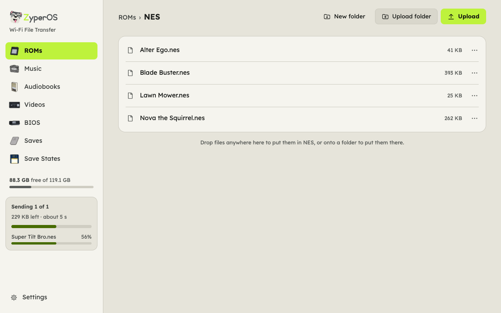<br><sub>On a computer: the folders at the left, an upload under them</sub></td>
    <td align="center">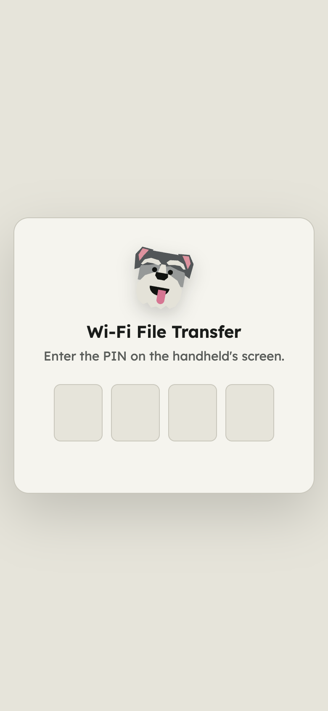<br><sub>The PIN</sub></td>
    <td align="center">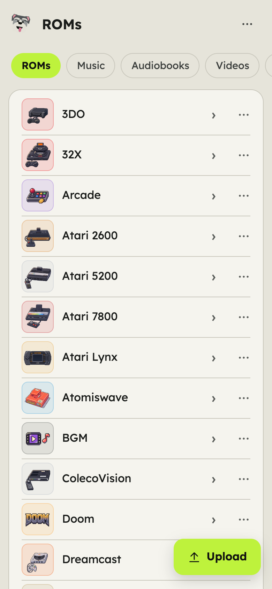<br><sub>On a phone</sub></td>
  </tr>
</table>

</div>

- **The PIN** goes in four boxes, and the page opens when the fourth digit lands; a paste fills all four. Zyper shuts his eyes while you type. Five wrong PINs and the page waits 30 seconds.
- **The card's eight folders:** ROMs, Music, Audiobooks, Videos, Menu Music, BIOS, Saves and Save States. Every folder wears ZyperOS's pixel art: each console's folder its own picture from the home screen, on a tile in its color, and the others a cartridge, a vinyl album for Music, a book with headphones, a video tape, a cassette for Menu Music, a chip, a memory card and a floppy disk. Hidden folders such as `.media` stay out of the lists.
- **Each game wears the cover the shelf shows for it:** its own from `.media`, or the one EmulationStation left beside it ([coming from EmulationStation](#coming-from-emulationstation)).
- **Upload** by dropping files anywhere on the page, into the folder that is open, or onto a folder's row. A dropped folder keeps the folders inside it, and a console's `.media` folder of covers too. **Upload** and **Upload folder** use the file picker instead. The uploads under the folders say how much is left and about how long it takes, and each file shows its progress.
- **The card's free space** is under the folders. Files that don't fit are caught before anything is sent, and the page offers to send the ones that fit.
- **Drag to move:** drag a file or a folder onto a folder's row, or onto a folder above in the path at the top, and it moves there on the card. On a phone, hold a row still for a moment to lift it. A disc set's folder moves whole and a `.cue` takes its tracks with it; a game's covers, saves and save states stay where they are, since they go by its name. If the folder already has something of that name, nothing moves and the page says so.
- **Pick several:** **Select** in a row's ⋯, Ctrl or Cmd with a click, or a finger held still on a row picks it. Then a tap picks or unpicks any other row (Shift with a click picks the rows in between), and a bar at the foot says how many and offers **Select all**, **Move to folder** and **Delete**. **Move to folder** (also in each row's ⋯) opens on the folders beside the one you are in, so another console's folder is one tap away; open a folder to go in, use the path to go back up, or make a **New folder** there. Dragging one picked row still moves them all. After a move, a note says what went where, with **Undo**.
- **Each file and folder has a ⋯** (or a right-click on a computer) for Download, Rename and Delete. Delete always asks first. A console's own folder (GBA, NES and the rest at the top of ROMs, and their folders in Save States) has Open alone: ZyperOS finds a system's games by that folder's name, so the page never moves, renames or deletes it, and says so when you drag or pick it. Everything in it still moves, renames and deletes, your own folders of games too. **New folder** makes one. In an album or a book, **Tidy names** renames its files and the folder to the names MP4 shows, and lists each rename before it makes any.
- **On a phone** the folders are a row of chips, **Upload** is a button under your thumb, and the rest is behind the ⋯ at the top.
- **Settings**, at the foot of the folders (behind the ⋯ on a phone), holds the rest:
  - **Update ZyperOS** over the USB cable, where the handheld has no internet: the page finds the newest release on GitHub and downloads its files to the computer, you drop them on the page, and the handheld checks the release's signature and every file, then installs it as System Update does.
  - **Box art and album covers** over the USB cable use the computer's internet: the page fetches the missing covers from libretro's collection and the Cover Art Archive, and the handheld matches each one to its game or album.
  - **The SteamGridDB key**, pasted in, which beats typing 32 characters on the handheld. The page never shows it again, only its last four characters.
  - **Show hidden folders**, for the covers in `.media`.
  - **Download logs** gets the handheld's logs for a bug report ([below](#sending-the-logs)).
- **An upload that loses Wi-Fi goes on:** it waits for the handheld and goes on from where it stopped, so a few seconds without the router no longer cost a whole disc. The page says how much the handheld kept, and **Stop sending** lets it go. The Wi-Fi log now records the signal too.
- **On the handheld's own network** the page opens by itself in the phone's sign-in sheet, with a note on what that small browser can't do.

The page is light or dark as the phone or computer is. When File Transfer closes, the handheld reads the card again, so what arrived is on the shelf.

### When the page does not open

Until a browser opens the page, the screen shows the connection as the
handheld sees it, in steps, each ticked when it is done, and the ones after
the step it is waiting on dimmed:

| Step | Ticked when | If it waits too long |
|---|---|---|
| **Cable** (USB) | the computer took the handheld and opened its network | `Waiting` with a computer that didn't connect: after 5 seconds, unplug the cable and plug it back in, which can take a few tries, or use a USB-A to USB-C cable, which connects every time ([why](#plugging-something-in)). `Unplugged`: no computer is on the cable; after 5 seconds, the hint says some cables only charge. After 10 seconds with a computer that does not answer: try another USB port or cable. After 10 seconds with the computer answering and no network: it has no driver for the handheld; on Windows, look in Device Manager |
| **Address** (USB) | the computer answers at the address the handheld gave it, `10.42.0.2` | after 10 seconds: check Network adapters in Windows' Device Manager |
| **Wi-Fi** (Wi-Fi) | the handheld is on a network | after 5 seconds: connect to Wi-Fi first |
| **Browser** | a browser asked for the page | after 30 seconds: type `http://zyperos.local` or the address, and turn off any VPN or proxy |

A step that waits too long shows its hint under it, in place of the other
steps. Once a browser opens the page the screen is the usual one, and if the
cable comes out the steps come back.

The USB cable is a network of two addresses, the handheld's `10.42.0.1` and
the computer's `10.42.0.2` (a /30). That is narrower than any other network
the computer is on, so the computer sends `10.42.0.1` down the cable even
when its Wi-Fi, a VPN or an office network also uses `10.42.0.x`. On the
Pixel 2, if the handheld's address server has stopped, USB File Transfer
starts it again.

### SSH over the cable

While **USB File Transfer** is open on the Pixel 2, the computer on the
cable can also open a shell on the handheld:

```
ssh root@zyperos.local
```

or `ssh root@10.42.0.1`. The password is the PIN on the screen. To skip it next time, give the
handheld your key once, with the PIN:

```
ssh-copy-id root@zyperos.local
```

The key stays on the card, in `.userdata/pixel2/ssh/`, with the handheld's
own host key, so the computer knows it the next time. The screen's **SSH**
row says `Waiting`, or how many are signed in. SSH only listens on the
cable's address, never on Wi-Fi, and only while the screen is open: closing
it ends every session. Five wrong PINs, on the page and in SSH together,
turn SSH off (`Locked`) until the screen opens again, and end any session
that is open. It does not start while a Wi-Fi adapter is in (`not with
Wi-Fi`), which on the Pixel 2 cannot happen with the cable in its one port. Copying files with `scp` needs its `-O` flag, since the
handheld has no SFTP server: `scp -O game.zip root@10.42.0.1:/roms/SNES/`.

A release image starts no SSH at boot and has no keys in it; this screen is
the only way in. A development image already has SSH on every interface with
the developer's key, so there the row says `Dev image` and the PIN is not
used.

### Plugging into a computer

On the Pixel 2 the USB port only charges until you say otherwise: a computer
sees no device at first. When a computer is plugged in, the shelf asks once
(with MENU open, MENU closes and the question comes at once; during a game,
it comes when you are back on the shelf),
with three tiles (left and right to move, A to choose; it starts on Charge
Only):

| | |
|---|---|
| **Charge Only** | nothing more; B, or no answer, means the same |
| **File Transfer** | opens USB File Transfer, with the link to the computer for as long as that screen is open |
| **Flash Drive** | the card becomes a USB drive the computer opens like any other, with no driver (Windows 10 too). ZyperOS steps aside: the screen says "Connected as a flash drive", with two tiles under it, Download (to the card) and Upload (from the card): each says, once a second, how fast it moves that way (its mark lit while it moves) and how much moved since the start (the handheld sees blocks, not files, so there is no time left). "Eject it on the computer to finish." When you eject it on the computer, or pull the cable, the card comes back (checked first if the computer left it unfinished) and ZyperOS starts again where it was. POWER meanwhile stops it and turns the handheld off safely, and B ejects it from the handheld (both hints at the foot); if the computer wrote to the card in the last few seconds, B asks first, since it may still be copying. Ejecting on the computer is still the best way. MENU and a volume key change the brightness there too, with the level on the side lights as on the shelf. If something still uses the card, nothing is shared and ZyperOS comes back |
| **Developer (SSH)** | development images only, beside Flash Drive: the link stays on until the cable comes out, for the image's own SSH |

A wall charger is never asked about, and unplugging always goes back to
charging only.

### Plugging something in

The Pixel 2 powers what is plugged into its port only when you say so. Its
USB-C port has no chip that tells a Wi-Fi adapter, USB-C headphones or a
keyboard from a computer that has not connected yet (its port is waiting
to be powered), and a computer must never be powered by the handheld (a
Mac waited 10, 16 and over 30 seconds in my tests). So when something like
that is plugged in, the shelf asks, two seconds after it goes in, **What
did you plug in?**, a list of three, each with a line that says what it is
for (Up and Down move, **A** chooses):

| | |
|---|---|
| **USB Accessory** (headphones, Wi-Fi, keyboard) | the port powers it, and it works as before (the adapter brings Wi-Fi, the headphones the sound) |
| **Computer** | where it starts, and what B and MENU mean: no power, and a message says your computer didn't connect: unplug the cable and plug it back in. It can take a few tries: at each plug, the computer's USB-C port and the handheld's settle which side gives power, and only one way round makes the link. Some computers' USB-C ports take the waiting side every time, as a phone's does, and then plugging in again never helps. Under the message, a smaller line names the way that always works: a USB-A to USB-C cable, with USB-A at the computer, whose port always gives power. A computer with only USB-C ports can use a USB-C to USB-A adapter, or a USB-C hub, with that cable |
| **Phone** (files in the phone's browser) | the port powers the phone, and a message asks you to turn on **USB tethering** on it (on Android: **Settings > Network & internet > Hotspot & tethering > USB tethering**; Samsung: **Connections > Mobile Hotspot and Tethering**). A phone's USB-C port takes the side that waits for power every time, so the handheld is its USB host, and USB tethering shares the phone's network over the cable. A few seconds later **USB File Transfer** opens by itself with the address the phone gave the handheld (192.168.x.y): open it in the phone's browser and type the PIN, as below. The line under the message is for a phone with no USB tethering (some Android devices have none, the AYN Thor among them): use Wi-Fi File Transfer, or a USB-C to USB-A adapter on the phone for **Flash Drive**. An iPhone shares its network over USB only with a computer it trusts, so when the handheld sees an iPhone the message says so instead: use Wi-Fi File Transfer, or a USB-C to USB-A adapter on the iPhone and a USB-A to USB-C cable. **Flash Drive** on a phone needs that adapter too: with it, the phone gives power and **Computer Connected** asks, as for a computer. The phone charges from the handheld while it is connected |

The question goes by itself when the thing is unplugged or the computer
connects. Every plug is asked about on its own, however soon after the last
one: a cable swapped for an adapter in a second is asked about like any
other. The handheld never powers the port in the first seconds after it
starts, while a computer or a charger powers it, or once a computer has
shown up on it during that plug; USB Accessory does not change that.

Nothing comes up over a game. Something plugged in while you play waits,
unpowered, and is asked about when you're back on the shelf. While a plug
waits for an answer (put off, plugged in during a game, or answered
Computer by mistake), a small USB mark shows in the shelf's top corner, and
**MENU > USB Device**, at the top of the menu, asks the question again for
it, with no replug. USB File Transfer in MENU turns the link on by itself
too.

An accessory that was powered when you turned the Pixel 2 off is powered again
at the next start, with no question, and a question that pops up by itself
ignores a button you were already holding, and any press in its first half
second, so a press meant for the menu does not answer it.

**MENU > USB Accessories** sets what happens, as on a phone: **Ask**, the
default, or **Automatic**, where an accessory gets power two seconds after
it goes in, with no question, under the same rules. Its one risk, said when
you choose it: a computer that has not connected yet gets about two seconds
of power before the handheld sees it on the cable and stops; that plug then
stays unpowered until it comes out. Once a computer has shown up, Automatic
pauses: until the port has been empty for 3 seconds, anything plugged in
gets the question instead (a computer whose port drops and comes back when
the power goes is never fed again, and an adapter swapped in is one press
away), and the message says to plug the computer in again. The second
time you answer **USB Accessory**, once the accessory has its power, the
shelf asks once, **Power without asking?**: **Automatic** turns this
setting to Automatic, **Keep Asking** leaves it on Ask, and either answer
is kept, so the offer never comes back.

**Developer Mode** (MENU, under Show Tutorial, development images only) keeps
the link on whenever a computer is plugged in, with no question, so
`ssh root@10.42.0.1` with the developer's key always works. It is on by
default, and kept on the card as `.userdata/pixel2/developer`, which the
system reads at boot. A release image has no Developer Mode: it never turns
the link on at boot, whatever that file says.

## System Update

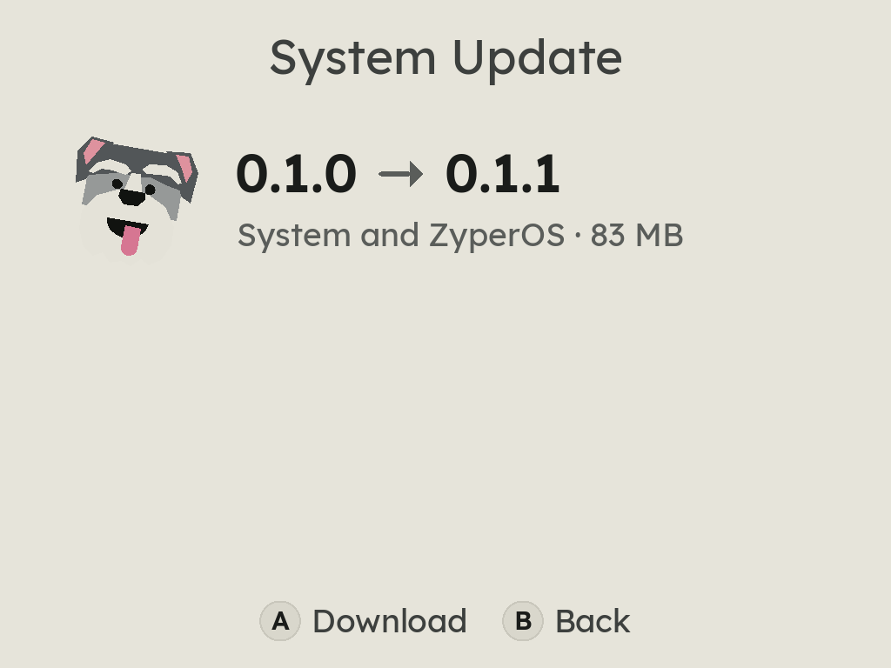 System Update: 0.1.0 to 0.1.1, System and ZyperOS, A Download, B Back">

**MENU > System Update** keeps ZyperOS up to date over Wi-Fi. It looks each time Wi-Fi connects and once a day, and Zyper tells you once when there is something new. Its page shows the two versions and what's new in full, scrolling with up and down; **A** downloads, checks and installs it, and **Restart Now** starts the new version. The download goes on in the background while you play, with a mark in the top corner showing how far it is, and Zyper tells you when it's ready to install. Auto Off waits for it, and if Wi-Fi drops or the handheld turns off, it goes on from where it stopped once Wi-Fi is back. Only the files that changed download, each one checked against a list signed with ZyperOS's key. It needs 25% battery, or the charger.

A new version starts on trial: if it doesn't start, the handheld goes back to the one before by itself. **Y** rolls back one version by hand. A card installed with two 512 MB system slots, which new installs have, updates the system itself too, written to the slot that isn't running. A card from before the slots, or with smaller ones, gets updates of ZyperOS, and a new system for it comes with a fresh install from the ZyperOS Installer.

Without Wi-Fi, **Update ZyperOS** on [the File Transfer page](#the-file-transfer-page) installs a new version over the USB cable, with the same checks.

<br clear="right">

## PortMaster

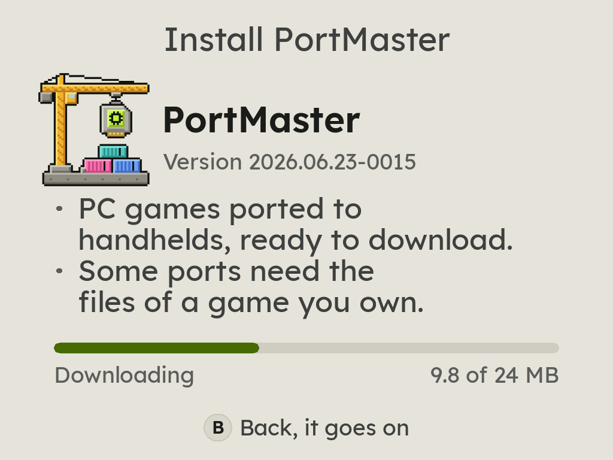

[PortMaster](https://portmaster.games) is the port store Linux handhelds share: PC games made to run on them, such as Stardew Valley and Celeste, each with what it needs. ZyperOS installs the official PortMaster app, as muOS, Knulli and ROCKNIX use it.

On the Ports shelf, PortMaster's entry has a cover of its own, drawn for ZyperOS in its pixel style for the light and dark themes: a dock crane lowering a game cartridge onto a stack of shipping containers. It is the same cover before and after the install, on Favorites too. The entry says **Install** until PortMaster is on the card. **A** opens its page, and **Install** downloads PortMaster's latest stable release from its GitHub over Wi-Fi (a USB Wi-Fi adapter on the Pixel 2), about 24 MB. ZyperOS checks it against the size and checksums PortMaster and GitHub publish, then unpacks it into `Roms/Ports`. Nothing goes in place until all of it checks out, so a cut-off download leaves no half-installed PortMaster. Then **A** opens it, from the page or the shelf, like any port, and PortMaster updates itself from then on.

Its first start unpacks its own files and downloads its catalog of ports, which takes a few minutes. Pick the ports you want in PortMaster; they are on the Ports shelf when you leave it. Many ports of commercial games need the game's own files from a copy you own, and PortMaster says which and where they go: [the File Transfer page](#the-file-transfer-page) sends them from a computer to the port's folder, under **ROMs > Ports**, over Wi-Fi or the USB cable. Ports copied from another system's ports folder run too.

When a port runs, ZyperOS steps aside to give it the memory, puts its own PortMaster settings for the Pixel 2 in place, and keeps the volume keys and **POWER** working. PortMaster is not part of ZyperOS: it comes from the PortMaster team, under the MIT license.

If PortMaster closes with an error, ZyperOS says so when it comes back, with the line of PortMaster's log that tells what went wrong, and offers **Reinstall**. **Reinstall PortMaster** is also on PortMaster's details (**X** on its entry). It puts a fresh copy of PortMaster's latest stable release on the card: your ports, their saves, the runtimes and the themes you downloaded stay, and PortMaster's own settings start over. Before each start, ZyperOS also removes a PortMaster list or settings file that a cut-off write left half-written, so PortMaster makes it again instead of closing as it starts.

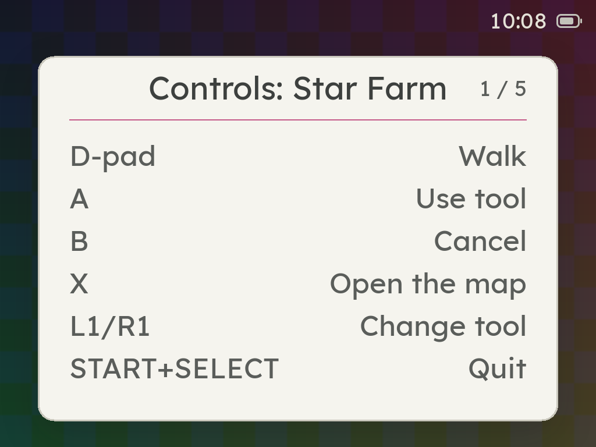

**MENU** over a port, or over PortMaster, pauses it under the in-game menu: **Continue**, **Controls** and **Quit**, back to the Ports shelf. **X** quits from any row, as in every in-game menu. The game stops where it is and nothing you press in the menu reaches it. **Controls** reads the port's own files: what its README says each button does, the keyboard key each button types for it (its gptokeyb keymap), the buttons that work in every port (**MENU**, **MENU** then **X** to quit, the volume keys, **MENU + VOL** for brightness, **SELECT + START**, PortMaster's own way to end a port, and **POWER**), and, last, what its PortMaster entry says to copy where. Over PortMaster it lists PortMaster's own buttons: **Up/Down** move, **L1/R1** a page, **A** chooses, **B** goes back, **X** filters the list, **Y** uninstalls a port. **Quit** ends the port, its helpers and the runtime it mounted, then the shelf comes back.

<br clear="right">

## Changing discs

A game on more than one disc, a PlayStation game with an `.m3u` in a folder of
its own or beside its discs (the shelf then shows the `.m3u` alone, not each
disc), has a **Disc** row in the in-game menu: MENU, the Game tab, just under
Quick Slot. Its value is the disc in the tray, by the name the emulator gives
it, or "Disc 2 of 3" when that name is too long for the row. **Left** and
**Right** (or **A**) pick the next or the last disc, going round: Left on disc 1
is the last disc. The game sees the lid open, a new disc go in and the lid
close, as it would on a console, so when it asks for disc 2, change the disc,
choose **Continue** and the game goes on. A game on one disc has no Disc row,
and neither has a system whose emulator has no disc tray.

## Player 2

On the Pixel 2, a friend can play an NES game with you as player 2, on
their phone or on a computer, with nothing to install. The handheld's own
buttons stay player 1, and the sound stays on the handheld.

<div align="center">

<table>
  <tr>
    <td align="center">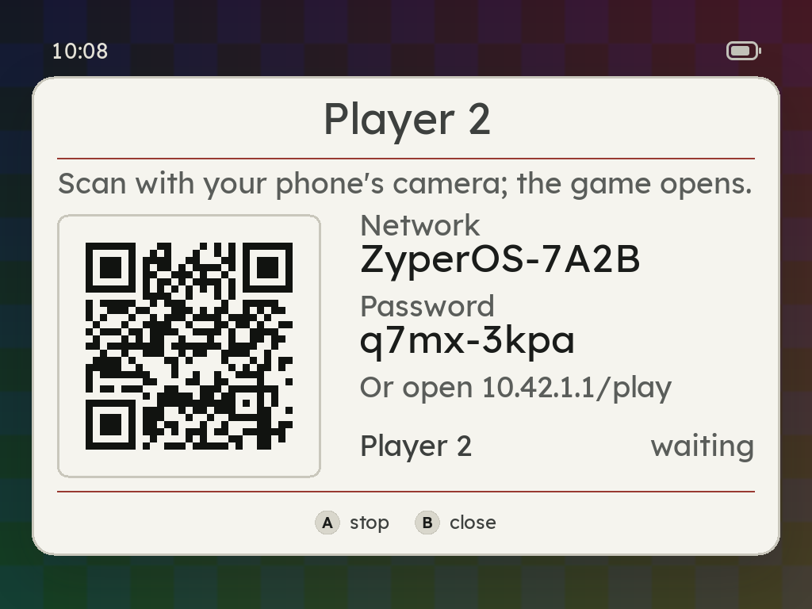<br><sub>On the handheld: scan to join</sub></td>
    <td align="center">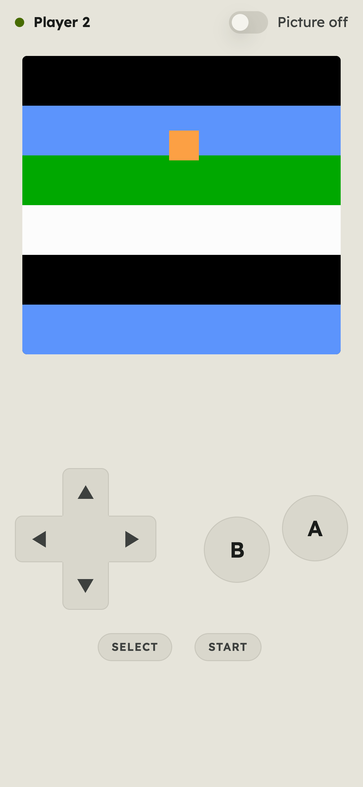<br><sub>On the phone</sub></td>
    <td align="center">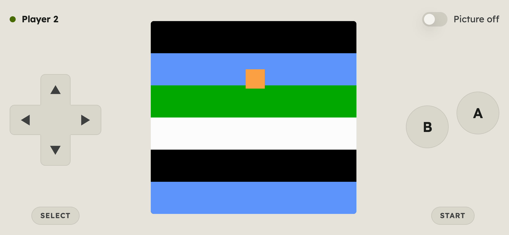<br><sub>On its side</sub></td>
  </tr>
</table>

</div>

In an NES game, MENU, then **Player 2**, on the Game tab just under Quick Slot. Its value says
`Off`, `Waiting` (on, with nobody playing yet) or `Connected`. A on the row
opens its page over the paused game:

| | |
|---|---|
| **With a Wi-Fi adapter in** | the page says a friend plays on a Wi-Fi network just for this game. **A** makes the handheld its own Wi-Fi network, as File Transfer does with no network around, and shows its QR code, the network's name and its password. The friend points the phone's camera at the code and joins; the game opens on the phone by itself, in its sign-in sheet. If it does not, open `10.42.1.1/play` in the phone's browser, which the page says under the password |
| **With a computer on the USB cable** | **A** brings up the cable's link, as USB File Transfer does, and the page says to open `zyperos.local/play` on the computer (`10.42.0.1/play` works too). Windows 10 has no driver for the link, as for USB File Transfer |
| **With neither** | the page says to plug in a Wi-Fi adapter or a computer, and A does nothing until you do. The page sees one plugged in while it is open |

Under that, a line for player 2: `Off`, `Waiting` or `Connected`. **B**
closes the page and **Continue** goes back to the game with Player 2 on. A
notice over the game says **Player 2 joined** when the friend's browser
starts to play, and **Player 2 left** once it has been gone five seconds,
the line saying `Connected` until then. A phone whose link drops for a
moment and comes back by itself was never gone, and nothing is said. A
phone that just goes quiet (it walked out of range) is let go after five
seconds of silence, so its notice comes about ten seconds after it went.
**A** on the page again stops Player 2, and A once more starts it again.
The game's end stops it too, however it ends: quit, POWER, a crash. The
handheld's network goes, and Wi-Fi comes back as it was. If it stops by
itself (the handheld's network or the page's server went away), a notice
says **Player 2 stopped**, the page says Player 2 had a problem, and A
starts it again.

**What the friend sees** is the game's picture, as large as the screen
takes it, and an NES pad under it: the d-pad at the left, **B** and **A**
at the right, SELECT and START under them. Several fingers at once work,
and a thumb can roll from B to A. In Chrome on an Android phone a press
gives a short vibration (not with the phone on silent, and not in the
phone's sign-in sheet, which cannot vibrate: open `10.42.1.1/play` in
Chrome for it). An iPhone has no way to do that for a web page. Nothing
zooms the page: a double tap on the pad is two presses, and a double tap
or a pinch anywhere else does nothing. Turned on its side, the picture
takes the whole height, with the pad's halves either side. The page speaks
the handheld's language and wears the handheld's theme, light or dark with
its accent and corners, whatever the phone is set to. At the top it says
**Connecting**, **Player 2**, **The game is full** (someone else is player
2; it keeps trying, and takes the place when it is free), **The host
turned multiplayer off** (you stopped Player 2 and the game goes on) or
**The game ended**. After **The host turned multiplayer off** the page
keeps trying: on the cable it plays again by itself when you turn Player 2
on again. On the hotspot the network's password is new each time, so the
friend scans the new code first.

On a computer the keyboard is the pad, and the bar names the keys:

| | |
|---|---|
| **Arrow keys** | the d-pad |
| **Z** | B |
| **X** | A |
| **Shift** | SELECT |
| **Enter** | START |

The keys are the letters printed on them, on any keyboard layout.

**Picture off**, at the top right, hides the picture, and the pad takes the
whole screen: for a friend who watches the handheld and uses the phone only
as a pad. Switched off again, the picture is back at once.

The page needs a recent browser (Safari 16.4 or Chrome 103 and later): an
older one says it is too old to show the game. A button left held never
stays held: the page lets go of everything when it is hidden or loses the
focus, and the handheld lets go of player 2's buttons a second after the
page stops saying them (a phone that locked, or walked out of range). A
friend who leaves the page, with Back or for another site, frees player 2's
place at once, so coming back is never told the game is full; Back brings
the game back.

The page's server listens only on the handheld's address on that link,
not on the address of another network the handheld's Wi-Fi may be on, and
no other site can show the page inside its own.

A game controller paired with the phone or the computer does not work yet.
It needs the page over HTTPS, which comes with a later update.

## Audio

Sound can come out of four places, and ZyperOS picks in a fixed order:

**a USB-C headphone adapter, then wired headphones, then Bluetooth, then the
speaker.**

The adapter is the Pixel 2's, whose USB-C port powers one once you choose
**USB Accessory** (see **Plugging something in** below); the Brick's port does
not. Bluetooth is the Brick's; the Pixel 2
has none.

A cable wins outright, in every setting. Someone who physically plugged
something in has said what they want more plainly than any menu can, and a
headset that merely happens to be connected has not said anything at all.

The **Audio Output** row has two positions rather than three. `Auto` follows
the rule above; `Speaker` refuses Bluetooth and nothing else - a cable still
works through it. There is no third "Headset" position because it would do
nothing `Auto` does not already do: `Auto` takes a headset whenever one is
connected, and neither setting can route to one that is not there. The row
shows where the sound actually went - `Auto (Wired)` - because `Auto` on its
own names a rule, not a place you can hear.

The **Audio Channels** row starts on `Auto`: mono on the Pixel 2's speaker,
which is one speaker, and stereo everywhere else - headphones in the jack, a
USB-C adapter, and the Brick's two speakers. The row says which it is making
now, `Auto (Mono)` or `Auto (Stereo)`, and plugging headphones in switches it
as the jack notices them. `Stereo` is stereo everywhere, the speaker
included. Mono is the two channels averaged, so it is never louder than the
louder of them and never clips.

The other choices are for anyone who hears with one ear. `Mono` plays
the two channels as one in both ears, so nothing a game or a song puts on one
side alone is lost. `Mono left` and `Mono right` put that sound in one ear
only, with the other silent, on headphones, a Bluetooth headset or a USB-C
adapter. On the speaker they play as `Mono`, since a speaker is not on one
ear. It covers games, MP4 and the menu music alike, and takes effect as you
change it.

The wired jack has its own volume range, not the speaker's. The two are about
9 dB apart, and the level is re-mapped the moment a cable goes in or out, so
plugging in mid-game does not arrive at nine decibels louder than you left it.

### Menu music

Music plays behind the shelf and the menus, never over a game, a port or MP4:
ZyperOS's ten 8-bit tracks, and your own. Yours go in `Menu Music`, a folder of
their own at the top of the card, beside `Music` and `Videos`: copy MP3 and Ogg
files there with the card in a computer, in Flash Drive, or on File Transfer's
page. Folders inside it play too, two deep (`Menu Music/Album/Disc 1/01
Song.mp3`), and a song you copy on plays once File Transfer closes. `Roms/BGM`,
where ROGUE OS and ZyperOS before 1.0.5 kept menu music, no longer plays: move
its songs into `Menu Music`. **MENU > Menu Music**:

| Row | What it is |
|---|---|
| **Music** | `On` or `Off`. `On` on a new device |
| **Volume** | 10% to 100%, under the system volume. `50%` to start |
| **ZyperOS Tracks** | `On`: ZyperOS's ten tracks play in the shuffle with yours. `Off`: yours alone. `On` to start. The row is there once you have music of your own; until then ZyperOS's tracks play |
| **Track** | `Shuffle`, which plays every track once before any plays again, or one track over and over, yours first, then ZyperOS's |
| **Song Pop-up** | `On` or `Off`: whether Zyper says each new song's name on the shelf, and MP4's track when L2 or R2 moves it. `On` to start |
| **Playing** | the song playing; A goes to the next |

On the systems row and a games shelf, **R2** is the next song and **L2** the one
before, back through the last 32 heard; after going back, R2 goes forward through
them again before anything new. With **Track** on one song, L2 and R2 move the
setting to the song before or after it in the list, which then plays over and
over. A press while the music is off, or quiet under a video snap's sound, is
refused with a sound. While MP4 plays behind the shelf the menu music is quiet,
and L2 and R2 move MP4 instead (below); with MP4 paused they are the menu
music's again.

Each time a new song starts on the shelf - by itself, by shuffle or by a press -
Zyper pops up at the top of the screen for two seconds with its name: the game or the
artist it is from above, from the file's own tags (ID3 in an MP3, the comments
in an Ogg), and the song's title below, or the file's name, tidied, when it has
no tags. A name too long for the panel scrolls, and the pop-up stays until it has
been read. It never blocks a button, and a menu, a game or MP4 puts it away. A
song that changes while a menu is open is not announced afterwards.

### Bluetooth

A paired headset reconnects by itself at boot and mid-session, and game audio
follows it without relaunching anything. The bond survives a reboot.

**Pairing is on the Bluetooth screen.** Put the headset in pairing mode, press
**Y** to search, **A** to pair and connect, **X** to forget. The toggle at the
top turns the radio on and off. Connecting a headset there disconnects any
other, because choosing one is the point; a headset that reconnects by itself
never pushes another off.

Only devices that advertise a name are listed. A scan in an ordinary room finds
a dozen BLE beacons and somebody's television, and BlueZ names everything it
cannot identify after its own address - so the list would otherwise be
unusable. A device you have already paired is always shown, named or not.

**Forget means forget.** The bond, the ALSA PCM and BlueZ's cached copy of the
device all go. Scanning leaves a cache entry for everything in range, so
leaving the screen sweeps the ones you never paired with.

The one thing that matters underneath is the agent: headsets pair "Just Works"
and need `NoInputNoOutput`. With the default agent every attempt fails with an
authentication error that looks like a broken key, a broken chip, or broken
headphones, and is none of them.

**A headset paired now carries sound straight away**, a running game's
included.

**The volume keys set the headset's own volume**, through its absolute volume
control, so there is still one volume and not two in series. The headset's
volume buttons move the Brick's level the other way. On a few headsets, the
Brick's buttons set only the starting volume; after that, change it on the
headset itself. In a game, a press on the headset changes the level without
showing the bar.

**The headset's play, pause and skip buttons control MP4**, wherever you are,
a game included.

One thing behaves differently on a Bluetooth sink and is not a bug:

- **there is roughly 100-150 ms of latency**, from SBC, the radio and the
  headset's own buffer. That is what Bluetooth audio costs on any device and
  nothing here can tune it away.

If a headset is switched off or walks out of range mid-game, sound falls back
to the speaker within a second or two and the game keeps running. It never ends
a game to report an audio problem. That fallback is the emulator's own - it
does not wait for the launcher to notice the headset is gone.

## Equalizer

**MENU > Sound > Equalizer** shapes the sound by its low, middle and high notes: the music and videos in MP4, the menu music, games and ports. It is the same row in **MP4's MENU**, so you can open it while a song or a video plays and hear each change as you make it.

The speaker and headphones each keep their own preset, `Off`, `Bass`, `Voice`, `Treble` or `Custom`, so the bass you like on headphones does not make the small speaker strain. The page shows the one in use now (**Speaker** or **Headphones**, which covers the jack, a USB-C adapter and a Bluetooth headset). **A** on it opens the presets, each with a picture of its curve, and you hear the one under the cursor before you choose it. Under it are five bands, `60 Hz`, `250 Hz`, `1 kHz`, `4 kHz` and `12 kHz`, each from -6 to +6 dB: change one and the preset becomes `Custom`, starting from the curve you had. `Off` on a new card, and `Off` is no filter at all, so nothing changes until you choose a preset.

While the page is open, MP4 keeps only a little sound waiting, so a step is heard in under a tenth of a second, and each gain moves over 20 ms, so a step never clicks. A boost that takes a loud song past full scale is bent gently rather than cut. Ports get the equalizer on a system that has its plugin; a port that plays straight to the hardware keeps its own sound.

## MP4

MP4 plays the music, the audiobooks and the videos on the card. Its card at the end of
the shelf opens MP4,
the same as SELECT does: Now Playing when something is playing or paused, and
otherwise a shelf of album covers, the way a console's opens onto its games -
in a horizontal row, with Up/Down jumping from one initial to the next. A on an
album opens its tracks. MENU, anywhere in MP4, has the album count, Show,
Sort By, Album Art (below), and Rescan Folder for music copied on while the
Brick was running.

**Show** is `All` to start with: your albums, books and videos on one shelf,
mixed, its count in MENU as the Total. It switches the shelf to music,
audiobooks or videos alone, and is there only when the card has more than one
of them. MP4 opens on whichever you left it on, except that SELECT with
something playing that the shelf does not show lands on that kind, on what is
playing.

**Shuffle All** plays every song on the card in a random order.

**Player Look** changes how Now Playing shows a song: **Cover**, the album's
cover large, as it always was; **Cassette**, a tape whose reels turn with the
song through its window, the next song rewinding it, the label in the
cover's color; **Vinyl**, a record in the cover's color turning at 33⅓ with
the cover as its label, its rings the album's songs and the tonearm's needle
on the one playing; **Classic**, a big clock over bars that move with the music,
and the album's tracks beside it; **Spectrum**, the music as 32 bars across
the screen under the cover. A on it opens the list, with the
look under the cursor playing in a small screen beside it; Left and Right
change it straight away. START on a song's Now Playing changes it too, one
look at a time. Paused, the bars come to rest. Books and videos keep their
own screen.

**View** shows the shelf as **Covers**, the covers in a row as it always
was, as a **Grid** of covers, or as a **List** of names with the cover beside
it, the way a game shelf's View does. START on the shelf turns between them,
Covers to Grid to List. On All, each album, book or video is marked with
what it is in every view.

**Sort By** puts the shelf in order by artist, the way the folders are, or by
album title, two of the same title going in their artists' order. The jump
goes by the initial of whichever it is: an artist's, or an album's. On `All`
the two are Folder, every album, book and series by the name of the folder
it is in (a film on its own by its own name), and Title.

**SELECT** opens MP4 from anywhere that is not a running game: the
shelf, every menu, and the in-game menu, where the game waits paused
underneath. SELECT again closes it from any screen in MP4, as you let it go,
and the music keeps playing; with START, it locks the screen instead (below). B goes back one screen: Now Playing to the album's tracks, the tracks
to the shelf, and the shelf out of MP4. The exceptions are Wi-Fi File Transfer and a
Box Art fetch, which only keep working while they are on screen.

Albums go in `Music/`, a folder per artist and one inside it per album:
`Music/Radiohead/The Bends/01 Planet Telex.mp3`. A folder of
tracks straight under `Music/` is filed under its artist when its tags say
clearly who that is
(the album artist, or the artist every track agrees on), moving to
`Music/<artist>/<album>/` with its cover; one with no clear answer - a
podcast, a mix - stays an album of its own. Songs straight in `Music/`, in no
folder at all, are moved into `Music/Singles/` the next time the shelf is
read, a name already there getting " (2)", and Singles has a cover of its own
at `Music/.media/Singles.png` until you replace it. Wi-Fi File Transfer
reaches `Music/` too, and albums sent that way are on the shelf when you leave
its screen. MP3, M4A, M4B, MP4, AAC, FLAC, Ogg, Opus and WAV play. Tracks play in
file-name order, and the number at the front of a file name is left off the
name shown.

**Audiobooks** go in `Audiobooks/`, in the same two shapes: an author's folder
with a folder per book, or a book's folder on its own. A book is one M4B or a
folder of files, which play in name order. A on a book goes straight to Now
Playing and carries on where you left it: its place is kept every thirty
seconds while it plays, whenever it pauses or moves to the next file, and when
the Brick turns off. B from there is the book's files, and A on one starts it
from its beginning. A book played to its end says Finished under its cover,
and A on it starts it over. Books always play in order, so on their Now
Playing Y changes the speed instead of the play mode, and on books Sort By is
by author or by title and there is no Album Art. A book's cover is the one its files carry, or the picture in its
folder: one named cover or folder, or the only one there.

**After a power-off.** If the handheld turns off while something plays -
the battery runs out, you hold POWER down, or you turn it off - MP4 opens by
itself at the next start, on Now Playing, paused at the same second: the same
song in the same album (in Shuffle All, the songs after it come in a new
order), the same book at its place and speed, the same video at its picture.
Press A to carry on. If a game was running too, the game comes back first,
with its menu up: press SELECT there for Now Playing, paused at the same
place. It keeps that place every thirty seconds while it plays,
and at once when the launcher turns the handheld off, so after a sudden power
cut it goes back at most half a minute. Something paused when the power went
stays where it is, and MP4 waits to be opened.

**Videos** go in `Videos/` on the card. A film on its own goes straight in, `Videos/Where the Light Is.mp4`, and is a card of its own; a folder of videos is a series, its files in name order, with seasons as folders inside it if you like: `Videos/Planet Earth/01 From Pole to Pole.mp4`. A picture named like the film, `Where the Light Is.jpg`, is its cover; otherwise MP4 takes one from the video itself. Every video remembers where you stopped.

The Pixel 2 has no hardware video decoder that its Linux can use, so its four cores decode in software. **H.264 in an .mp4 plays smoothly up to 720p**; 854x480 or 640x360 is the size to make for its 640x480 screen, and costs a fraction of the battery. HEVC and VP9 play up to about 480p. 1080p only just keeps up, dropping frames when the picture moves a lot. AV1 plays up to 1440x1080 at 24 fps, 1280x720 at 60 fps and 1920x1080 at 30 fps; 1920x1080 at 60 fps does not keep up. MKV, WebM, MOV and AVI files play too, if the video inside them is one of those. A video too big to play smoothly says so over its picture, and one whose picture cannot play here says that instead of staying black.

**Y** turns a video between full screen, where the controls show only when you press a button, and a view with its controls always on screen.

**Repeat**, in MP4's menu on Videos and All only, is how videos play on: `Off`, each once and in order; `One`, the video playing again and again; or `All`, its folder round again. It is `Off` on a new card, changes a video already playing, and leaves music's play mode as it is. With `One` or `All` the controls show its mark before the time left, and the screen stays on while the video plays.

**Lock Screen**, for a pocket: press **X** or **SELECT + START** together on
any MP4 screen while something plays, or pick Lock Screen in MP4's menu. With
music or a book the screen goes dark, which on a book playing measured about 6
hours of listening becoming 10; a video stays in sight. Every button is
ignored, POWER included, except the volume keys and a Bluetooth headset's
play, pause and skip, and each press of an ignored one shows the lock screen
for four seconds, with how to unlock it. The volume keys
change the volume in the usual steps and show the volume bar: with music the
screen lights for as long as the bar shows, about a second and a half after
the last press, and then goes dark again; over a video the bar shows on the
picture. Hold **SELECT + START** together for two seconds to unlock. If the
music stays paused past Auto Off, the device turns itself off with a book's
place saved.

With something playing or paused, SELECT goes straight to **Now Playing**: the
cover, the track, where in it you are, and what comes next.

While it plays you can leave MP4 and keep listening. On the systems row and a
games shelf, **L2** and **R2** then do what L1 and R1 do on Now Playing - the
track before or the next, or a book's chapter - and Zyper pops up with what
plays now: the artist and the title, or the book and its chapter. R2 on the
last track of an album playing in order has nowhere to go, and says so with a
sound.

| | |
|---|---|
| **A** | pause, or play |
| **L1/R1** | previous / next track, or chapter in a book that has them. More than three seconds in, L1 starts the track or chapter over |
| **Left/Right** | back or ahead ten seconds; held, a minute a step after a second and five minutes after three |
| **Y** | the play mode for music; the speed for a book, 1x to 2x and 0.75x, kept for each book |
| **B** | the album's tracks |
| **MENU** | MP4's menu |
| **X**, or **SELECT + START** | lock the screen |
| **SELECT** | close MP4 |

The foot of Now Playing shows the keys as the shelves do, a button and a word:
A pause or play, B back, X lock, Y the mode or the speed, L1/R1 the track, and
the d-pad's sides seek. A video's two views show the same row, with Y changing
the view and L1/R1 the video. A language whose words do not fit one row puts
the rest on a second row above it.

**Y changes the play mode on Now Playing**, and only there: in order, then
repeat all, then repeat one, then shuffle, and round again. Its mark sits
beside the track count on that screen, which is the one place a mode is shown -
so the mode is set where it can be read. Shuffle starts from the track you
chose and plays the rest in a random order, and when
it runs out it shuffles again and carries on - never starting the new round
with the song that ended the last. The mode is kept across restarts.

**While music plays, a running game is silent.** Only the game's own sound:
the music, the volume keys and the mute switch all carry on as before. Pause
the music, or let the album end, and the game is heard again within a tenth of
a second. SELECT in the in-game menu is how to switch between them mid-game.

An album's tracks are a list over its shelf, with what is playing under a rule
at the foot. A on a track plays the album from there and opens Now Playing; on
the track already playing it just opens Now Playing. The shoulders and the
d-pad's sides do what they do on Now Playing. Auto Off waits while music plays,
the way it does on the charger.

Covers come from the music. The first time an album is shown, MP4 takes the
picture its files carry and keeps it beside the album, in
`Music/<artist>/.media/`, the way box art sits in `Roms/<system>/.media`. An
album whose files carry none gets a generated card.

**Album Art**, in MENU on MP4's shelf, fetches covers over Wi-Fi for every
album with none, or with one smaller than the shelf draws it - 461px. It asks
MusicBrainz which record the album is, from the artist and album folder names
and the number of tracks - the track count is what tells a same-named single,
or another band, from the album - and takes that record's front cover from
the Cover Art Archive at 500px. An album it has supplied is remembered and not
asked about again; one it could not find is asked about on every run, since a
cover may be added later. MusicBrainz takes a request a second, so a large
library takes a while: seven albums took a minute on the Brick.

## The shelf

Systems use ZyperOS's own animated pixel console art on an open background. Each system is its own console, drawn for ZyperOS, and it moves: a handheld plays its startup, a console takes its cartridge or its disc, and Favorites' heart beats. Games use a
straight row of box art. The selected item grows and the others stay quiet,
with no perspective or reflection on these pages.

The shelf always runs horizontally. Left and right move between systems or games.
L1 and R1 jump three systems on the systems row, coming round past either end
as a step does, and a screenful on a games shelf.
Up and down jump by initial on a games or album shelf. A opens a system or starts a game.
B returns to the systems row. Fancy Pants and UI Direction are removed.
Old saved layout and card-style values do not change this behavior.

MENU > Home Screen selects Spotlight, Gallery or Grid; START on the home steps
from one to the next, and its hint at the foot names the next. MENU > System Order puts the
systems A to Z by name (3DO, 32X, Arcade, Atari 2600 ...) or by their release
dates, as before. Favorites stays first, then Recents, and Ports and MP4 stay last.
MENU > Home Systems shows or hides each of them. Spotlight puts the system name
beside its animated console sprite, with nearby systems below. Gallery puts the
focused sprite between its neighbors and shows the full system name below.
Grid shows the systems in three rows of six, each sprite with its short name,
the focused one underlined and its full name and count under the grid; Up and
Down move a row there, and L1 and R1 a screenful or to the last system. Spotlight and Grid use short names, such as GBA and N64.
These labels do not rename any folder. Every layout remembers the same
selected system.

Appearance selects Light, Dark or Auto. Console sprites retain their source
colors in both themes. Only the focused system animates. The top bar shows the
clock at the left, a background song when one is playing or paused, and Wi-Fi
and the battery at the right. A long song title shortens before the status
marks. MENU > Battery Icon shows the battery as its mark alone (Bars), with
its charge beside it (Percentage) or with the time left beside it (Time Left).
Time Left reads how long each percent has taken to fall, averaged over about
ten minutes, and counts to where ZyperOS saves and powers off (2%), not to 0%.
It shows the percentage until two falls have been seen, a few minutes after a
start or after the cable comes out, and it never shows more than a day. On the
cable it shows the time to full, or to the Charge Limit, from the gauge's
current as the charging screen does, and the percentage while that settles or
where the charger's gauge cannot say.

The games page uses a horizontal cover row. The focused cover is larger than its
neighbors. Its full scraped title, play time and achievement count appear below.
A resumes an available saved game or starts it otherwise. Y toggles Favorite;
X opens game details. A game without a cover keeps a readable text fallback.

Above it, **Cover and Video** opens a page for the game's cover and its video
snap. At the left, **Now** is the cover the shelf shows, with where it came
from. At the right, **Found** is what the sources offer: libretro first, then
ScreenScraper (with an account) and SteamGridDB (with a key), each picture
named under it ("Box Front · USA", "Title Screen", "Fan Cover") with its
source. Left and right move along them; A shows one big beside Now, and A
again makes it the cover. The cover it replaces is kept as **Before**, first
in the row: A on it puts it back (one level, either way). Below, the game's
video: its picture plays muted while a row of it is chosen; **Watch** plays it
on the whole screen with its sound, **Download** or **Replace** fetches it
from ScreenScraper, and **Delete** removes it after a question. Download and
Replace show only when ScreenScraper has a video to fetch; when there is none,
a line beside the empty picture says why: no Wi-Fi, ScreenScraper not linked,
or no video of that game. With no
network the page still shows the cover, plays the video and puts Before back,
and says to connect, or to add covers from a computer with File Transfer.
ScreenScraper counts each of its pictures as a request on your account, so
only the small copies of the pictures on screen are fetched, and the whole one
only when you look closer. The row's value says what is missing: `No cover` or
`No video`.

<div align="center">
<table>
  <tr>
    <td align="center"><br><sub>What the sources offer, beside the cover you have</sub></td>
    <td align="center">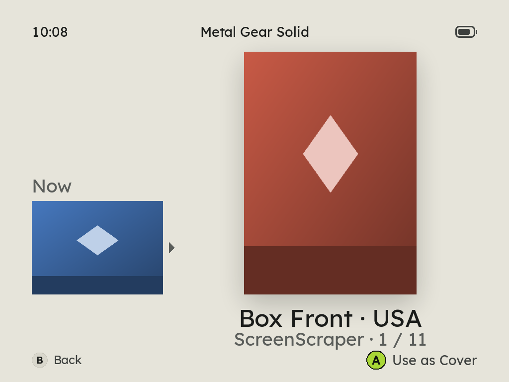<br><sub>A look before anything changes</sub></td>
  </tr>
</table>
</div>

**Rename**, above Delete Game, gives the game a new name. A opens the
keyboard with the game's name as its file has it. START renames. The game's
file takes the new name, with its extension. A disc set or ScummVM game in a
folder of its own renames the folder. Its saves, its save states and Auto,
its cover and video snap, its achievement set, the EmulationStation pictures
and video named after it and its `gamelist.xml` entry follow, and so do its
favorite, play time and details. The shelf shows the new name, and the next
scrape can find the game by it. A file another game uses too, such as the
save a `.gb` and a `.gbc` of one name share, is copied, so the other game
keeps it. A name cannot be empty, start or end with a dot, or have
`/ \ : * ? " < > |`, and it cannot be another game's name on the shelf: the
message says why, and the keyboard opens again. Arcade sets, BIOS sets and
ports have no Rename, because the core or PortMaster finds them by their
names.

### Delete Game

Press X on the game, choose **Delete Game** at the bottom of its details, and answer **Delete**. The cursor starts on **Cancel**, and B is Cancel too. It works from Favorites as well, and on Ports: a port goes with the folders its PortMaster `port.json` names, its saves in them, and PortMaster itself always stays.

<div align="center">

<table>
  <tr>
    <td align="center">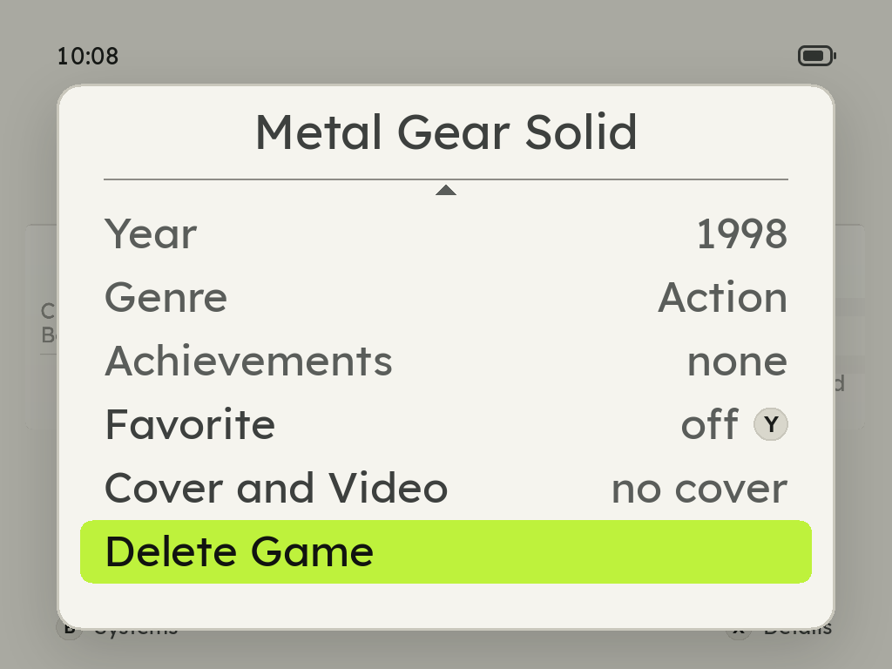<br><sub>Delete Game, the last row of a game's details</sub></td>
    <td align="center">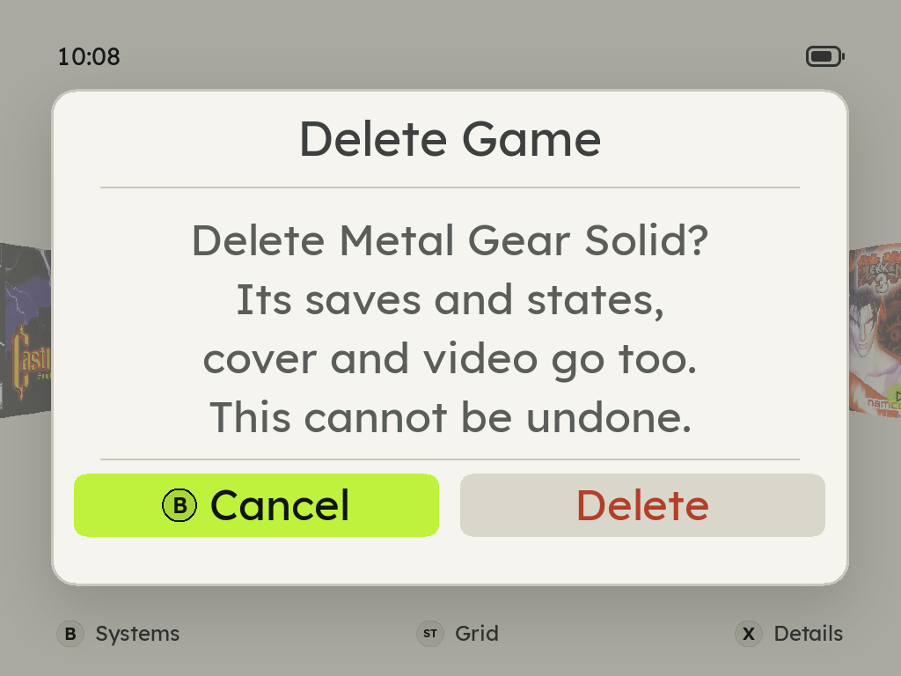<br><sub>It asks first, on Cancel</sub></td>
  </tr>
</table>

</div>

What goes, and nothing else:

- **The game:** its file, or its folder for a game in a folder of its own (a multi-disc set with its `.m3u`, a ScummVM game). A folder of games it is kept in stays, with the other games in it. A `.cue`, `.gdi` or `.toc` at the top of the folder takes the track files it names, and a `.cue` its `.sbi`. An arcade set is its `.zip`, and on NAOMI and Atomiswave the folder of its name that holds its CHD.
- **Its saves:** `Saves/<game>.srm`, `.sav` and DraStic's `.dsv`, and the arcade cores' own, in `Saves/fbneo/`, `Saves/mame2003-plus/` and `Saves/reicast/`.
- **Its save states:** the six slots and the autosave, with their pictures.
- **Its cover and video snap** in `.media/`, and its cached achievement set.
- **Its details, title, favorite and play time** in the card's library.

A file that another game on the card still uses stays: a save two systems' games of the same name both write, a cover a `.cue` and a `.chd` of one name share, a `.bin` that a second `.cue` names. A BIOS set on a shelf, like `neogeo.zip`, is never deleted. Achievements you earned stay on your account. If a `.cue` or `.m3u` names a file outside the game's folder, nothing is deleted and the handheld says so. Ports are not deleted from here: a port's files are spread over its script, its folder and PortMaster's shared ones, so delete it with File Transfer.

### Storage

**MENU > Storage**, just above System Update. The bar shows the card by part: games, saves and save states, art (covers and video snaps), media (music, videos, audiobooks), ZyperOS itself, and the rest. Under it, every system and folder by size; A on a system opens its page, with its games largest first. A on a game there asks Delete Game's question. A on Music, Videos or Audiobooks opens its albums, films and books by size, with your own menu music and the covers and playlists beside them; A on one asks before it goes, with the room it gives back. **X** changes the order of the list you are on: by size, A to Z, or last played (not on Music, Videos and Audiobooks, where nothing records what was played). Each list keeps its order. The first time, Zyper measures the card while you wait; after that the page opens at once and updates itself.

<div align="center">

<table>
  <tr>
    <td align="center">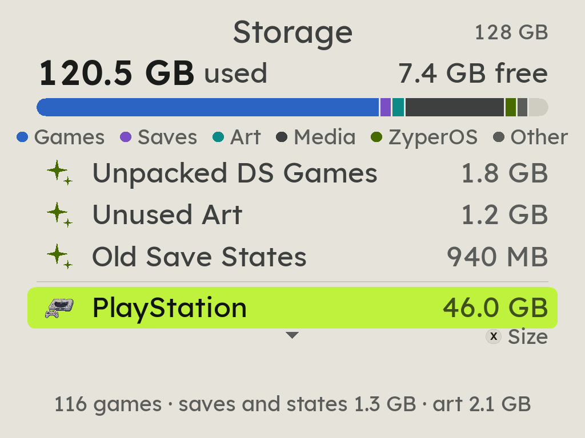 Storage: 120.5 GB used and 7.4 GB free of 128 GB, a bar by part, two recommendations, then PlayStation, Videos and Sega CD by size"><br><sub>The card by part, then by size</sub></td>
    <td align="center">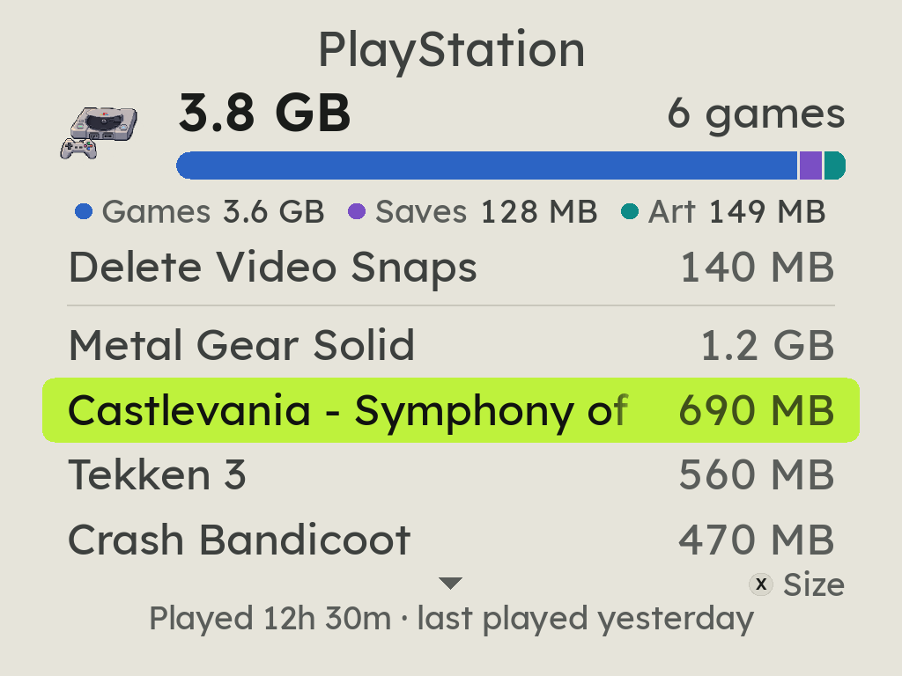<br><sub>A system's games, largest first</sub></td>
    <td align="center">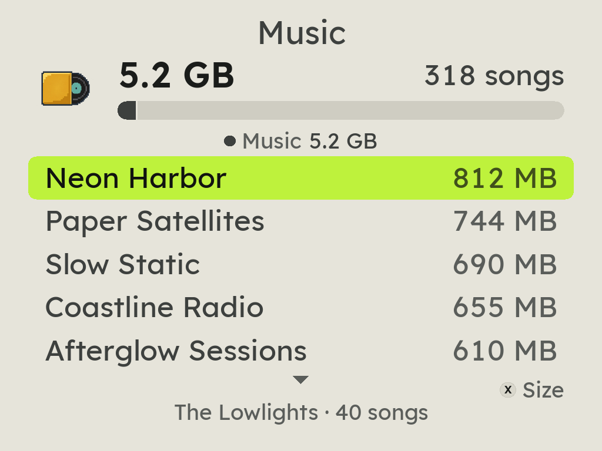<br><sub>Music's albums; X changes the order</sub></td>
  </tr>
</table>

</div>

**Unused Art** deletes the covers and video snaps of games that are no longer on the card; a fetch in **MENU > Downloads** can bring them back. **Old Save States** deletes the save states of games none of whose states was written in a year and that you have not played in one. Your saves stay. Each asks first, with the room it gives back, and the cursor on Cancel.

### Ports

A port (a PortMaster port, OpenBOR, the standalone Flycast) starts behind a
loading screen: its cover, its name and "Starting. This can take a minute.",
until the port draws its own picture. A port's first start can install for a
long time, hours for a big game: PortMaster downloads the runtimes the port
needs, or the port unpacks its game from an installer. When a start takes more
than a few seconds, the foot of the loading screen shows the last line the
port and PortMaster print, as it changes (the file being downloaded, how far
along it is), so you can see that it still runs. A window of PortMaster's own, such as its patcher, shows
over the loading screen. After a minute, the screen says that a first start
can install for hours, and how to leave: hold **MENU** and **START**. **MENU**
opens the port's menu over the loading screen, with **Keep Waiting**,
**Controls** and **Quit**. Everything a port prints is also in File Transfer's
**Download logs**. On the Pixel 2.

## Coming from EmulationStation

Knulli, ROCKNIX, ArkOS, AmberELEC, ROGUE OS, RetroPie, Recalbox and the other
systems built on EmulationStation (ES) keep each console's games in a short
folder, such as `roms/nds`, with the pictures, videos and details they
scraped beside the games. Copy those folders into `Roms/` on the ZyperOS card
as they are. ZyperOS reads them, and they still work in the other system:
ZyperOS writes nothing in them but its own covers in `.media/`.

**Folders.** Each system reads its ZyperOS folder or its ES folder:

| ZyperOS folder | ES folders it also reads |
|---|---|
| `Nintendo DS` | `nds` |
| `Game Boy Advance`, `Game Boy Color`, `Game Boy` | `gba`, `gbav`, `gbc`, `gb`, `sgb` |
| `SNES` | `snes`, `sfc`, `superfamicom` |
| `NES` | `nes`, `famicom`, `fds` |
| `Genesis` | `genesis`, `megadrive`, `md`, `megadrive-japan` |
| `PlayStation`, `PSP` | `playstation`, `psx`, `ps1`; `psp`, `pspminis` |
| `Nintendo 64` | `n64` |
| `TurboGrafx-16` | `pcengine`, `tg16`, `turbografx`, `pcenginecd`, `tg16cd`, `turbografxcd`, `tg-cd`, `supergrafx`, `sgfx` |
| `Sega CD`, `32X`, `Master System`, `Game Gear` | `segacd`, `megacd`, `sega32x`, `mastersystem`, `sms`, `gamegear`, `gg` |
| `Neo Geo`, `Neo Geo CD`, `Neo Geo Pocket (Color)` | `neogeo`, `neocd`, `neogeocd`, `ngp`, `ngpc` |
| `Arcade`, `MAME` | `fbneo`, `fba`, `cps1`, `cps2`, `cps3`; `mame2003`, `mame2003plus` |

ROCKNIX's and AmberELEC's hacks folders are read too: `nesh`, `snesh`,
`gbh`, `gbch`, `gbah`, `genh`, `megadriveh` and `gamegearh`, and ArkOS's
`snes-hacks`. The rest are in `ZyperOS/systems.cfg` on the card, on its
`es|` lines (Atari 2600 is `atari2600`, WonderSwan is `wswan`, and so on).
Capitals do not count, so `playstation` is the `PlayStation` folder and
`wonderswan` the `WonderSwan` one. A shelf reads one folder: its ZyperOS
folder while that has a game, and otherwise the ES folder with the most
games. A new ZyperOS card has every ZyperOS folder, empty, so a copied ES
folder is read. When both have games, the ZyperOS folder is read: move the
games into one of them. Two ES folders of one system count the same way:
of `nes` and `nesh`, the one with more games is read.

**What ZyperOS reads, in order.** ZyperOS's own cover and video snap come
first: `.media/<game>.png` and `.media/<game>.mp4`, from Box Art, the
Scraper or Cover and Video. A game with none uses ES's:

- the cover: `gamelist.xml`'s `<thumbnail>`, then `<image>`, then
  `images/<game>-thumb`, `images/<game>-image`, `images/<game>`,
  `media/box2dfront/<game>`, `media/images/<game>`, `boxart/<game>` and
  `downloaded_images/<game>` (`.png`, then `.jpg`), and last the game's
  logo, `<marquee>` or `images/<game>-marquee.png`;
- the video snap: `gamelist.xml`'s `<video>`, then `videos/<game>-video.mp4`,
  `videos/<game>.mp4`, `media/videos/<game>.mp4` and
  `downloaded_videos/<game>.mp4`.

A cover with an ES video has the play mark, and the video plays when you rest
on the game, as a ZyperOS snap does. The File Transfer page shows the same
cover beside each game. **Box Art** counts an ES cover as a
cover, so it fetches covers only for games with none. **Cover and Video**
shows an ES cover as Now, from EmulationStation; a cover you choose there is
ZyperOS's own, and shows from then on.

**Names, details and favorites.** A moment after each start, ZyperOS reads
each folder's `gamelist.xml` and keeps, for each game that has no details
yet, its `<name>`, `<desc>`, `<releasedate>`, `<genre>`, `<players>`,
`<developer>`, `<publisher>` and `<rating>`, and makes a game with
`<favorite>true</favorite>` a favorite. The shelf shows the names at once.
A game that has details from the Scraper or a rename keeps them, and a
ScreenScraper scrape later replaces what came from `gamelist.xml`. ES's
`<name>` is not used when it is only the file's name: ZyperOS's own tidy
name is shorter.

The details' last row is **Delete Game**. It asks first, naming the game and
saying that its saves, states, cover and video go with it and that this cannot
be undone; the cursor starts on Cancel, and B is Cancel. The game's files go -
its folder for a game in one, the tracks a top-level `.cue`, `.gdi` or `.toc`
names, an arcade set's `.zip` - with its saves in `Saves/`, its save states and
their pictures, its cover and video snap and the cover kept as Before, its
cached achievement set, and its
details, favorite and play time in the library. Each path is built from the
game's own name, never matched by a pattern; a file another game on the card
still uses stays, a BIOS set such as `neogeo.zip` is never deleted, and a
sheet that names a file outside the game's folder stops the whole delete. The
shelf moves to the next game, or the one before at the end; a shelf left with
no games goes from the home. Ports have no Delete Game.

Card art comes from, in order:

1. box art in `Roms/<system>/.media/<name>.png`, whether you put it there or
   MENU > Downloads fetched it. With a ScreenScraper account the fetch asks
   ScreenScraper first. It stores the game's name, year, genre and synopsis.
   Without an account, or for a game ScreenScraper does not have, it asks
   libretro: by file name, and where no name matches, by checksum: a zip
   records its ROM's CRC, which names the game in No-Intro's list - the catalog
   libretro files its covers under - so a file still carrying an older name
   finds its box anyway. On the main card that found 29 more, every one the
   right game. With a SteamGridDB key (MENU > Downloads > Settings > SteamGridDB, or pasted on the
   File Transfer page), what libretro still has no cover for is asked of
   SteamGridDB last, by name, and taken only when the name is a close match:
   a portrait 600x900 grid in PNG or JPEG. Fetched art is shrunk to the size it is drawn at - libretro
   ships covers at its own resolution, which on some systems is two to three
   times the pixels this screen can show, and every one of those pixels is
   decode time on every scroll past. Art you put there yourself is never
   touched, whatever size it is - only what the fetch brings in;
2. **the autosave preview** - the frame you were looking at when you stopped,
   which for a game in progress is a better card than any box;
3. a generated slab: the system's color, the title, and the title's first
   letter enormous and barely there behind it.

**Game names.** A valid ScreenScraper reply supplies the displayed game name.
The launcher stores the name even if no cover exists or its download fails.
It shows the cleaned filename when no stored name exists.
It keeps the ROM filename and all launch, save, cover, favorite, and play-time keys.

The shelf updates when you leave the scrape screen, including after a stopped run.
No restart is necessary. The selected game stays selected on its system and Favorites shelves.
Name order uses the displayed name. Equal names use the filename to keep a stable order.
Play Time, Last Played, and Recently Added keep their primary order.

With a ScreenScraper account, the bulk scrape requests missing names even when covers already exist.
These requests keep the existing covers, including covers that you added.
The progress line counts saved names separately from downloaded covers.
Games with both a cover and a stored title keep the normal skip policy.
Use a game's Replace action to request its metadata and cover again.
The libretro cover fallback does not supply a stored display name.

**Adding a cover by hand.** Some games have no cover anywhere the fetch looks -
fan translations, homebrew, a dump no catalog lists. Put one in yourself over
Wi-Fi File Transfer: open `Roms/<system>/.media/` in its file browser and upload a
PNG named exactly like the ROM file, with `.png` in place of its extension -
`Black Castle.gb` wants `Black Castle.png`. Box Art never overwrites a cover
that is already there, and Replace only swaps yours out when ScreenScraper or
libretro has a cover to put in its place. Keep it near 512 pixels on the long
side: a cover you add is drawn as it is and never resized, so a 2000-pixel scan
is decoded at full size whenever its card comes into view.

Pressing A on a game with an autosave does not start it, it continues it.

## Questions

### My games don't show up

Check the folder name against the [table of systems](#supported-systems), spelled exactly, and that the file type is listed for that console. A console with nothing in its folder is hidden. Games sent over Wi-Fi File Transfer appear when you leave its screen. Games copied any other way while the device is on appear after **Rescan Folder** in that console's menu, or after a restart. The log names every file a console's folder left out, and the file types it takes.

### Where are my saves

Battery saves are `.srm` files in `Saves/`, named after the game. Save states, the autosave included, are in `.userdata/shared/.zyperos/`, one folder per console. Neo Geo Pocket Color games write no `.srm`, so their progress lives in the autosave.

### Sending the logs

Open **MENU > Wi-Fi File Transfer** (**USB File Transfer** over the USB cable), open its address in a browser, and click **Download logs** under the folders (behind the ⋯ on a phone). You get one `.tar.gz` file holding the last ten boots' logs, on the Pixel 2 the USB port's last 50 plugs (`usb.log`: what was plugged in, what the handheld asked and did, and how long it stayed) and the Wi-Fi adapter's joins and drops, each drop with the reason the network or the adapter gave and the last signal seen (`wifi.log`), and a short summary of the device, ready to send to whoever is helping you. Wi-Fi network, headset and account names are masked in it, and the logs on the card are left as they are. The logs themselves are on the card, in `.userdata/brick/logs/` on the Brick and `.userdata/pixel2/logs/` on the Pixel 2.

## How it compares

The GKD Pixel 2 has several operating systems to choose from. This is ZyperOS beside the one it comes with and four others, from what each one's own pages, code and releases say in November 2026. ROGUE OS set the bar for this handheld, and ZyperOS set out to match it.

| | ZyperOS | Stock<sup>1</sup> | ROGUE OS | TortOS | ROCKNIX | plumOS Pixel2 |
|---|---|---|---|---|---|---|
| **Source, license** | GPL-3.0 | — | Its changed files, no license named | GPL-3.0 | GPL-2.0 for its own code | MIT for its own code |
| **Install, latest** | Card image or ZyperOS Installer, v1.0.6 (Nov 2026) | On the card it comes with | Card image, then v1.22's files (Aug 2025) | Card image or TortOS Installer, v2.1.1 (Oct 2026) | Card image, 20261101 (Nov 2026) | Card image, v0.1.4 (Aug 2026), in testing |
| **Systems** | 45, and Ports | Over 100 folders | 117<sup>2</sup> | 11 | 120<sup>2</sup> | 86<sup>2</sup> |
| **Games without taking the card out** | Wi-Fi or USB web page at zyperos.local, its own hotspot, SSH | Samba | USB cable, SSH | Wi-Fi or USB web page | Samba, SFTP, USB cable | Samba, SFTP, FTP |
| **Box art on the device** | libretro, ScreenScraper<sup>3</sup>, SteamGridDB | On a computer (Skraper) | ScreenScraper | libretro, ScreenScraper | ScreenScraper | libretro |
| **RetroAchievements** | Yes | — | — | Yes | Yes | — |
| **Achievements offline** | Yes: sent when Wi-Fi is back, dated when earned | — | — | Yes: sent later | No: needs the internet | — |
| **System updates** | Over Wi-Fi or the USB cable, A/B with roll back | — | Copy the new files | TortOS Installer, on a computer | Over the air, or a file | A file you copy, A/B with roll back |
| **First-start tutorial** | Yes | — | — | — | — | — |
| **Themes** | Light and dark, and Night Mode by the clock on the Pixel 2; ten accents, three backgrounds each, a folder color, square or rounded corners | EmulationStation themes | 13 launcher skins | 2 card art styles | Yes, with a downloader | Your own themes |
| **Languages** | 8: English, 简体中文, Español, Português (Brasil), Français, Deutsch, 日本語, Italiano | — | 21, in its launcher | English | 36 | 6 |
| **Menu music** | 10 free tracks and yours, from a folder of its own | — | — | — | Yes | — |
| **Media player** | Music, audiobooks, video | — | Music, video | Music, audiobooks | Music, video | Music |
| **PortMaster** | Yes, installed from the Ports shelf with one press, with the in-game menu over every port | Yes | Yes | — | Yes | Yes |
| **Rumble** | Yes | — | Yes | No | Yes | — |
| **Shaders** | Sharp-Shimmerless, and CRT (flat or curved), scanlines and an LCD grid at a strength you set, for one system or every system | — | A screen filter in DraStic | — | Built in, per game or per system | — |
| **Change a button** | In the game, for one game or a system, with the d-pad as a stick | — | — | — | — | — |
| **Side lights** | Battery (charging, low, its level all the time), volume and brightness, files moving and finished, achievements: each on or off | — | — | Battery | Battery | — |
| **Choose the home's systems** | Each system on or off, and Favorites and Recents, the ten games played last | — | — | — | — | — |
| **Folders of games, a grid and a list** | Folders to any depth, each with its count; covers, a grid in the shape of the art, or a list for each system | EmulationStation's | — | — | EmulationStation's | — |
| **Storage by part and by game** | Yes, with recommendations and media pages | — | — | — | — | — |
| **Pick a game's cover on the device** | From three sources, a big look first, the old one kept to put back | — | — | — | — | — |
| **Rename a game on the device** | With its saves, states, art and EmulationStation entry | — | — | — | — | — |
| **Video previews on the shelf** | Yes | — | — | — | — | — |
| **Charge limit** | 80, 85 or 90% | — | — | — | — | — |
| **Battery time left** | Time left, or time to full on the cable | — | — | — | — | — |
| **A DS game's language** | Picked per game, whatever `firmware.bin` says | — | — | — | — | — |
| **Charging screen when off** | Yes | — | — | — | — | — |
| **A second player in a browser** | NES games: a friend's phone or computer, over the handheld's own Wi-Fi or the USB cable | — | — | — | — | — |
| **Boot time** | 1.6 s<sup>4</sup>, about 2 s from power on<sup>5</sup> | 30 to 40 s from power on<sup>5</sup> | — | 2.2 s<sup>4</sup> | — | — |

— means none of the sources below says either way. The Pixel 2 has no Wi-Fi of its own, so on every system a Wi-Fi feature needs a USB Wi-Fi adapter. Knulli, muOS, twigUI (spruceOS) and a MinUI port run on the Pixel 2 too.

1. GameKiddy publishes no documentation for the stock firmware. Its column is from Retro Game Corps' review of February 2025, and the firmware may have changed since.
2. No count is published, so this is the systems in its own list, counted without tools, media players and ports. Hacks and regions can be entries of their own.
3. In builds made with ScreenScraper's developer key.
4. Each project's own number, and not measured the same way: ZyperOS's from the kernel's start to the home screen, on the Pixel 2 (mean of 10 starts), and TortOS's from power on to its shelf.
5. My own count on my Pixel 2, from power on until it can be used, with the stock card it came with and with ZyperOS: the stock firmware takes over 30 seconds, usually close to 40; ZyperOS about 2.

<details>
<summary><b>Sources</b></summary>

- **ZyperOS:** the README, this guide and the code, [v1.0.6](https://github.com/tarikbc/ZyperOS/releases/tag/v1.0.6); the boot times I measured on my Pixel 2 (notes 4 and 5) and [#83](https://github.com/tarikbc/ZyperOS/pull/83).
- **Stock:** [Retro Game Corps, February 2025](https://retrogamecorps.com/2025/02/01/how-to-make-the-gkd-pixel-ii-software-suck-less/); the boot time is my own count (note 5).
- **ROGUE OS:** [README](https://github.com/Ninoh-FOX/PIXEL2-ROGUE-OS/blob/f567073e9dd9d5f688a23728067d043af2fbdc20/README.md), [v1.22](https://github.com/Ninoh-FOX/PIXEL2-ROGUE-OS/releases/tag/GKDPIXELII_1.22), [system list](https://github.com/Ninoh-FOX/PIXEL2-ROGUE-OS/blob/f567073e9dd9d5f688a23728067d043af2fbdc20/EMUELEC/SYSTEM/usr/local/share/emulationstation/es_systems.cfg), [launcher skins](https://github.com/Ninoh-FOX/PIXEL2-ROGUE-OS/tree/f567073e9dd9d5f688a23728067d043af2fbdc20/EMUELEC/SYSTEM/usr/local/share/iux/skins), [launcher languages](https://github.com/Ninoh-FOX/PIXEL2-ROGUE-OS/tree/f567073e9dd9d5f688a23728067d043af2fbdc20/EMUELEC/SYSTEM/usr/local/share/iux/translations).
- **TortOS:** [README](https://github.com/ericreinsmidt/TortOS/blob/aafe6dee0d8221642e68d8b17fb17c6c5a39f8e1/README.md), [guide](https://github.com/ericreinsmidt/TortOS/blob/aafe6dee0d8221642e68d8b17fb17c6c5a39f8e1/docs/guide.md), [plastron's README](https://github.com/ericreinsmidt/plastron/blob/b67f5ec86a601f878f1bc8452d16af7112950f3d/README.md), [v2.1.1](https://github.com/ericreinsmidt/TortOS/releases/tag/v2.1.1).
- **ROCKNIX:** [README](https://github.com/ROCKNIX/distribution/blob/13d241a7d35fbe9b895ef04519f62bdb3a57d31f/README.md), [features](https://rocknix.org/), [adding games](https://rocknix.org/play/add-games/), [scraper](https://rocknix.org/configure/scraper/), [RetroAchievements](https://rocknix.org/play/retro-achievements/), [updates](https://rocknix.org/play/update/), [themes](https://rocknix.org/configure/themes/), [shaders](https://rocknix.org/configure/shaders/), [RK3326 systems](https://github.com/ROCKNIX/distribution/blob/13d241a7d35fbe9b895ef04519f62bdb3a57d31f/documentation/PER_DEVICE_DOCUMENTATION/RK3326/SUPPORTED_EMULATORS_AND_CORES.md), [Pixel 2 device tree](https://github.com/ROCKNIX/distribution/blob/13d241a7d35fbe9b895ef04519f62bdb3a57d31f/projects/ROCKNIX/devices/RK3326/linux/dts/rockchip/rk3326s-gkd-pixel2.dts) and [settings](https://github.com/ROCKNIX/distribution/tree/13d241a7d35fbe9b895ef04519f62bdb3a57d31f/projects/ROCKNIX/packages/hardware/quirks/devices/GameKiddy%20GKD%20Pixel2), [menu music](https://github.com/ROCKNIX/emulationstation-next/blob/f6c542872e3850c5f432929ead219547a897cd4a/es-app/src/guis/GuiMenu.cpp), [languages](https://github.com/ROCKNIX/emulationstation-next/blob/f6c542872e3850c5f432929ead219547a897cd4a/es-app/src/guis/GuiMenu.cpp#L1627-L1670), [20261101](https://github.com/ROCKNIX/distribution/releases/tag/20261101).
- **plumOS Pixel2:** [README](https://github.com/game-de-it/plumOS-pixel2_v2/blob/dec872c042229c1d38443f7e8e3fe962fc369e81/README.md), [network](https://github.com/game-de-it/plumOS-pixel2_v2/blob/dec872c042229c1d38443f7e8e3fe962fc369e81/docs/user/network.md), [updates](https://github.com/game-de-it/plumOS-pixel2_v2/blob/dec872c042229c1d38443f7e8e3fe962fc369e81/docs/user/updates.md), [folders](https://github.com/game-de-it/plumOS-pixel2_v2/blob/dec872c042229c1d38443f7e8e3fe962fc369e81/docs/user/storage.md), [system list](https://github.com/game-de-it/plumOS-pixel2_v2/blob/dec872c042229c1d38443f7e8e3fe962fc369e81/package/frontend-pixel2/systems.json), [scraper](https://github.com/game-de-it/plumOS-pixel2_v2/blob/dec872c042229c1d38443f7e8e3fe962fc369e81/package/app-layer-pixel2/bin/plumos-thumbnail-scraper), [languages](https://github.com/game-de-it/plumOS-pixel2_v2/tree/dec872c042229c1d38443f7e8e3fe962fc369e81/vendor/plumos-frontend/seed/share/frontend/lang), [v0.1.4](https://github.com/game-de-it/plumOS-pixel2_v2/releases/tag/v0.1.4).
- **The others:** [Knulli 20260511](https://github.com/knulli-cfw/knulli-linux/releases/tag/20260511), [muOS](https://github.com/MustardOS/mustardos.github.io/blob/HEAD/_data/devices/rk-pixel-2.yml), [twigUI](https://github.com/spruceUI/twigUI-next), [MinUI for the Pixel 2](https://github.com/NukeBomB3000/minui-gkd-pixel2).

</details>

## Screens

<div align="center">

<table>
  <tr>
    <td align="center">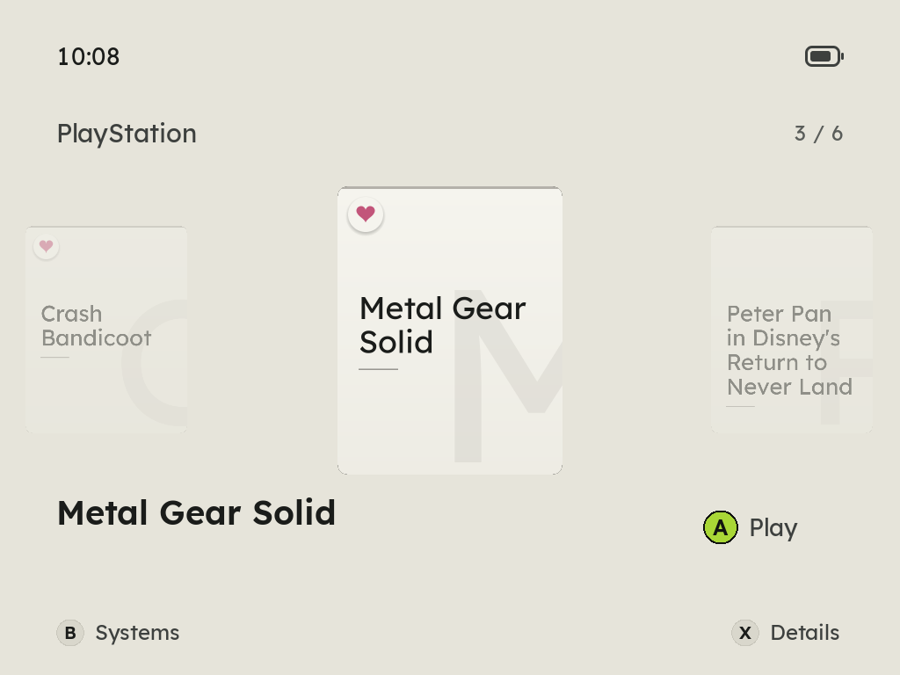<br><sub>Your games, cover by cover</sub></td>
    <td align="center">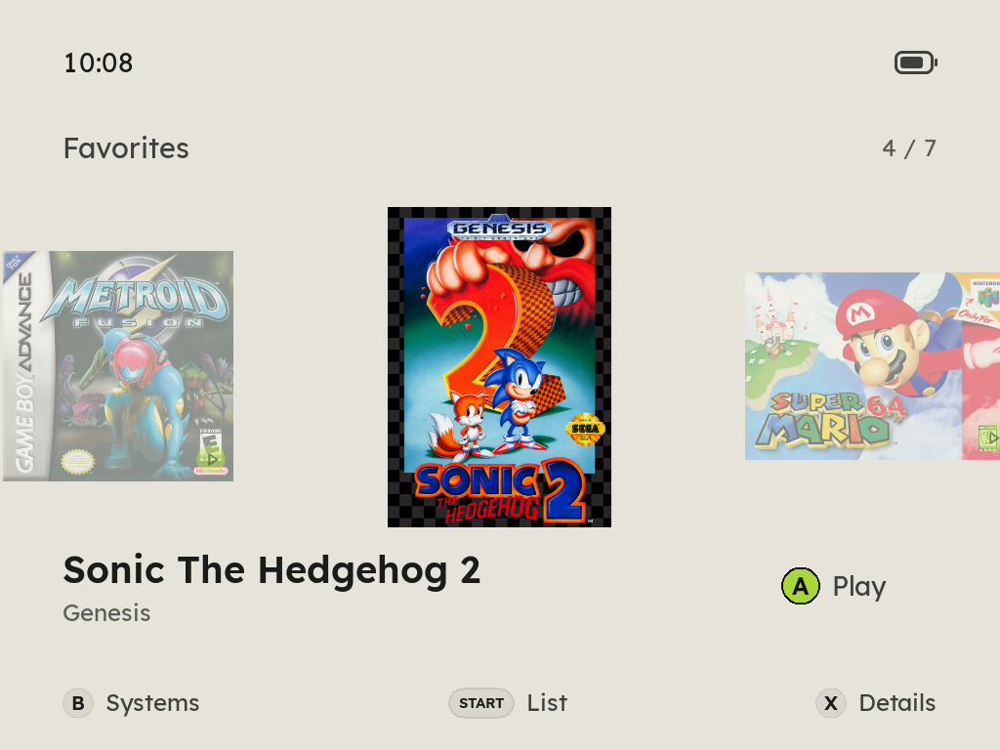<br><sub>Favorites from every system</sub></td>
    <td align="center">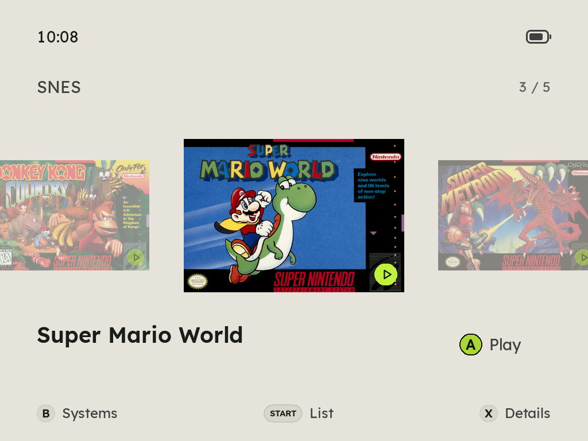<br><sub>Box art the handheld finds itself</sub></td>
  </tr>
  <tr>
    <td align="center"><br><sub>Every system, in pixel art</sub></td>
    <td align="center">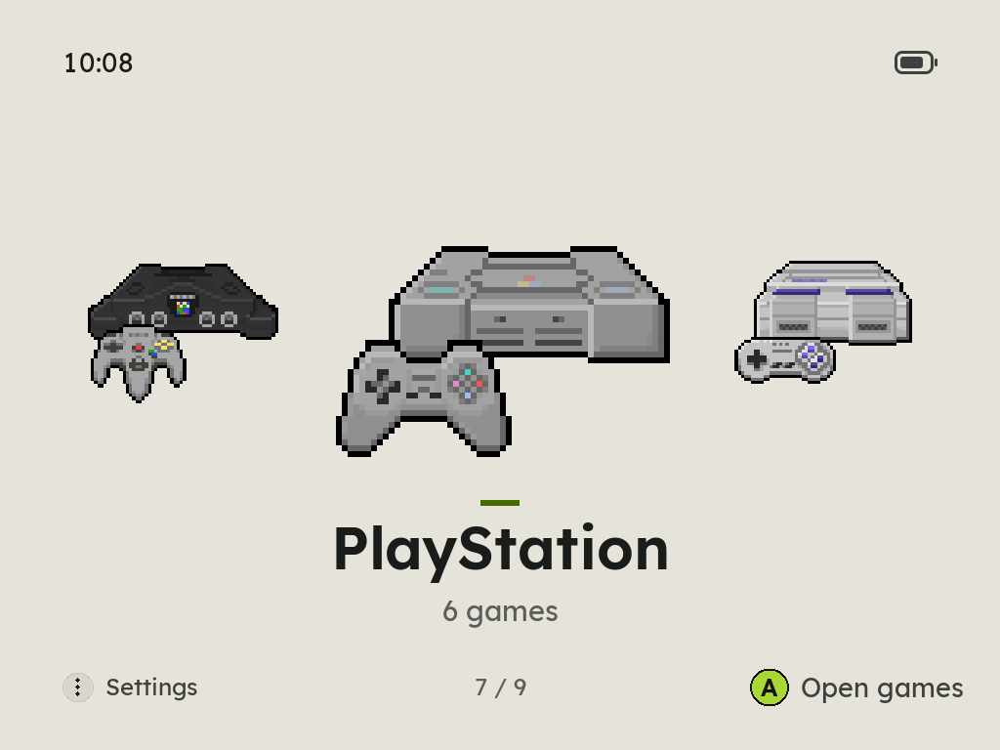<br><sub>Or the Gallery home</sub></td>
    <td align="center"><br><sub>Pick a cover, and see it first</sub></td>
  </tr>
  <tr>
    <td align="center"><br><sub>RetroAchievements, and Zyper cheers</sub></td>
    <td align="center">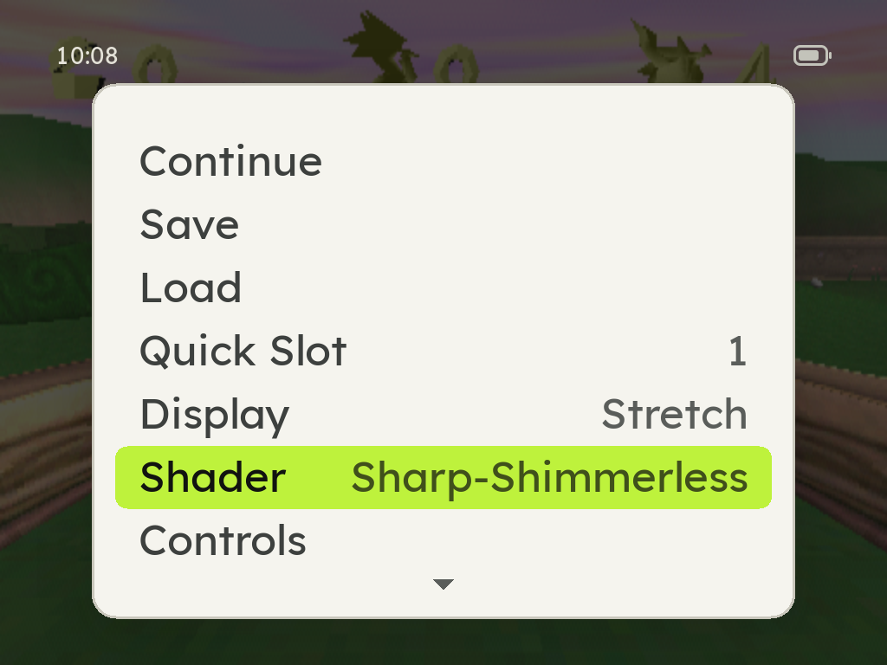<br><sub>A shader for each system, in the Display tab</sub></td>
    <td align="center">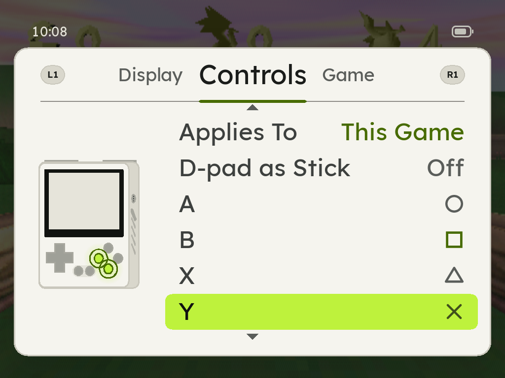<br><sub>Change a button: the Pixel 2 shows which</sub></td>
  </tr>
  <tr>
    <td align="center"><br><sub>PortMaster with one press</sub></td>
    <td align="center"> Storage: the card in one bar by part, two recommendations, then every system by size"><br><sub>What fills the card</sub></td>
    <td align="center">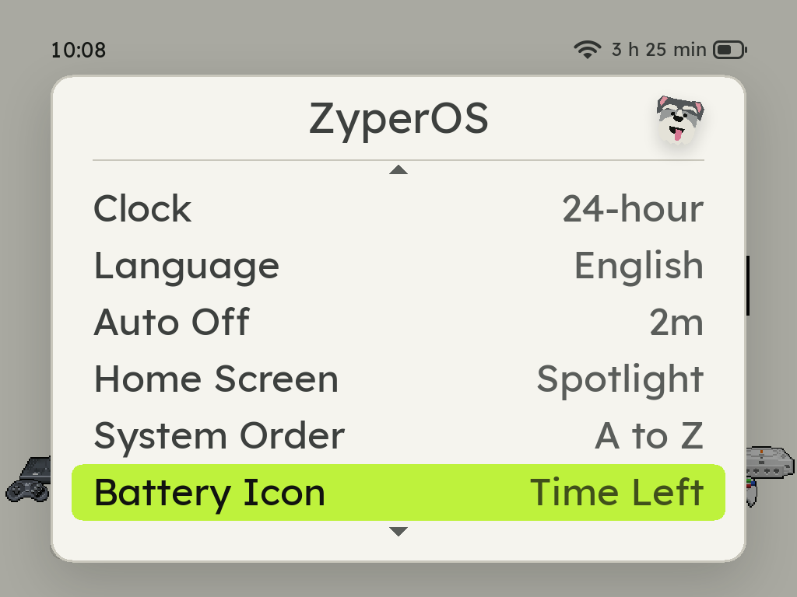 Battery Icon set to Time Left: the corner reads 3 h 25 min beside the battery"><br><sub>The battery, as time left</sub></td>
  </tr>
  <tr>
    <td align="center">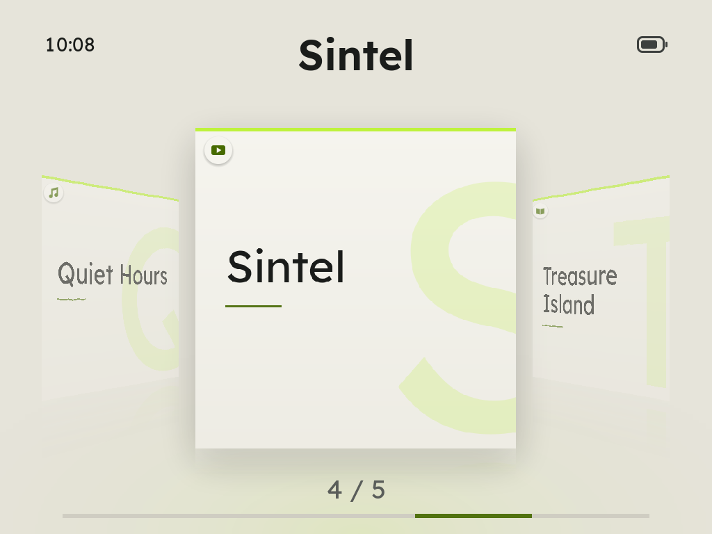<br><sub>Your albums, books and films, in MP4</sub></td>
    <td align="center">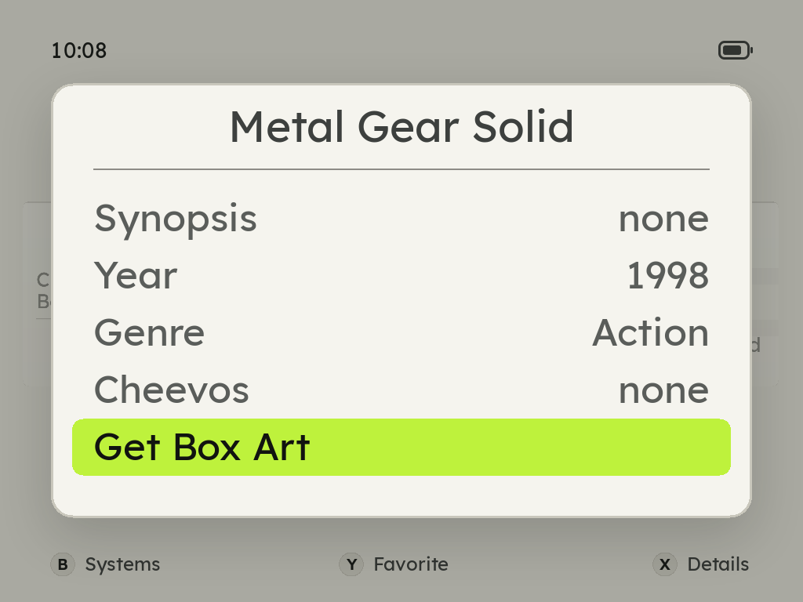<br><sub>A game's details, one button away</sub></td>
    <td align="center">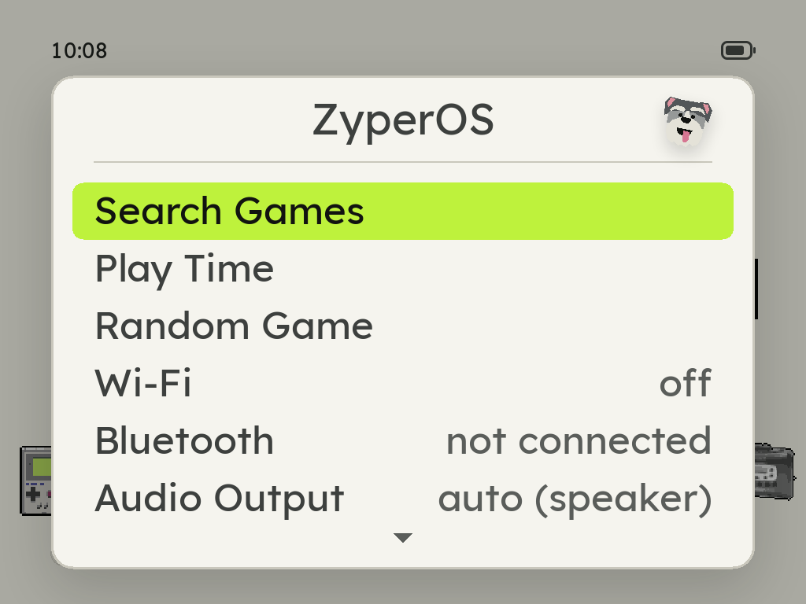<br><sub>The device's settings in six tabs</sub></td>
  </tr>
  <tr>
    <td align="center"><br><sub>Your folders, as you made them</sub></td>
    <td align="center"><br><sub>Or a list, per system</sub></td>
    <td align="center"><br><sub>A folder open, its covers beside it</sub></td>
  </tr>
  <tr>
    <td align="center"><br><sub>Or the Grid home, 18 systems at once</sub></td>
    <td align="center"><br><sub>Every shape of art, at home in one grid</sub></td>
    <td align="center"><br><sub>A game's video opens wide in the grid</sub></td>
  </tr>
  <tr>
    <td align="center"><br><sub>Your EmulationStation art, as it is</sub></td>
    <td align="center"><br><sub>Rename a game on the handheld</sub></td>
    <td align="center"><br><sub>The new name, on the keyboard</sub></td>
  </tr>
</table>

<sub>The shots show real box art to show what the Scraper does. The games and their art belong to their owners: ZyperOS comes with no games and no art.</sub>

</div>
