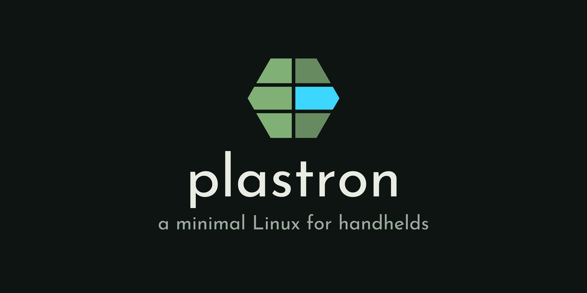

<p align="center">
  
</p>

a minimal Linux for handhelds, built to boot fast and run
[ZyperOS](../README.md). It lives in ZyperOS's repository, in `plastron/`, and
keeps its own license (`LICENSE`). It runs on two: the GKD
Pixel 2 (Rockchip RK3326S, which Linux calls PX30S) and the TrimUI Brick and
Brick Hammer (Allwinner A133).

On both, the card is the whole system, and plastron is as little as it takes
to boot fast and run ZyperOS and [diatom](https://github.com/tarikbc/ZyperOS/tree/main/diatom),
its emulator. Nothing is written to a device's own storage: the Brick starts
from the card ahead of its own system, and boots that again without the card.
It started as Eric Reinsmidt's
[plastron](https://github.com/ericreinsmidt/plastron) and keeps his notices.

## Status

ZyperOS runs on both. The shelf is up about 2.2 s from power on on the
Pixel 2, and about 1.9 s on the Brick.

The Pixel 2's hardware all works: the display (Panfrost, with the panel's
colors corrected in the display controller's gamma table), sound with
headphone switching and USB-C headphone adapters, every button, the
rumble motor (force feedback on the joypad's own input device), power,
brightness and battery. It has no radio of its own; a USB Wi-Fi adapter on
Linux's rtl8xxxu driver gives it Wi-Fi while it's plugged in. In the ZyperOS
image the RTL8188EU adapters (the TL-WN725N v2/v3 among them) go to Realtek's
own driver, rtl8188eu, instead (`buildroot/board/zyperos/rootfs-overlay/etc/modprobe.d/rtl8188eu.conf`):
rtl8xxxu drives that chip as a client only, and ZyperOS's Wi-Fi File Transfer
makes the adapter an access point with hostapd when the handheld is on no
network, for a phone to join by a QR code. Buildroot's rtl8188eu predates
kernel 7.1; upstream's fix for it is `buildroot/board/zyperos/patches/rtl8188eu`.
The kernel exports only the symbols its own modules use
(`CONFIG_TRIM_UNUSED_KSYMS`), so the ones rtl8188eu takes are kept by name in
`buildroot/board/px2/linux-ksyms.txt`.

The Brick's does too: the display (Imagination's PowerVR GE8300, through its
closed libraries), sound with headphone switching, every button, power,
brightness, battery, and Wi-Fi and Bluetooth on its XR829 chip. It has no
rumble in plastron.

Both reach a computer over the USB cable as a network device (NCM), which
ZyperOS's Down To The Wire serves its files over; Windows 11, macOS and Linux
need no driver.

The Pixel 2's kernel is kernel.org 7.1.2 with ROCKNIX's patches, config and
device tree from their 20260901 release, the config cut down to what the
Pixel 2 uses, and the patches cut down to the ones it needs: PX30S support,
the panel and joypad drivers, and a few fixes, 19 in all. The Brick's is
Allwinner's Linux 4.9.191 for the A133, from Creality's Sonic Pad SDK, with
plastron's patches: mainline Linux's exFAT driver, the SDK's charger driver,
and the Brick's own changes.

The Pixel 2's bootloader is put together by `make bootloader`: U-Boot
(`buildroot/board/px2/u-boot/`), built from source, with Rockchip's BL31, DDR
init and miniloader, which are prebuilt blobs, fetched from Rockchip's rkbin
at pinned commits and checked by sha256. Rockchip's BL31, not TF-A's, because
only it can change the DDR clock: U-Boot has it train the RK3326S's DDR
frequencies (FSP_INIT) and the kernel's DMC driver moves between them. U-Boot records its
own timings in the device tree it hands Linux (bootstage), so where the
bootloader spends its time can be read on the running device under
`/proc/device-tree/bootstage`, with no serial console. The Brick's,
`make brick-bootloader`, is U-Boot with plastron's patches for the A133 and
the Brick, and TF-A's BL31, all built from source.

[THIRD-PARTY.md](THIRD-PARTY.md) says where every part comes from.

## Installing

ZyperOS has no release images yet: build one (below) and write it to a card
with any program that writes disk images. It erases the whole card.

The first boot adds an exFAT partition over the rest of the card, for games,
saves and music, which a Mac or PC can read and write (labeled ZYPEROS).

## Building

Needs Docker. Everything else - the cross-compilers included - Buildroot
builds from source inside the container. ZyperOS, and diatom in its diatom/
folder, are built from its checkout, mounted into the container (see the
Makefile).

```sh
make                # out/sdcard.img: ZyperOS on the Pixel 2's base system
make base           # out/sdcard-base.img: the Pixel 2's base system alone
make qemu           # out/qemu/: ZyperOS on QEMU's virt machine, standing in for the Pixel 2
make linux-rebuild  # just the Pixel 2's kernel, after changing its config or patches
make bootloader     # U-Boot -> buildroot/board/px2/bootloader/u-boot-px2.bin
make brick-kernel   # the Brick's kernel and modules, from all its patches
make brick          # out/brick-sdcard.img: ZyperOS on the Brick's system
make brick-bootloader  # U-Boot -> buildroot/board/brick/bootloader/
make release        # both devices' release images and sources -> out/release
make third-party    # the package lists, from the last release build
make sdk            # the last Pixel 2 build's toolchain and libraries, as an SDK volume
make shell          # a shell in the build container
```

The first build takes a while: it builds the whole toolchain. After that,
Buildroot only rebuilds what changed. Buildroot alone never notices a change
to a local package (the launcher and Diatom from the ZyperOS checkout, and the
gauge, splash, powerkey, usbrole and jackswitch here), so `scripts/build.sh`
fingerprints each one's source before every build and builds again any whose
source changed since the last one. A dirclean by hand is only for a kernel
config or patch change (`make linux-rebuild`).

The Brick's build needs its two closed parts, which plastron doesn't include:
Imagination's GPU libraries, in `BRICK_GPU`, and XRadio's XR829 firmware, in
`BRICK_XR829`. `buildroot/package/pvr-ge8300/Config.in` and
`buildroot/package/xr829-firmware/Config.in` say which files they are. Both
come from Creality's Sonic Pad SDK: the GPU libraries from
[`package/libs/libgpu/ge8300/fbdev/glibc`](https://github.com/CrealityTech/sonic_pad_os/tree/7f37a7f/package/libs/libgpu/ge8300/fbdev/glibc)
and the firmware from
[`package/firmware/linux-firmware/xr829`](https://github.com/CrealityTech/sonic_pad_os/tree/7f37a7f/package/firmware/linux-firmware/xr829).
Only those copies match the checksums the build checks them against.

To get SSH access, put a public key in `local/authorized_keys` before
building. `local/` is not tracked. A release build carries no key and starts
no SSH server at boot. It keeps the dropbear program: on the Pixel 2,
ZyperOS's USB File Transfer screen starts it while the screen is open, on
the cable's address alone, with the PIN the screen shows as root's password
(ZyperOS's `src/sshlink.h` says how). `scripts/release.sh` checks all three:
no start script, no key, and the program there.

Several people, or several of one person's sessions, can share one build
volume. Each build takes its output folder's lock first
(`scripts/lock.sh`): two builds of the same output wait for each other, and
builds of different outputs - the QEMU image beside the everyday one, the
Pixel 2's and the Brick's release - run at the same time. The lock is
`flock` on `/work/<output>.lock`, so the kernel lets it go when its build
ends, a killed one too, and a build that waits says who has it. Steps that
only read a build (`make copy-out`, `make push`, `make sdk`) take it shared.

`make sdk` is for building ZyperOS without this volume. It copies the last
Pixel 2 build's `host/` folder - the cross-compiler, pkg-config and the
sysroot with the system's libraries - into a Docker volume of its own,
relocated to `/sdk` as Buildroot's own SDK relocates (`scripts/sdk.sh`,
`scripts/sdk-pack.sh`), and reads the build volume without writing to it. The
volume is named by a hash of what it holds, `plastron-sdk-px2-<id>`, and
never changes once packed; `share/plastron/sdk` in it says which plastron
build it came from. ZyperOS's `make px2-payload` mounts the newest one
read-only and builds its payload against it, in its own working tree, so any
number of ZyperOS branches build at once and none of them goes into this
volume. Run it again after a build that changes the system's libraries;
`SDK_OUTPUT` and `SDK_NAME` pack another output. Old SDKs stay until
`docker volume rm`.

`make qemu` builds the Pixel 2's system for QEMU's arm64 virt machine
(`configs/qemu_defconfig`): the same toolchain, packages and ZyperOS, a kernel
for the virt machine (`board/qemu/`), Mesa's llvmpipe in place of the Mali,
and the Pixel 2's buttons, battery, charger, backlight and side lights
simulated (`package/px2sim`). ZyperOS's `tools/qemu-run.sh` boots it on a Mac,
and its simulator shows it as a Pixel 2 in a window; its docs/qemu.md says
what that covers and what still needs the device. The first `make qemu` also
builds LLVM, for llvmpipe.

## On the device

Write the card image to a card from sector 0. On the device, the card's exFAT
partition is mounted at `/mnt/SDCARD` (labeled ZYPEROS, or PIXEL2 on the
Pixel 2's base image).

With the USB cable plugged into a computer, each device appears as a network
interface, and gives the computer an address:

| | Device | Computer | Shell, in a development build |
|---|---|---|---|
| Pixel 2 | 10.42.0.1 | 10.42.0.2 | `ssh root@10.42.0.1`, with the key above |
| Brick | 10.55.0.2 | 10.55.0.1 | `ssh root@10.55.0.2`, with the key above |

On the Pixel 2 the USB port charges only until asked. A development build
starts in Developer Mode, so the link above is up from boot with no
question. A release build (or Developer Mode turned off in ZyperOS's menu)
asks when a computer is plugged in: Charge Only, File Transfer, or, on a
development build, Developer (SSH). A development build keeps Developer Mode
on the card as `.userdata/pixel2/developer` ("1" or "0"), which `S40usbgadget`
reads at boot; a release build never binds at boot and ignores the file.

In a release build, choose File Transfer (or open USB File Transfer on the
handheld) and `ssh root@10.42.0.1` with the PIN it shows; `ssh-copy-id` saves a
key on the card for later. SSH stops when the screen closes.

## Layout

```
buildroot/                  a Buildroot external tree (BR2_EXTERNAL)
  configs/px2_defconfig     the base Pixel 2 system: boots, display, sound,
                            buttons, power, nothing ZyperOS-specific
  configs/brick_defconfig   the Brick's system, ZyperOS included
  board/zyperos/             ZyperOS on the Pixel 2's base: zyperos.config
                            (merged into the base config) and its rootfs
                            overlay
  package/                  our packages (splash, Panfrost, jackswitch, the
                            Brick's GPU, firmware and kernel modules, ...)
  board/px2/
    linux.config            kernel config, derived from ROCKNIX's RK3326
                            one by scripts/kernel-config.sh
    patches/linux/          kernel patches, numbered in the order they apply
    dts/                    the Pixel 2 device tree (ROCKNIX's)
    bootloader/             the bootloader written at sector 64: ROCKNIX's,
                            and ours with U-Boot rebuilt (u-boot-px2.bin)
    u-boot/                 U-Boot's patches, ROCKNIX's sources, our config
    boot.cmd                the U-Boot boot script
    genimage.cfg            the card layout
    rootfs-overlay/         files added to the root filesystem
  board/brick/
    linux/patches/          patches to Allwinner's Linux 4.9
    dts/                    the Brick's device tree (Allwinner's, cut down)
    bootloader/             the bootloader, made by make brick-bootloader
    u-boot/patches/         U-Boot's patches for the A133 and the Brick
    boot.cmd, genimage.cfg, rootfs-overlay/    as for the Pixel 2
docker/                     the build containers: Buildroot's, and the
                            Brick's kernel and bootloader
scripts/build.sh            runs Buildroot inside it
scripts/release.sh          builds a release, image and sources
scripts/third-party.py      writes the package lists from the release build
scripts/make-logo.py        draws docs/plastron.svg and the card above
```

## License

plastron's own files are free software under the GNU General Public License,
version 3 or any later version ([LICENSE](LICENSE)); they were MIT until
2026-10-25. The kernel and U-Boot patches, the device trees and the boot
loaders keep their own licenses; [THIRD-PARTY.md](THIRD-PARTY.md) lists them.
The card image carries the licenses and sources of everything in it, which
Buildroot collects with `make legal-info`.
